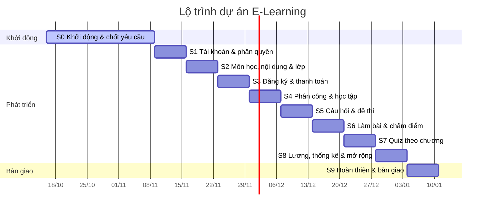

# PLAN — Dự án E-Learning (vibe coding với Claude Code)

| Mục | Nội dung |
|---|---|
| Sản phẩm | Ứng dụng web học trực tuyến cho trung tâm đào tạo: môn học, lớp, đăng ký & thanh toán, quiz theo chương, thi cuối kỳ, lương giảng viên |
| Yêu cầu | [docs/requirement.md](docs/requirement.md) (v1.0) |
| Sơ đồ CSDL | [So_do_CSDL.drawio](So_do_CSDL.drawio) (ERD v1.0, 27 bảng) |
| Phương pháp | Agile / Scrum, sprint **1 tuần** |
| Nhóm | 4 thành viên + Claude Code (Planner, Coder, Tester, E2E) |
| Sprint hiện tại | **Sprint 0 — Khởi động** |
| Cập nhật lần cuối | 02/11/2026 |

---

## 1. Tiến độ tổng quan

**Tổng tiến độ phát triển: `░░░░░░░░░░` 0 / 192 SP (0%)** · Sprint 0: `▓▓▓▓▓░░░░░` 7 / 15 việc (47%)

| Sprint | Thời gian | Mục tiêu | SP kế hoạch | SP xong | Trạng thái |
|---|---|---|---:|---:|---|
| S0 | 16/10 – 08/11 | Khởi động, chốt yêu cầu & môi trường | — | — | 🔄 Đang làm |
| S1 | 09/11 – 15/11 | Tài khoản & phân quyền | 18 | 0 | ⬜ Chưa bắt đầu |
| S2 | 16/11 – 22/11 | Môn học, nội dung & lớp học | 27 | 0 | ⬜ Chưa bắt đầu |
| S3 | 23/11 – 29/11 | Đăng ký & thanh toán | 23 | 0 | ⬜ Chưa bắt đầu |
| S4 | 30/11 – 06/12 | Phân công, vận hành lớp & học tập | 24 | 0 | ⬜ Chưa bắt đầu |
| S5 | 07/12 – 13/12 | Ngân hàng câu hỏi & đề thi | 22 | 0 | ⬜ Chưa bắt đầu |
| S6 | 14/12 – 20/12 | Làm bài & chấm điểm | 24 | 0 | ⬜ Chưa bắt đầu |
| S7 | 21/12 – 27/12 | Quiz theo chương | 24 | 0 | ⬜ Chưa bắt đầu |
| S8 | 28/12 – 03/01 | Lương, thống kê & mở rộng | 30 | 0 | ⬜ Chưa bắt đầu |
| S9 | 04/01 – 10/01 | Hoàn thiện & bàn giao | — | — | ⬜ Chưa bắt đầu |
| | | **Tổng** | **192** | **0** | |

> Lịch trên là **dự kiến**, chưa có hạn nộp đồ án (Q-30 trong requirement.md). Khi có hạn nộp, mình sẽ co giãn lại các sprint; nếu thiếu thời gian thì bỏ các story **Could** trước.



---

## 2. Quy ước

### 2.1 Ký hiệu

| Ký hiệu | Ý nghĩa |
|---|---|
| ⬜ | Chưa làm |
| 🔄 | Đang làm |
| 👀 | Làm xong, chờ nhóm review |
| ✅ | Xong (đạt Definition of Done) |
| ⛔ | Bị chặn (ghi rõ lý do) |
| `- [ ]` / `- [x]` | Việc trong sprint chưa xong / đã xong |

### 2.2 Mã số

- **E1 → E10**: Epic, tức nhóm chức năng lớn (requirement.md mục 5).
- **US-xx**: User story, định nghĩa và tiêu chí chấp nhận nằm trong requirement.md.
- **T-x.y**: Việc kỹ thuật thứ *y* của Sprint *x*.
- **BR-xx / NFR-xx / Q-xx**: Quy tắc nghiệp vụ / Yêu cầu phi chức năng / Câu hỏi (requirement.md).
- **SP (story point)**: độ lớn tương đối của một user story theo dãy 1, 2, 3, 5, 8, 13.
- **Ưu tiên MoSCoW**: Must (bắt buộc), Should (nên có), Could (có thì tốt).

### 2.3 Vai trò

| Vai trò | Ai | Việc chính |
|---|---|---|
| Product Owner | Bạn (trưởng nhóm) | Duyệt yêu cầu, sắp ưu tiên backlog, giao việc cho Claude Code, nghiệm thu cuối sprint |
| Thành viên nhóm | 3 thành viên còn lại | Review thay đổi, chạy thử theo kịch bản demo, viết báo cáo và slide |
| **Planner** | Claude Code | Đọc requirement.md và PLAN.md, chia user story thành việc nhỏ, cập nhật PLAN.md |
| **Coder** | Claude Code | Viết code cho từng việc trên nhánh riêng |
| **Tester** | Claude Code | Viết và chạy unit / integration test (Vitest) cho tiêu chí chấp nhận và quy tắc nghiệp vụ |
| **E2E** | Claude Code | Viết và chạy kịch bản trên trình duyệt (Playwright) cho các luồng chính |

Bốn vai trò của Claude Code sẽ được tạo thành các agent riêng trong `.claude/agents/` (việc T-0.10), mỗi agent có hướng dẫn và giới hạn công cụ riêng.

---

## 3. Quy trình làm việc

| Nghi thức | Khi nào | Làm gì |
|---|---|---|
| Sprint Planning | Đầu sprint | Planner chia user story thành việc T-x.y; PO duyệt |
| Daily | Mỗi phiên làm việc với Claude Code | Chọn việc ⬜ → 🔄, làm, test, tick `[x]`, ghi nhật ký |
| Sprint Review | Cuối sprint | Cả nhóm chạy demo theo mục "Demo cuối sprint", cập nhật SP xong ở mục 1 |
| Retrospective | Sau Review | Ghi 3 ý vào mục 9: tốt / chưa tốt / cải tiến |

**Một vòng làm một user story:**

1. PO giao việc, ví dụ: *"Làm US-17"*.
2. **Planner** đọc tiêu chí chấp nhận, chia thành các việc nhỏ trong sprint backlog.
3. **Coder** tạo nhánh `feature/us-17-don-dang-ky` và viết code.
4. **Tester** viết test cho từng tiêu chí chấp nhận, chạy cho đến khi pass.
5. **E2E** chạy kịch bản trình duyệt cho luồng liên quan.
6. Thành viên nhóm review và chạy thử, sau đó merge vào `main`, commit theo Conventional Commits (ví dụ `feat(enrollment): tạo đơn đăng ký nhiều lớp`).
7. **Planner** tick việc, cập nhật trạng thái user story và tiến độ.

### 3.1 Definition of Ready

- User story có tiêu chí chấp nhận rõ ràng trong requirement.md.
- Câu hỏi liên quan đã có câu trả lời hoặc đã thống nhất dùng phương án mặc định.
- Đã ước lượng SP; không phụ thuộc vào việc chưa xong.

### 3.2 Definition of Done

- Đạt toàn bộ tiêu chí chấp nhận của user story.
- Test của Tester và kịch bản của E2E đều pass; lint pass.
- Phân quyền được kiểm tra ở phía server.
- Giao diện tiếng Việt, hiển thị được trên máy tính và điện thoại.
- Đã được một thành viên nhóm review; code đã merge vào `main` và `main` vẫn chạy được.
- PLAN.md đã cập nhật trạng thái.

---

## 4. Công nghệ

| Thành phần | Lựa chọn | Lý do |
|---|---|---|
| Ngôn ngữ | TypeScript | Một ngôn ngữ cho cả giao diện và backend |
| Framework | Next.js (App Router) | Giao diện và API trong cùng một project |
| Giao diện | Tailwind CSS + shadcn/ui | Nhanh, đẹp, responsive sẵn |
| CSDL | PostgreSQL (chạy bằng Docker) | Transaction tốt, phù hợp ERD nhiều quan hệ |
| ORM | Prisma | Migration, seed, truy vấn có kiểu dữ liệu |
| Xác thực | Auth.js + bcrypt | Phiên đăng nhập an toàn, mật khẩu băm |
| Thanh toán | Stripe chế độ test (Checkout + webhook), nút giả lập dự phòng | Q-13 |
| Lưu file | Thư mục `uploads/` khi chạy local; dịch vụ lưu trữ đám mây khi demo online | File bài học, file nộp quiz |
| Kiểm tra dữ liệu | Zod | Dùng chung cho form và API |
| Kiểm thử | Vitest (Tester), Playwright (E2E) | |
| Triển khai | Docker Compose (máy cá nhân); Vercel + Postgres cloud (demo online) | |

Đã chốt theo Q-24 trong requirement.md.

---

## 5. Product Backlog

| Mã | Epic | User story (tóm tắt) | Ưu tiên | SP | Sprint | Trạng thái |
|---|---|---|---|---:|---|---|
| US-01 | E1 Tài khoản | Khách đăng ký tài khoản học viên | Must | 3 | S1 | ⬜ |
| US-02 | E1 Tài khoản | Đăng nhập / đăng xuất | Must | 3 | S1 | ⬜ |
| US-03 | E1 Tài khoản | Phân quyền 3 vai trò | Must | 5 | S1 | ⬜ |
| US-04 | E1 Tài khoản | Hồ sơ cá nhân, đổi mật khẩu | Should | 2 | S1 | ⬜ |
| US-05 | E1 Tài khoản | Admin quản lý tài khoản, tạo giảng viên | Must | 5 | S1 | ⬜ |
| US-06 | E1 Tài khoản | Quên mật khẩu | Could | 3 | S8 | ⬜ |
| US-07 | E2 Môn học | Admin tạo / sửa / ẩn môn học | Must | 3 | S2 | ⬜ |
| US-08 | E2 Môn học | Quản lý chương | Must | 3 | S2 | ⬜ |
| US-09 | E2 Môn học | Quản lý bài học (video, văn bản, file) | Must | 5 | S2 | ⬜ |
| US-10 | E2 Môn học | Danh mục môn học + tìm kiếm | Must | 3 | S2 | ⬜ |
| US-11 | E2 Môn học | Chi tiết môn học, lớp đang mở | Must | 3 | S2 | ⬜ |
| US-12 | E3 Lớp học | Admin mở lớp, phân công giảng viên | Must | 5 | S2 | ⬜ |
| US-13 | E3 Lớp học | Giảng viên xem lớp được phân công | Must | 3 | S2 | ⬜ |
| US-14 | E3 Lớp học | Giảng viên đề xuất không dạy lớp | Should | 3 | S4 | ⬜ |
| US-15 | E3 Lớp học | Admin duyệt / từ chối đề xuất | Should | 3 | S4 | ⬜ |
| US-16 | E3 Lớp học | Mở lớp theo sĩ số tối thiểu, hoãn / huỷ, kết thúc lớp | Must | 5 | S4 | ⬜ |
| US-17 | E4 Đăng ký | Tạo đơn đăng ký một hoặc nhiều lớp | Must | 8 | S3 | ⬜ |
| US-18 | E4 Đăng ký | Thanh toán Stripe test / giả lập | Must | 8 | S3 | ⬜ |
| US-19 | E4 Đăng ký | Kích hoạt đơn, mở quyền vào lớp | Must | 5 | S3 | ⬜ |
| US-20 | E4 Đăng ký | Huỷ đơn chưa thanh toán | Should | 2 | S3 | ⬜ |
| US-21 | E4 Đăng ký | Lịch sử đơn và thanh toán | Should | 2 | S4 | ⬜ |
| US-22 | E4 Đăng ký | Admin theo dõi thanh toán, hoàn tiền | Should | 3 | S4 | ⬜ |
| US-23 | E5 Học tập | "Môn học của tôi" | Must | 3 | S4 | ⬜ |
| US-24 | E5 Học tập | Học bài, đánh dấu hoàn thành, tiến độ | Must | 5 | S4 | ⬜ |
| US-25 | E5 Học tập | Giảng viên xem tiến độ học viên | Should | 3 | S8 | ⬜ |
| US-26 | E6 Câu hỏi | Giảng viên soạn câu hỏi 3 loại cho môn | Must | 5 | S5 | ⬜ |
| US-27 | E6 Câu hỏi | Phương án và đáp án đúng | Must | 5 | S5 | ⬜ |
| US-28 | E6 Câu hỏi | Nhập câu hỏi từ Excel/CSV | Could | 5 | S8 | ⬜ |
| US-29 | E7 Đề thi | Tự tạo đề cuối kỳ khi mở lớp | Must | 2 | S2 | ⬜ |
| US-30 | E7 Đề thi | Admin lên lịch thi | Must | 3 | S5 | ⬜ |
| US-31 | E7 Đề thi | Admin random câu hỏi tạo đề | Must | 5 | S5 | ⬜ |
| US-32 | E7 Đề thi | Xem trước đề thi | Should | 2 | S5 | ⬜ |
| US-33 | E8 Làm bài | Học viên xem đề thi của lớp | Must | 2 | S5 | ⬜ |
| US-34 | E8 Làm bài | Làm bài và nộp bài | Must | 8 | S6 | ⬜ |
| US-35 | E8 Làm bài | Tự chấm câu trắc nghiệm | Must | 5 | S6 | ⬜ |
| US-36 | E8 Làm bài | Giảng viên chấm tự luận | Must | 5 | S6 | ⬜ |
| US-37 | E8 Làm bài | Công bố đáp án và điểm | Must | 3 | S6 | ⬜ |
| US-38 | E8 Làm bài | Ghi điểm cuối kỳ | Must | 3 | S6 | ⬜ |
| US-39 | E8 Làm bài | Bảng điểm của lớp | Should | 3 | S8 | ⬜ |
| US-40 | E8 Làm bài | Xuất bảng điểm Excel | Could | 2 | S8 | ⬜ |
| US-41 | E9 Quiz | Giảng viên tạo quiz cho từng chương | Must | 8 | S7 | ⬜ |
| US-42 | E9 Quiz | Học viên làm quiz (trắc nghiệm, tự luận, nộp file) | Must | 8 | S7 | ⬜ |
| US-43 | E9 Quiz | Chấm quiz | Must | 5 | S7 | ⬜ |
| US-44 | E9 Quiz | Xem điểm quiz, điểm quá trình | Must | 3 | S7 | ⬜ |
| US-45 | E10 Lương | Admin tính lương tháng | Must | 5 | S8 | ⬜ |
| US-46 | E10 Lương | Duyệt và đánh dấu đã trả lương | Should | 2 | S8 | ⬜ |
| US-47 | E10 Lương | Giảng viên xem bảng lương | Should | 2 | S8 | ⬜ |
| US-48 | E10 Thống kê | Dashboard Admin | Should | 3 | S8 | ⬜ |
| US-49 | E10 Thống kê | Dashboard giảng viên | Could | 2 | S8 | ⬜ |

---

## 6. Sprint Backlog

### Sprint 0 — Khởi động (16/10 – 08/11) 🔄

**Mục tiêu:** Chốt yêu cầu, sơ đồ CSDL và công nghệ; dựng xong khung project chạy được.

- [x] T-0.1 Phân tích sơ đồ CSDL ban đầu
- [x] T-0.2 Dọn thư mục `docs/` (xoá tài liệu cũ, giữ thư mục)
- [x] T-0.3 Viết bản demo `docs/requirement.md`
- [x] T-0.4 Lập `PLAN.md`
- [x] T-0.5 **(PO)** Trả lời câu hỏi Q-01 → Q-26
- [x] T-0.6 Chốt ERD v1.0 (`So_do_CSDL.drawio`), requirement v1.0 và lập lại backlog theo câu trả lời
- [x] T-0.7 **(PO)** Trả lời 12 câu còn mở Q-27 → Q-38, nhất là hạn nộp đồ án (Q-30)
- [ ] T-0.8 Viết từ điển dữ liệu (kiểu dữ liệu, ràng buộc, chỉ mục) vào `docs/database/`
- [ ] T-0.9 Thêm `.gitignore`, `CLAUDE.md` (quy ước cho Claude Code), cập nhật `README.md`
- [ ] T-0.10 Tạo 4 agent Claude Code trong `.claude/agents/`: Planner, Coder, Tester, E2E
- [ ] T-0.11 Khởi tạo project Next.js + TypeScript, cấu trúc thư mục, lint + format
- [ ] T-0.12 Docker Compose cho PostgreSQL, `.env.example`, tài khoản Stripe chế độ test
- [ ] T-0.13 CI cơ bản trên GitHub Actions (lint + test)
- [ ] T-0.14 Wireframe các màn hình chính → `docs/ui/`
- [ ] T-0.15 Commit và push bản nền lên GitHub

**Demo cuối sprint:** Chạy một lệnh là có trang chủ trống + CSDL; 4 agent gọi được.

### Sprint 1 — Tài khoản & phân quyền (09/11 – 15/11) · 18 SP

**Mục tiêu:** Ba vai trò đăng nhập được và chỉ thấy đúng phần của mình.
**User story:** US-01, US-02, US-03, US-04, US-05

- [ ] T-1.1 Prisma schema + migration: `USER`, `ADMIN`, `TEACHER`, `STUDENT`
- [ ] T-1.2 Seed: 1 Admin, 3 giảng viên (có hệ số lương), 10 học viên
- [ ] T-1.3 Trang đăng ký học viên (US-01)
- [ ] T-1.4 Đăng nhập / đăng xuất, quản lý phiên (US-02)
- [ ] T-1.5 Middleware phân quyền theo vai trò, trang 403 (US-03)
- [ ] T-1.6 Layout chung: header, menu theo vai trò, trang chủ
- [ ] T-1.7 Trang hồ sơ, đổi mật khẩu (US-04)
- [ ] T-1.8 Admin: danh sách tài khoản, tạo giảng viên, sửa hệ số lương, khoá / mở (US-05)
- [ ] T-1.9 Tester: test đăng ký, đăng nhập, phân quyền · E2E: đăng nhập lần lượt 3 vai trò

**Demo cuối sprint:** Đăng ký học viên; đăng nhập bằng 3 vai trò, mỗi vai trò thấy menu riêng; Admin tạo một giảng viên mới.

### Sprint 2 — Môn học, nội dung & lớp học (16/11 – 22/11) · 27 SP

**Mục tiêu:** Admin xây xong môn học, mở lớp và phân công giảng viên; khách xem được.
**User story:** US-07, US-08, US-09, US-10, US-11, US-12, US-13, US-29

- [ ] T-2.1 Schema: `COURSE`, `SECTION`, `LESSON`, `CLASSES`, `EXAM` (phần thông tin cơ bản)
- [ ] T-2.2 Admin: tạo / sửa / ẩn môn học (US-07)
- [ ] T-2.3 Admin: quản lý chương và bài học, sắp xếp thứ tự (US-08, US-09)
- [ ] T-2.4 Tải lên file đính kèm bài học, giới hạn dung lượng và định dạng (NFR-05)
- [ ] T-2.5 Danh mục và chi tiết môn học (US-10, US-11)
- [ ] T-2.6 Admin: mở lớp, phân công giảng viên; tự tạo đề cuối kỳ `DISABLED` (US-12, US-29)
- [ ] T-2.7 Giảng viên: xem lớp được phân công (US-13)
- [ ] T-2.8 Seed môn học, chương, bài học, lớp mẫu
- [ ] T-2.9 Tester: test quyền (giảng viên không sửa được môn học) · E2E: Admin tạo môn → mở lớp → khách thấy lớp

**Demo cuối sprint:** Admin tạo môn học có chương và bài học, mở lớp và giao cho giảng viên; khách thấy lớp đang nhận đăng ký; giảng viên thấy lớp của mình.

### Sprint 3 — Đăng ký & thanh toán (23/11 – 29/11) · 23 SP

**Mục tiêu:** Học viên đăng ký nhiều lớp trong một đơn, thanh toán và được vào lớp.
**User story:** US-17, US-18, US-19, US-20

- [ ] T-3.1 Schema: `ENROLLMENT`, `STUDENT COURSES DETAIL`, `STUDY`, `PAYMENT`
- [ ] T-3.2 Chọn nhiều lớp, tạo đơn đăng ký và các dòng chi tiết (US-17)
- [ ] T-3.3 Stripe Checkout chế độ test + webhook xác nhận (US-18)
- [ ] T-3.4 Nút thanh toán giả lập dự phòng (US-18)
- [ ] T-3.5 Kích hoạt đơn: chi tiết `STUDYING`, thêm `STUDY`, mở quyền (US-19)
- [ ] T-3.6 Huỷ đơn chưa thanh toán (US-20)
- [ ] T-3.7 Chặn nội dung lớp khi chưa được mở quyền (BR-10)
- [ ] T-3.8 Tester: test tính tiền, trùng lớp, hết chỗ, kích hoạt · E2E: đăng ký 2 lớp → thanh toán thẻ test → vào lớp

**Demo cuối sprint:** Học viên chọn 2 lớp, thanh toán bằng thẻ test của Stripe, vào được cả 2 lớp.

### Sprint 4 — Phân công, vận hành lớp & học tập (30/11 – 06/12) · 24 SP

**Mục tiêu:** Lớp vận hành đúng quy tắc sĩ số và phân công; học viên học bài, thấy tiến độ.
**User story:** US-14, US-15, US-16, US-21, US-22, US-23, US-24

- [ ] T-4.1 Schema: `CLASS_DECLINE_REQUEST`, `LESSON_PROGRESS`
- [ ] T-4.2 Giảng viên đề xuất không dạy lớp (US-14)
- [ ] T-4.3 Admin duyệt / từ chối, phân giảng viên khác (US-15)
- [ ] T-4.4 Mở lớp khi đủ sĩ số tối thiểu, hoãn / huỷ + hoàn tiền, kết thúc lớp (US-16)
- [ ] T-4.5 Lịch sử đơn và thanh toán; Admin theo dõi thanh toán (US-21, US-22)
- [ ] T-4.6 Trang "Môn học của tôi" (US-23)
- [ ] T-4.7 Học bài, đánh dấu hoàn thành, tính tiến độ (US-24)
- [ ] T-4.8 Tester: test sĩ số tối thiểu / tối đa, tiến độ · E2E: giảng viên xin không dạy → Admin duyệt → đổi giảng viên

**Demo cuối sprint:** Giảng viên xin không dạy, Admin duyệt và giao lớp cho người khác; học viên học 3 bài và thấy tiến độ tăng.

### Sprint 5 — Ngân hàng câu hỏi & đề thi (07/12 – 13/12) · 22 SP

**Mục tiêu:** Có ngân hàng câu hỏi của môn và đề thi cuối kỳ được lên lịch, random đầy đủ.
**User story:** US-26, US-27, US-30, US-31, US-32, US-33

- [ ] T-5.1 Schema: `QUESTIONS`, `QUESTION_OPTION`, `EXAM_QUESTION`; bổ sung cột lịch thi cho `EXAM`
- [ ] T-5.2 Giảng viên soạn câu hỏi 3 loại cho môn mình dạy (US-26)
- [ ] T-5.3 Phương án và đáp án đúng, kiểm tra hợp lệ theo loại câu (US-27)
- [ ] T-5.4 Admin lên lịch thi (US-30)
- [ ] T-5.5 Admin random câu hỏi theo số câu mỗi loại (US-31)
- [ ] T-5.6 Xem trước đề (US-32)
- [ ] T-5.7 Học viên xem đề thi của lớp và trạng thái (US-33)
- [ ] T-5.8 Tester: random đủ số câu, không trùng, điểm chia đều, khoá random sau giờ mở đề

**Demo cuối sprint:** Giảng viên soạn 30 câu hỏi; Admin lên lịch và random đề 20 câu; học viên thấy đề ở trạng thái "Chưa mở".

### Sprint 6 — Làm bài & chấm điểm (14/12 – 20/12) · 24 SP

**Mục tiêu:** Học viên thi trọn một đề, giảng viên chấm tự luận và công bố điểm.
**User story:** US-34, US-35, US-36, US-37, US-38

- [ ] T-6.1 Schema: `ANSWER`, `ANSWER_DETAIL`, `ANSWER_CHOICE`
- [ ] T-6.2 Giao diện làm bài: radio / checkbox / ô nhập, đồng hồ, lưu ngay (US-34)
- [ ] T-6.3 Nộp bài, tự nộp khi hết giờ, giới hạn số lần, yêu cầu đóng đủ học phí (US-34)
- [ ] T-6.4 Tự chấm câu trắc nghiệm 1 đáp án và nhiều đáp án (US-35)
- [ ] T-6.5 Giảng viên chấm câu tự luận (US-36)
- [ ] T-6.6 Công bố đáp án và điểm, ghi `last_exam_point` (US-37, US-38)
- [ ] T-6.7 Tester: test chấm điểm, hết giờ, ẩn đáp án trước khi công bố · E2E: thi → chấm → công bố → xem điểm

**Demo cuối sprint:** Học viên làm đề có cả trắc nghiệm và tự luận; giảng viên chấm tự luận, công bố; học viên thấy điểm và đáp án đúng.

### Sprint 7 — Quiz theo chương (21/12 – 27/12) · 24 SP

**Mục tiêu:** Mỗi chương có quiz; học viên làm được cả 3 kiểu trả lời.
**User story:** US-41, US-42, US-43, US-44

- [ ] T-7.1 Schema: `QUIZ`, `QUIZ_QUESTION`, `QUIZ_OPTION`, `QUIZ_RESULT`, `QUIZ_RESULT_DETAIL`
- [ ] T-7.2 Giảng viên tạo quiz cho từng chương của lớp mình (US-41)
- [ ] T-7.3 Học viên làm quiz: chọn đáp án, nhập tự luận, nộp file (US-42)
- [ ] T-7.4 Tự chấm trắc nghiệm; giảng viên chấm tự luận và file (US-43)
- [ ] T-7.5 Xem điểm quiz, tính điểm quá trình (US-44)
- [ ] T-7.6 Tester: test chấm quiz, mỗi chương 1 quiz · E2E: làm quiz có nộp file → giảng viên chấm

**Demo cuối sprint:** Học viên làm quiz chương 1 (có nộp file), thấy điểm trắc nghiệm ngay, điểm tự luận sau khi giảng viên chấm.

### Sprint 8 — Lương, thống kê & mở rộng (28/12 – 03/01) · 30 SP

**Mục tiêu:** Admin tính được lương giảng viên; có số liệu theo dõi; làm thêm các story Could nếu kịp.
**User story:** US-25, US-39, US-45, US-46, US-47, US-48 (Must / Should) · US-06, US-28, US-40, US-49 (Could, 12 SP)

- [ ] T-8.1 Schema `SALARY`; cấu hình lương cơ bản, phụ cấp lớp, đơn giá học viên
- [ ] T-8.2 Admin tính lương tháng (US-45)
- [ ] T-8.3 Duyệt, đánh dấu đã trả; giảng viên xem bảng lương (US-46, US-47)
- [ ] T-8.4 Giảng viên xem tiến độ học viên và bảng điểm lớp (US-25, US-39)
- [ ] T-8.5 Dashboard Admin (US-48)
- [ ] T-8.6 *(Could)* Dashboard giảng viên, xuất Excel, nhập câu hỏi từ Excel, quên mật khẩu (US-49, US-40, US-28, US-06)
- [ ] T-8.7 Tester: test công thức lương · E2E: luồng trọn vẹn từ mở lớp đến tính lương

**Demo cuối sprint:** Admin tính lương tháng 12 cho 3 giảng viên và duyệt; giảng viên xem bảng lương của mình.

### Sprint 9 — Hoàn thiện & bàn giao (04/01 – 10/01)

**Mục tiêu:** Không thêm tính năng; sản phẩm ổn định, tài liệu đầy đủ, sẵn sàng bảo vệ.

- [ ] T-9.1 Rà soát yêu cầu phi chức năng: bảo mật, file tải lên, responsive, hiệu năng
- [ ] T-9.2 Sửa lỗi tồn đọng
- [ ] T-9.3 Seed dữ liệu demo đầy đủ, viết kịch bản demo
- [ ] T-9.4 Triển khai bản demo online
- [ ] T-9.5 Hoàn thiện tài liệu: README, `docs/` (CSDL, hướng dẫn sử dụng)
- [ ] T-9.6 **(Thành viên nhóm)** Báo cáo đồ án và slide → `docs/report/`

---

## 7. Cấu trúc tài liệu

```text
So_do_CSDL.drawio            ← ERD v1.0 (chính thức)
docs/
├── requirement.md           ← đặc tả yêu cầu v1.0
├── database/                ← từ điển dữ liệu (T-0.8)
├── ui/                      ← wireframe (T-0.14)
└── report/                  ← báo cáo, slide đồ án (T-9.6)
```

---

## 8. Rủi ro

| Mã | Rủi ro | Ảnh hưởng | Cách giảm |
|---|---|---|---|
| R1 | Chưa có hạn nộp đồ án (Q-30) | Lịch không khớp | Chỉnh lịch ngay khi có; bỏ story Could trước |
| R2 | Phạm vi lớn: 192 SP, 27 bảng | Trễ các sprint sau | Làm Must trước; S8 dồn story Could để có thể cắt |
| R3 | Tích hợp Stripe (webhook, môi trường test) gặp khó | Trễ Sprint 3 | Có nút thanh toán giả lập dự phòng |
| R4 | Sơ đồ CSDL đổi giữa chừng | Lỗi dữ liệu, phải làm lại | Mọi thay đổi đi qua migration; cập nhật `So_do_CSDL.drawio` cùng lúc |
| R5 | Code do AI sinh ra khó kiểm soát | Lỗi ẩn | Chia việc nhỏ; Tester và E2E chạy trước khi merge; thành viên nhóm review |
| R6 | Câu hỏi còn mở Q-27 → Q-38 được trả lời khác mặc định | Phải sửa story đã làm | Trả lời trước sprint có story liên quan (cột "Sprint" trong backlog) |
| R7 | File chưa commit bị mất | Mất công sức | Commit và push sau mỗi phiên làm việc |

---

## 9. Nhật ký sprint (Review & Retrospective)

| Sprint | Đã demo | Tốt | Chưa tốt | Cải tiến sprint sau |
|---|---|---|---|---|
| S0 | | | | |

---

## 10. Nhật ký thay đổi

| Ngày | Nội dung |
|---|---|
| 16/10/2026 | Khởi động lại dự án theo hướng vibe coding với Claude Code. Xoá tài liệu cũ trong `docs/`. Tạo `docs/requirement.md` v0.1 và `PLAN.md` v0.1 từ sơ đồ `So_do_CSDL_doan.drawio`. |
| 19/10/2026 | Sơ đồ bỏ trang 2, thêm bảng `ADMIN`. Requirement lên v0.2. |
| 23/10/2026 | Sơ đồ đề xuất `So_do_CSDL_de_xuat.drawio`: gộp `COURSE`, Admin tạo môn học, thêm cụm QUIZ. |
| 02/11/2026 | Theo câu trả lời Q-01 → Q-26: ERD v1.0 (`So_do_CSDL.drawio`, 27 bảng), requirement v1.0 (49 user story), lập lại backlog 192 SP thành 9 sprint, thêm vai trò Planner / Coder / Tester / E2E cho Claude Code. |
| 13/11/2026 | PO trả lời Q-27 → Q-38 (hạn nộp 01/12/2026; demo chỉ chạy trên máy cá nhân). Xoá `So_do_CSDL_de_xuat.drawio` và các file `.bkp`, thêm `.gitignore`, commit bản nền. Requirement, ERD và lịch sprint **chưa** cập nhật theo câu trả lời mới. |
