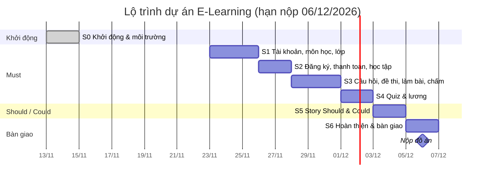

# PLAN — Dự án E-Learning (vibe coding với Claude Code)

| Mục | Nội dung |
|---|---|
| Sản phẩm | Ứng dụng web học trực tuyến cho trung tâm đào tạo: môn học, lớp, đăng ký & thanh toán, quiz theo chương, thi cuối kỳ, lương giảng viên |
| Yêu cầu | [docs/requirement.md](docs/requirement.md) — tài liệu yêu cầu người dùng (URD) v1.2 |
| Sơ đồ CSDL | [So_do_CSDL.drawio](So_do_CSDL.drawio) (ERD v1.1, 27 bảng) |
| Phương pháp | Agile / Scrum, sprint ngắn **2 – 3 ngày** |
| Hạn nộp | **06/12/2026** (Q-30, PO dời từ 01/12 sang 06/12 ngày 23/11) |
| Nhóm | 4 thành viên + Claude Code (Planner, Coder, Tester, E2E) |
| Sprint hiện tại | **Sprint 1 — Tài khoản, môn học & lớp học** (23/11 – 25/11; Sprint 0 đã xong, CI chờ push) |
| Cập nhật lần cuối | 23/11/2026 |

---

## 1. Tiến độ tổng quan

**Tổng tiến độ phát triển: `░░░░░░░░░░` 0 / 195 SP (0%)** · Sprint 0: `▓▓▓▓▓▓▓▓▓░` 14 / 15 việc (93%)

| Sprint | Thời gian | Mục tiêu | SP kế hoạch | SP xong | Trạng thái |
|---|---|---|---:|---:|---|
| S0 | 16/10 – 14/11 | Khởi động, chốt yêu cầu & môi trường | — | — | ✅ Xong, trừ T-0.13 🔄 |
| S1 | 23/11 – 25/11 | Tài khoản, môn học & lớp học | 43 | 0 | ⬜ Chưa bắt đầu |
| S2 | 26/11 – 27/11 | Đăng ký, thanh toán & học tập | 34 | 0 | ⬜ Chưa bắt đầu |
| S3 | 28/11 – 30/11 | Ngân hàng câu hỏi, đề thi, làm bài & chấm điểm | 44 | 0 | ⬜ Chưa bắt đầu |
| S4 | 01/12 – 02/12 | Quiz theo chương & lương | 29 | 0 | ⬜ Chưa bắt đầu |
| S5 | 03/12 – 04/12 | Các story Should & Could | 45 | 0 | ⬜ Chưa bắt đầu |
| S6 | 05/12 – 06/12 | Hoàn thiện & bàn giao | — | — | ⬜ Chưa bắt đầu |
| | | **Tổng** | **195** | **0** | |

> **Hạn nộp 06/12/2026.** Lịch xếp lại ngày 23/11 (TD-07): giữ nguyên toàn bộ 50 story, **195 SP**, không bớt story nào; chỉ dời mốc ngày. Toàn bộ 33 story **Must** (150 SP) nằm ở S1 → S4, xong trước hết ngày 02/12. S5 gom 17 story **Should / Could** (45 SP), hết ngày 04/12 là **ngừng thêm tính năng**. S6 (05 – 06/12) chỉ sửa lỗi và bàn giao, nộp trong ngày 06/12. Mốc ngày chỉ là trần; sprint nào xong sớm thì bắt đầu sprint sau ngay.



---

## 2. Quy ước

### 2.1 Ký hiệu

| Ký hiệu | Ý nghĩa |
|---|---|
| ⬜ | Chưa làm |
| 🔄 | Đang làm |
| 👀 | Làm xong, chờ nhóm review |
| ✅ | Xong (đạt Definition of Done) |
| ⛔ | Bị chặn (ghi rõ lý do) |
| `- [ ]` / `- [x]` | Việc trong sprint chưa xong / đã xong |

### 2.2 Mã số

- **E1 → E10**: Epic, tức nhóm chức năng lớn (requirement.md mục 6).
- **US-xx**: User story, định nghĩa và tiêu chí chấp nhận nằm trong requirement.md.
- **T-x.y**: Việc kỹ thuật thứ *y* của Sprint *x*.
- **UR-xx / FR-m.n / AT-xx**: Yêu cầu người dùng / Chức năng hệ thống / Kịch bản nghiệm thu (requirement.md mục 4, 7, 12).
- **BR-xx / NFR-xx / Q-xx**: Quy tắc nghiệp vụ / Yêu cầu phi chức năng / Câu hỏi (requirement.md mục 8, 9 và Phụ lục A).
- **SP (story point)**: độ lớn tương đối của một user story theo dãy 1, 2, 3, 5, 8, 13.
- **Ưu tiên MoSCoW**: Must (bắt buộc), Should (nên có), Could (có thì tốt).

### 2.3 Vai trò

| Vai trò | Ai | Việc chính |
|---|---|---|
| Product Owner | Bạn (trưởng nhóm) | Duyệt yêu cầu, sắp ưu tiên backlog, giao việc cho Claude Code, nghiệm thu cuối sprint |
| Thành viên nhóm | 3 thành viên còn lại | Review thay đổi, chạy thử theo kịch bản demo, viết báo cáo và slide |
| **Planner** | Claude Code | Đọc requirement.md và PLAN.md, chia user story thành việc nhỏ, cập nhật PLAN.md |
| **Coder** | Claude Code | Viết code cho từng việc trên nhánh riêng |
| **Tester** | Claude Code | Viết và chạy unit / integration test (Vitest) cho tiêu chí chấp nhận và quy tắc nghiệp vụ |
| **E2E** | Claude Code | Viết và chạy kịch bản trên trình duyệt (Playwright) cho các luồng chính |

Bốn vai trò của Claude Code là bốn agent trong `.claude/agents/` (`planner`, `coder`, `tester`, `e2e`), mỗi agent có hướng dẫn và giới hạn công cụ riêng. Agent mới chỉ được nạp khi mở phiên Claude Code mới.

---

## 3. Quy trình làm việc

| Nghi thức | Khi nào | Làm gì |
|---|---|---|
| Sprint Planning | Đầu sprint | Planner chia user story thành việc T-x.y; PO duyệt |
| Daily | Mỗi phiên làm việc với Claude Code | Chọn việc ⬜ → 🔄, làm, test, tick `[x]`, ghi nhật ký |
| Sprint Review | Cuối sprint | Cả nhóm chạy demo theo mục "Demo cuối sprint", cập nhật SP xong ở mục 1 |
| Retrospective | Sau Review | Ghi 3 ý vào mục 9: tốt / chưa tốt / cải tiến |
| Báo cáo sprint | Sau Retrospective, **trước khi bắt đầu sprint kế tiếp** | Claude Code viết vào [docs/sprint-reports.md](docs/sprint-reports.md): đã hoàn thành, chưa thực hiện, thiếu sót, lỗi đã mắc; cập nhật bảng việc tồn |

**Một vòng làm một user story:**

1. PO giao việc, ví dụ: *"Làm US-17"*.
2. **Planner** đọc tiêu chí chấp nhận, chia thành các việc nhỏ trong sprint backlog.
3. **Coder** tạo nhánh `feature/us-17-don-dang-ky` và viết code.
4. **Tester** viết test cho từng tiêu chí chấp nhận, chạy cho đến khi pass.
5. **E2E** chạy kịch bản trình duyệt cho luồng liên quan.
6. Thành viên nhóm review và chạy thử, sau đó merge vào `main`, commit theo Conventional Commits (ví dụ `feat(enrollment): tạo đơn đăng ký nhiều lớp`).
7. **Planner** tick việc, cập nhật trạng thái user story và tiến độ.

### 3.1 Definition of Ready

- User story có tiêu chí chấp nhận rõ ràng trong requirement.md.
- Câu hỏi liên quan đã có câu trả lời hoặc đã thống nhất dùng phương án mặc định.
- Đã ước lượng SP; không phụ thuộc vào việc chưa xong.

### 3.2 Definition of Done

- Đạt toàn bộ tiêu chí chấp nhận của user story.
- Test của Tester và kịch bản của E2E đều pass; lint pass.
- Phân quyền được kiểm tra ở phía server.
- Giao diện tiếng Việt, hiển thị được trên máy tính và điện thoại.
- Đã được một thành viên nhóm review; code đã merge vào `main` và `main` vẫn chạy được.
- PLAN.md đã cập nhật trạng thái.

---

## 4. Công nghệ

| Thành phần | Lựa chọn | Lý do |
|---|---|---|
| Ngôn ngữ | TypeScript | Một ngôn ngữ cho cả giao diện và backend |
| Framework | Next.js 16 (App Router) | Giao diện và API trong cùng một project |
| Giao diện | Tailwind CSS 4 + shadcn/ui | Nhanh, đẹp, responsive sẵn |
| CSDL | PostgreSQL 17 (chạy bằng Docker, cổng 5440) | Transaction tốt, phù hợp ERD nhiều quan hệ |
| ORM | Prisma 7 | Migration, seed, truy vấn có kiểu dữ liệu |
| Xác thực | Auth.js + bcrypt | Phiên đăng nhập an toàn, mật khẩu băm |
| Thanh toán | Stripe chế độ test (Checkout + webhook), nút giả lập dự phòng | Q-13; PO đã có tài khoản Stripe test |
| Lưu file | Thư mục `uploads/` trên máy cá nhân | File bài học, file đề và file nộp quiz |
| Kiểm tra dữ liệu | Zod | Dùng chung cho form và API |
| Kiểm thử | Vitest (Tester), Playwright (E2E) | |
| Triển khai | Docker Compose trên máy cá nhân; chưa triển khai online | Quyết định ngày 13/11 |

Đã chốt theo Q-24 trong requirement.md.

---

## 5. Product Backlog

| Mã | Epic | User story (tóm tắt) | Ưu tiên | SP | Sprint | Trạng thái |
|---|---|---|---|---:|---|---|
| US-01 | E1 Tài khoản | Khách đăng ký tài khoản học viên | Must | 3 | S1 | ⬜ |
| US-02 | E1 Tài khoản | Đăng nhập / đăng xuất | Must | 3 | S1 | ⬜ |
| US-03 | E1 Tài khoản | Phân quyền 3 vai trò | Must | 5 | S1 | ⬜ |
| US-04 | E1 Tài khoản | Hồ sơ cá nhân, đổi mật khẩu | Should | 2 | S5 | ⬜ |
| US-05 | E1 Tài khoản | Admin quản lý tài khoản, tạo giảng viên và Admin khác | Must | 5 | S1 | ⬜ |
| US-06 | E1 Tài khoản | Quên mật khẩu | Could | 3 | S5 | ⬜ |
| US-07 | E2 Môn học | Admin tạo / sửa / ẩn môn học | Must | 3 | S1 | ⬜ |
| US-08 | E2 Môn học | Quản lý chương | Must | 3 | S1 | ⬜ |
| US-09 | E2 Môn học | Quản lý bài học (video, văn bản, file) | Must | 5 | S1 | ⬜ |
| US-10 | E2 Môn học | Danh mục môn học + tìm kiếm | Must | 3 | S1 | ⬜ |
| US-11 | E2 Môn học | Chi tiết môn học, lớp đang mở | Must | 3 | S1 | ⬜ |
| US-12 | E3 Lớp học | Admin mở lớp, phân công giảng viên | Must | 5 | S1 | ⬜ |
| US-13 | E3 Lớp học | Giảng viên xem lớp được phân công | Must | 3 | S1 | ⬜ |
| US-14 | E3 Lớp học | Giảng viên đề xuất không dạy lớp | Should | 3 | S5 | ⬜ |
| US-15 | E3 Lớp học | Admin duyệt / từ chối đề xuất | Should | 3 | S5 | ⬜ |
| US-16 | E3 Lớp học | Mở lớp theo sĩ số tối thiểu, huỷ + hoàn tiền, kết thúc lớp | Must | 5 | S2 | ⬜ |
| US-17 | E4 Đăng ký | Tạo đơn đăng ký một hoặc nhiều lớp (chặn khi còn nợ) | Must | 8 | S2 | ⬜ |
| US-18 | E4 Đăng ký | Thanh toán Stripe test / giả lập, cọc hoặc trả đủ | Must | 8 | S2 | ⬜ |
| US-19 | E4 Đăng ký | Kích hoạt đơn, mở quyền vào lớp | Must | 5 | S2 | ⬜ |
| US-20 | E4 Đăng ký | Huỷ đơn chưa thanh toán | Should | 2 | S5 | ⬜ |
| US-21 | E4 Đăng ký | Lịch sử đơn và thanh toán | Should | 2 | S5 | ⬜ |
| US-22 | E4 Đăng ký | Admin theo dõi thanh toán, hoàn tiền | Should | 3 | S5 | ⬜ |
| US-23 | E5 Học tập | "Môn học của tôi" | Must | 3 | S2 | ⬜ |
| US-24 | E5 Học tập | Học bài, đánh dấu hoàn thành, tiến độ | Must | 5 | S2 | ⬜ |
| US-25 | E5 Học tập | Giảng viên xem tiến độ học viên | Should | 3 | S5 | ⬜ |
| US-26 | E6 Câu hỏi | Giảng viên soạn câu hỏi (trắc nghiệm, tự luận) cho môn | Must | 5 | S3 | ⬜ |
| US-27 | E6 Câu hỏi | Phương án và đáp án đúng | Must | 5 | S3 | ⬜ |
| US-28 | E6 Câu hỏi | Nhập câu hỏi từ Excel/CSV | Could | 5 | S5 | ⬜ |
| US-29 | E7 Đề thi | Tự tạo đề cuối kỳ khi mở lớp | Must | 2 | S1 | ⬜ |
| US-30 | E7 Đề thi | Admin lên lịch thi | Must | 3 | S3 | ⬜ |
| US-31 | E7 Đề thi | Admin random câu hỏi tạo đề | Must | 5 | S3 | ⬜ |
| US-32 | E7 Đề thi | Xem trước đề thi | Should | 2 | S5 | ⬜ |
| US-33 | E8 Làm bài | Học viên xem đề thi của lớp | Must | 2 | S3 | ⬜ |
| US-34 | E8 Làm bài | Làm bài và nộp bài | Must | 8 | S3 | ⬜ |
| US-35 | E8 Làm bài | Tự chấm câu trắc nghiệm 1 đáp án | Must | 5 | S3 | ⬜ |
| US-36 | E8 Làm bài | Giảng viên chấm tự luận | Must | 5 | S3 | ⬜ |
| US-37 | E8 Làm bài | Công bố đáp án và điểm | Must | 3 | S3 | ⬜ |
| US-38 | E8 Làm bài | Ghi điểm cuối kỳ | Must | 3 | S3 | ⬜ |
| US-39 | E8 Làm bài | Bảng điểm của lớp | Should | 3 | S5 | ⬜ |
| US-40 | E8 Làm bài | Xuất bảng điểm Excel | Could | 2 | S5 | ⬜ |
| US-41 | E9 Quiz | Giảng viên tạo quiz cho từng chương (trắc nghiệm hoặc nộp file) | Must | 8 | S4 | ⬜ |
| US-42 | E9 Quiz | Học viên làm quiz (trắc nghiệm 2 lần / nộp file 1 lần) | Must | 8 | S4 | ⬜ |
| US-43 | E9 Quiz | Chấm quiz | Must | 5 | S4 | ⬜ |
| US-44 | E9 Quiz | Xem điểm quiz, điểm quá trình | Must | 3 | S4 | ⬜ |
| US-45 | E10 Lương | Admin tính lương tháng | Must | 5 | S4 | ⬜ |
| US-46 | E10 Lương | Duyệt và đánh dấu đã trả lương | Should | 2 | S5 | ⬜ |
| US-47 | E10 Lương | Giảng viên xem bảng lương | Should | 2 | S5 | ⬜ |
| US-48 | E10 Thống kê | Dashboard Admin | Should | 3 | S5 | ⬜ |
| US-49 | E10 Thống kê | Dashboard giảng viên | Could | 2 | S5 | ⬜ |
| US-50 | E9 Quiz | Giảng viên báo sai sót quiz, Admin sửa điểm | Should | 3 | S5 | ⬜ |

---

## 6. Sprint Backlog

### Sprint 0 — Khởi động (16/10 – 14/11) ✅

**Mục tiêu:** Chốt yêu cầu, sơ đồ CSDL và công nghệ; dựng xong khung project chạy được.

- [x] T-0.1 Phân tích sơ đồ CSDL ban đầu
- [x] T-0.2 Dọn thư mục `docs/` (xoá tài liệu cũ, giữ thư mục)
- [x] T-0.3 Viết bản demo `docs/requirement.md`
- [x] T-0.4 Lập `PLAN.md`
- [x] T-0.5 **(PO)** Trả lời câu hỏi Q-01 → Q-26
- [x] T-0.6 Chốt ERD v1.0 (`So_do_CSDL.drawio`), requirement v1.0 và lập lại backlog theo câu trả lời
- [x] T-0.7 **(PO)** Trả lời 12 câu còn mở Q-27 → Q-38, nhất là hạn nộp đồ án (Q-30)
- [x] T-0.8 Viết từ điển dữ liệu (kiểu dữ liệu, ràng buộc, chỉ mục) → `docs/database/data-dictionary.md`
- [x] T-0.9 `.gitignore`, `CLAUDE.md` (quy ước cho Claude Code), cập nhật `README.md`
- [x] T-0.10 Tạo 4 agent Claude Code trong `.claude/agents/`: Planner, Coder, Tester, E2E
- [x] T-0.11 Khởi tạo project Next.js 16 + TypeScript, shadcn/ui, Vitest, Playwright, cấu trúc thư mục, lint + format
- [x] T-0.12 Docker Compose cho PostgreSQL, Prisma 7, `.env.example` (khoá Stripe test do PO điền vào `.env` trước Sprint 2)
- [ ] T-0.13 🔄 CI trên GitHub Actions: lint, typecheck, format, unit test, build — 23/11: PO đã cấp token mới (lưu ở `docs/secrets/`, không commit), file đã chuyển vào `.github/workflows/ci.yml`; **còn chờ PO cho push** và xem lần chạy CI đầu tiên
- [x] T-0.14 Wireframe các màn hình chính → `docs/ui/wireframes.md`
- [x] T-0.15 Commit và push bản nền lên GitHub

**Demo cuối sprint:** Chạy `npm run up` là có trang chủ hiển thị "Cơ sở dữ liệu: Đã kết nối"; 4 agent có trong `.claude/agents/`.

### Sprint 1 — Tài khoản, môn học & lớp học (23/11 – 25/11) · 43 SP

**Mục tiêu:** Ba vai trò đăng nhập được; Admin xây xong môn học, mở lớp và phân công giảng viên; khách xem được.
**User story:** US-01, US-02, US-03, US-05, US-07, US-08, US-09, US-10, US-11, US-12, US-13, US-29

- [ ] T-1.1 Prisma schema + migration: `USER`, `ADMIN`, `TEACHER`, `STUDENT`, `COURSE`, `SECTION`, `LESSON`, `CLASSES`, `EXAM` (thông tin cơ bản)
- [ ] T-1.2 Seed: 1 Admin, 3 giảng viên (có hệ số lương), 10 học viên, môn học, chương, bài học, lớp mẫu
- [ ] T-1.3 Đăng ký học viên, đăng nhập / đăng xuất, quản lý phiên (US-01, US-02)
- [ ] T-1.4 Middleware phân quyền theo vai trò, trang 403; layout và menu theo vai trò (US-03)
- [ ] T-1.5 Admin: danh sách tài khoản, tạo giảng viên, tạo Admin khác, sửa hệ số lương, khoá / mở (US-05)
- [ ] T-1.6 Admin: tạo / sửa / ẩn môn học; quản lý chương và bài học, sắp xếp thứ tự (US-07, US-08, US-09)
- [ ] T-1.7 Tải lên file đính kèm bài học, giới hạn dung lượng và định dạng (NFR-05)
- [ ] T-1.8 Danh mục và chi tiết môn học (US-10, US-11)
- [ ] T-1.9 Admin: mở lớp, phân công giảng viên; tự tạo đề cuối kỳ `DISABLED` (US-12, US-29)
- [ ] T-1.10 Giảng viên: xem lớp được phân công và học viên trong lớp (US-13)
- [ ] T-1.11 Tester: đăng ký, đăng nhập, phân quyền · E2E: đăng nhập 3 vai trò; Admin tạo môn → mở lớp → khách thấy lớp

**Demo cuối sprint:** Đăng nhập bằng 3 vai trò, mỗi vai trò thấy menu riêng; Admin tạo môn học có chương và bài học, mở lớp và giao cho giảng viên; khách thấy lớp đang nhận đăng ký.

### Sprint 2 — Đăng ký, thanh toán & học tập (26/11 – 27/11) · 34 SP

**Mục tiêu:** Học viên đăng ký nhiều lớp trong một đơn, cọc hoặc trả đủ, vào lớp học bài; lớp mở hoặc huỷ đúng quy tắc sĩ số.
**User story:** US-16, US-17, US-18, US-19, US-23, US-24

- [ ] T-2.1 Schema: `ENROLLMENT`, `STUDENT COURSES DETAIL`, `STUDY`, `PAYMENT`, `LESSON_PROGRESS`
- [ ] T-2.2 Chọn nhiều lớp, tạo đơn đăng ký; chặn khi còn đơn chưa trả đủ (US-17, BR-22)
- [ ] T-2.3 Stripe Checkout chế độ test + webhook; trả cọc, trả đủ, trả phần còn lại (US-18) — **cần PO cấp khoá Stripe test vào `.env`**
- [ ] T-2.4 Nút thanh toán giả lập dự phòng (US-18)
- [ ] T-2.5 Kích hoạt đơn: chi tiết `STUDYING`, thêm `STUDY`, mở quyền; chặn nội dung khi chưa có quyền (US-19, BR-10)
- [ ] T-2.6 Chốt sĩ số tại ngày khai giảng: đủ thì `ONGOING`, thiếu thì `CANCELLED` + hoàn tiền; kết thúc lớp (US-16)
- [ ] T-2.7 Trang "Môn học của tôi"; học bài, đánh dấu hoàn thành, tính tiến độ (US-23, US-24)
- [ ] T-2.8 Tester: tính tiền, trùng lớp, hết chỗ, chặn nợ, kích hoạt, huỷ lớp hoàn tiền · E2E: đăng ký 2 lớp → thanh toán thẻ test → vào lớp → học bài

**Demo cuối sprint:** Học viên chọn 2 lớp, cọc bằng thẻ test của Stripe, vào lớp học 3 bài và thấy tiến độ tăng; lớp không đủ sĩ số bị huỷ và hoàn tiền.

### Sprint 3 — Ngân hàng câu hỏi, đề thi, làm bài & chấm điểm (28/11 – 30/11) · 44 SP

**Mục tiêu:** Học viên thi trọn một đề cuối kỳ do Admin random; giảng viên chấm tự luận và công bố điểm.
**User story:** US-26, US-27, US-30, US-31, US-33, US-34, US-35, US-36, US-37, US-38

- [ ] T-3.1 Schema: `QUESTIONS`, `QUESTION_OPTION`, `EXAM_QUESTION`, `ANSWER`, `ANSWER_DETAIL`; bổ sung cột lịch thi cho `EXAM`
- [ ] T-3.2 Giảng viên soạn câu hỏi trắc nghiệm 1 đáp án và tự luận cho môn mình dạy (US-26, US-27)
- [ ] T-3.3 Admin lên lịch thi; random câu hỏi theo số câu mỗi loại (US-30, US-31)
- [ ] T-3.4 Học viên xem đề thi của lớp và trạng thái (US-33)
- [ ] T-3.5 Giao diện làm bài: radio / ô nhập, đồng hồ, lưu ngay; nộp bài, tự nộp khi hết giờ, giới hạn số lần, yêu cầu đóng đủ học phí (US-34)
- [ ] T-3.6 Tự chấm câu trắc nghiệm; giảng viên chấm câu tự luận (US-35, US-36)
- [ ] T-3.7 Công bố đáp án và điểm, ghi `last_exam_point` (US-37, US-38)
- [ ] T-3.8 Tester: random đủ số câu, không trùng, điểm chia đều, chấm điểm, hết giờ, ẩn đáp án trước khi công bố · E2E: thi → chấm → công bố → xem điểm

**Demo cuối sprint:** Giảng viên soạn 30 câu; Admin lên lịch và random đề 20 câu; học viên đã trả đủ làm bài, giảng viên chấm tự luận và công bố; học viên thấy điểm và đáp án đúng.

### Sprint 4 — Quiz theo chương & lương (01/12 – 02/12) · 29 SP

**Mục tiêu:** Mỗi chương có quiz dạng trắc nghiệm hoặc nộp file; Admin tính được lương giảng viên.
**User story:** US-41, US-42, US-43, US-44, US-45

- [ ] T-4.1 Schema: `QUIZ`, `QUIZ_QUESTION`, `QUIZ_OPTION`, `QUIZ_RESULT`, `QUIZ_RESULT_DETAIL`, `SALARY`; cấu hình lương cơ bản, phụ cấp lớp, đơn giá học viên
- [ ] T-4.2 Giảng viên soạn quiz: chọn dạng, soạn câu trắc nghiệm hoặc đề nộp file, publish; khoá khi đã có bài làm (US-41)
- [ ] T-4.3 Học viên làm quiz trắc nghiệm (tối đa 2 lần) và nộp file (1 lần, trước hạn) (US-42)
- [ ] T-4.4 Tự chấm quiz trắc nghiệm; giảng viên chấm bài nộp file (US-43)
- [ ] T-4.5 Xem điểm quiz (lần sau cùng), tính điểm quá trình (US-44)
- [ ] T-4.6 Admin tính lương tháng (US-45)
- [ ] T-4.7 Tester: chấm quiz, số lần làm, hạn nộp, khoá quiz, công thức lương · E2E: làm quiz có nộp file → giảng viên chấm

**Demo cuối sprint:** Học viên làm quiz trắc nghiệm 2 lần và nộp file cho một quiz khác; giảng viên chấm bài nộp; Admin tính lương tháng cho 3 giảng viên.

### Sprint 5 — Các story Should & Could (03/12 – 04/12) · 45 SP

**Mục tiêu:** Bổ sung toàn bộ chức năng nên có và có thì tốt theo thứ tự ưu tiên; hết ngày 04/12 thì ngừng thêm tính năng.
**User story:** US-04, US-14, US-15, US-20, US-21, US-22, US-25, US-32, US-39, US-46, US-47, US-48, US-50 (Should, 33 SP) · US-06, US-28, US-40, US-49 (Could, 12 SP)

- [ ] T-5.1 Schema: `CLASS_DECLINE_REQUEST`, `QUIZ_FEEDBACK`
- [ ] T-5.2 Giảng viên đề xuất không dạy lớp; Admin duyệt / từ chối, phân giảng viên khác (US-14, US-15)
- [ ] T-5.3 Huỷ đơn chưa thanh toán; lịch sử đơn và thanh toán; Admin theo dõi thanh toán (US-20, US-21, US-22)
- [ ] T-5.4 Duyệt, đánh dấu đã trả lương; giảng viên xem bảng lương (US-46, US-47)
- [ ] T-5.5 Giảng viên báo sai sót quiz, Admin điều chỉnh điểm (US-50)
- [ ] T-5.6 Xem trước đề thi; tiến độ học viên và bảng điểm lớp (US-32, US-25, US-39)
- [ ] T-5.7 Hồ sơ cá nhân, đổi mật khẩu; Dashboard Admin (US-04, US-48)
- [ ] T-5.8 *(Could)* Dashboard giảng viên, xuất Excel, nhập câu hỏi từ Excel, quên mật khẩu (US-49, US-40, US-28, US-06)
- [ ] T-5.9 Tester và E2E cho các story đã làm trong sprint

**Demo cuối sprint:** Giảng viên xin không dạy, Admin duyệt và giao lớp cho người khác; Admin duyệt bảng lương; giảng viên báo sai sót quiz và Admin sửa điểm.

### Sprint 6 — Hoàn thiện & bàn giao (05/12 – 06/12)

**Mục tiêu:** Không thêm tính năng; sản phẩm ổn định trên máy cá nhân, tài liệu đầy đủ, nộp trong ngày 06/12.

- [ ] T-6.1 Rà soát yêu cầu phi chức năng: bảo mật, file tải lên, responsive, hiệu năng
- [ ] T-6.2 Sửa lỗi tồn đọng
- [ ] T-6.3 Seed dữ liệu demo đầy đủ, viết kịch bản demo
- [ ] T-6.4 Hoàn thiện tài liệu: README (cách chạy bằng Docker Compose), `docs/` (CSDL, hướng dẫn sử dụng)
- [ ] T-6.5 **(Thành viên nhóm)** Báo cáo đồ án và slide → `docs/report/`

---

## 7. Cấu trúc tài liệu

```text
So_do_CSDL.drawio            ← ERD v1.1 (chính thức)
CLAUDE.md                    ← quy ước cho Claude Code
.claude/agents/              ← 4 agent: planner, coder, tester, e2e
docs/
├── sprint-reports.md        ← báo cáo sprint: kết quả, thiếu sót, lỗi, việc tồn
├── requirement.md           ← tài liệu yêu cầu người dùng (URD) v1.2
├── architecture.md          ← cấu trúc hệ thống: thành phần, tầng, phân hệ, luồng xử lý
├── database/                ← từ điển dữ liệu (data-dictionary.md)
├── ui/                      ← wireframe (wireframes.md)
└── report/                  ← báo cáo, slide đồ án (T-6.5)
```

---

## 8. Rủi ro

| Mã | Rủi ro | Ảnh hưởng | Cách giảm |
|---|---|---|---|
| R1 | Hạn nộp 06/12/2026 rất gần: giữ đủ 195 SP trong 14 ngày (23/11 – 06/12), S2, S4, S5 chỉ có 2 ngày | Không kịp review và chạy thử | Must xong trước hết 02/12; ngừng thêm tính năng sau 04/12; sprint nào trễ thì báo PO ngay để PO quyết định, không tự bỏ story |
| R2 | Phạm vi lớn: 195 SP, 27 bảng; nhóm review không kịp tốc độ viết code | Lỗi ẩn lọt tới buổi bảo vệ | Làm Must trước; S5 gom story Should / Could để có thể cắt; mỗi sprint có demo để nhóm chạy thử |
| R3 | Tích hợp Stripe (webhook, môi trường test) gặp khó | Trễ Sprint 2 | Có nút thanh toán giả lập dự phòng |
| R4 | Sơ đồ CSDL đổi giữa chừng | Lỗi dữ liệu, phải làm lại | Mọi thay đổi đi qua migration; cập nhật `So_do_CSDL.drawio` cùng lúc |
| R5 | Code do AI sinh ra khó kiểm soát | Lỗi ẩn | Chia việc nhỏ; Tester và E2E chạy trước khi merge; thành viên nhóm review |
| R6 | PO đổi yêu cầu đã chốt (Q-01 → Q-38, G-1 → G-5) giữa chừng | Phải sửa story đã làm, trễ hạn 06/12 | Thay đổi mới chỉ nhận vào Sprint 5 trở đi, trừ lỗi nghiêm trọng |
| R7 | File chưa commit bị mất | Mất công sức | Commit và push sau mỗi phiên làm việc |

---

## 9. Nhật ký sprint (Review & Retrospective)

| Sprint | Đã demo | Tốt | Chưa tốt | Cải tiến sprint sau |
|---|---|---|---|---|
| S0 | Chạy `npm run up`: trang chủ báo đã kết nối CSDL; `npm run check` và 4 kịch bản E2E pass (14/11) | Yêu cầu và ERD chốt xong trước khi code; khung project có sẵn lint và test | Trễ 6 ngày so với lịch đầu; draw.io ghi đè sơ đồ một lần | Đóng file `.drawio` trước khi nhờ Claude sửa sơ đồ; mỗi sprint commit ngay khi xong |

---

## 10. Nhật ký thay đổi

| Ngày | Nội dung |
|---|---|
| 16/10/2026 | Khởi động lại dự án theo hướng vibe coding với Claude Code. Xoá tài liệu cũ trong `docs/`. Tạo `docs/requirement.md` v0.1 và `PLAN.md` v0.1 từ sơ đồ `So_do_CSDL_doan.drawio`. |
| 19/10/2026 | Sơ đồ bỏ trang 2, thêm bảng `ADMIN`. Requirement lên v0.2. |
| 23/10/2026 | Sơ đồ đề xuất `So_do_CSDL_de_xuat.drawio`: gộp `COURSE`, Admin tạo môn học, thêm cụm QUIZ. |
| 02/11/2026 | Theo câu trả lời Q-01 → Q-26: ERD v1.0 (`So_do_CSDL.drawio`, 27 bảng), requirement v1.0 (49 user story), lập lại backlog 192 SP thành 9 sprint, thêm vai trò Planner / Coder / Tester / E2E cho Claude Code. |
| 13/11/2026 | PO trả lời Q-27 → Q-38 (hạn nộp 01/12/2026; demo chỉ chạy trên máy cá nhân). Xoá `So_do_CSDL_de_xuat.drawio` và các file `.bkp`, thêm `.gitignore`, commit bản nền. |
| 13/11/2026 | Theo câu trả lời Q-27 → Q-38: ERD v1.1 (bỏ `ANSWER_CHOICE`, thêm `QUIZ_FEEDBACK`, mở rộng cụm QUIZ), requirement v1.1 (50 user story, thêm US-50), backlog 195 SP xếp lại thành S1 → S6 kết thúc ngày 30/11; bỏ triển khai online. |
| 14/11/2026 | Xong Sprint 0: khung Next.js 16 + Prisma 7 + PostgreSQL (Docker, cổng 5440), shadcn/ui, Vitest, Playwright; từ điển dữ liệu, wireframe, `CLAUDE.md`, 4 agent. Không bật Cache Components của Next.js để đơn giản hoá việc render theo phiên đăng nhập. CI đã viết nhưng chưa bật vì token GitHub thiếu quyền `workflow` (T-0.13). |
| 16/11/2026 | Thêm quy định viết báo cáo sprint vào `docs/CLAUDE.md` sau mỗi sprint; viết báo cáo Sprint 0. `docs/requirement.md` lên v1.2: sắp xếp lại thành tài liệu yêu cầu người dùng (URD) với 22 UR, 72 chức năng hệ thống, tiêu chí nghiệm thu AT-01 → AT-08, ma trận truy vết; thêm NFR-10 → NFR-12. Sprint 1 chưa bắt đầu, trễ 1 ngày so với lịch. |
| 16/11/2026 | Thêm `docs/architecture.md` mô tả cấu trúc hệ thống (thành phần chạy, các tầng, cấu trúc thư mục, 10 phân hệ, luồng xử lý, quyết định kiến trúc). |
| 23/11/2026 | Đổi tên `docs/CLAUDE.md` thành `docs/sprint-reports.md`: tránh trùng tên với `CLAUDE.md` ở gốc, và tránh để Claude Code tự nạp nhật ký sprint như một file chỉ dẫn. |
| 23/11/2026 | Xử lý TD-07: PO dời hạn nộp từ 01/12 sang **06/12/2026**, giữ nguyên 195 SP. Xếp lại lịch: S1 23 – 25/11, S2 26 – 27/11, S3 28 – 30/11, S4 01 – 02/12, S5 03 – 04/12, S6 05 – 06/12. TD-01: PO cấp token GitHub mới, chuyển `ci.yml` vào `.github/workflows/` (chờ PO cho push). |
