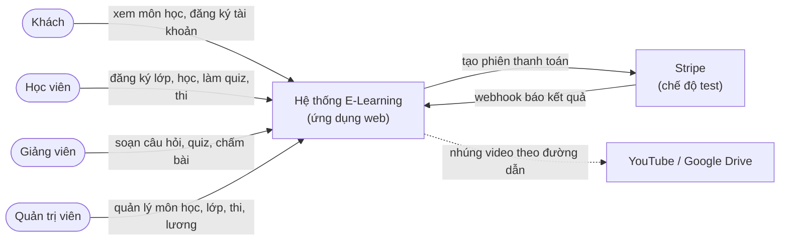
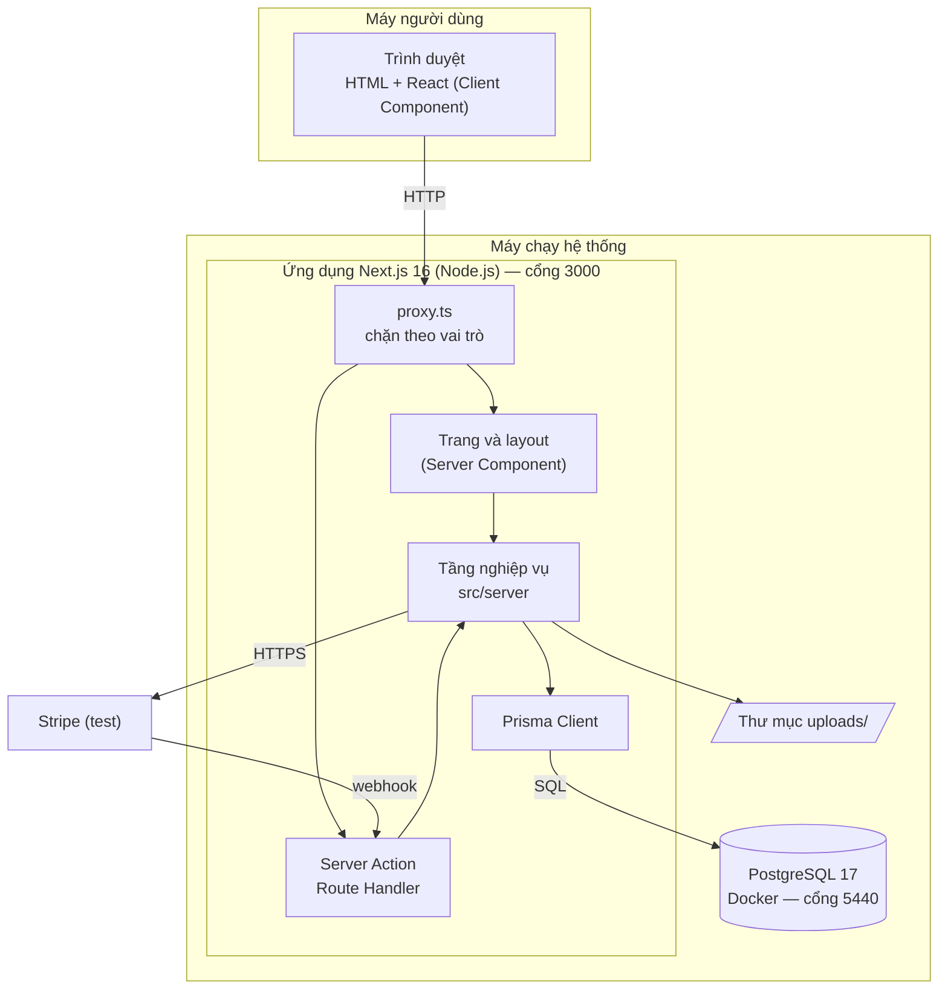
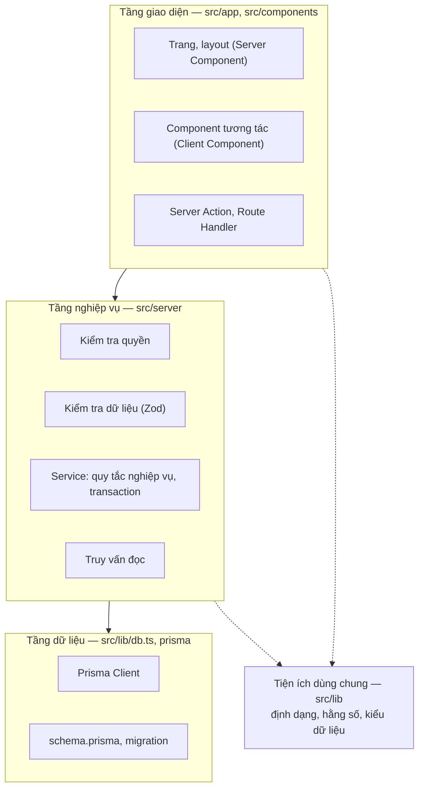
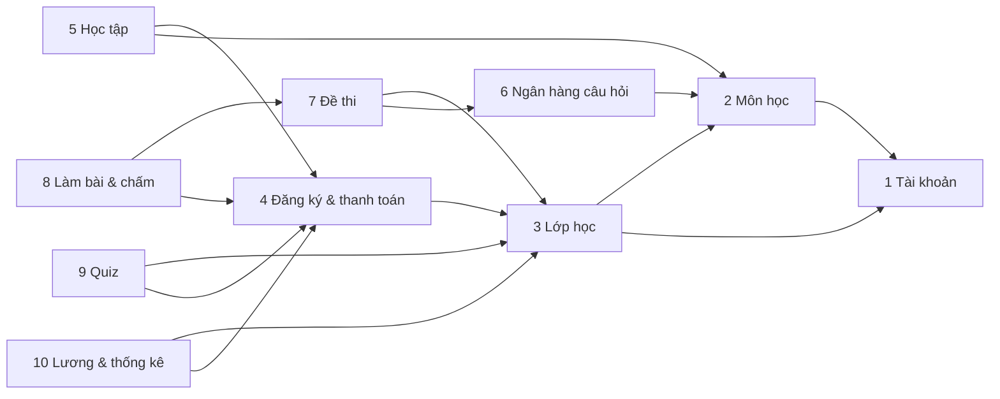
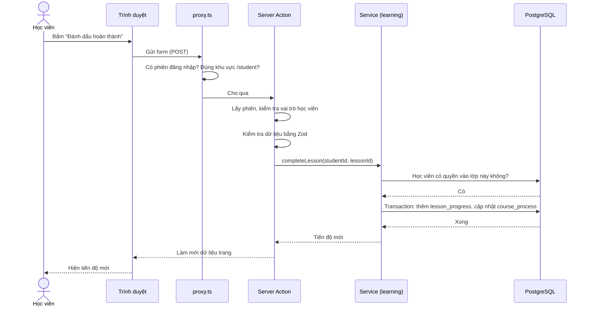
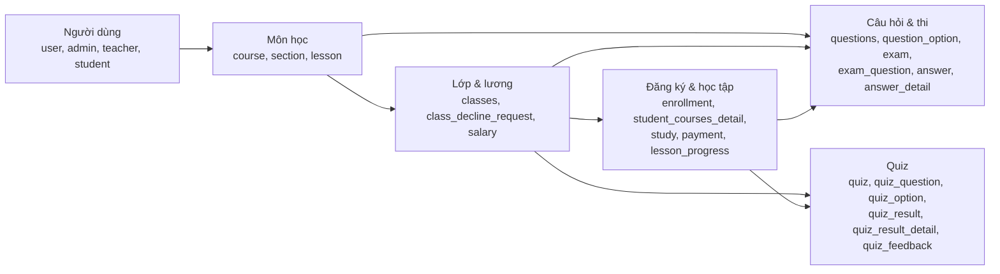
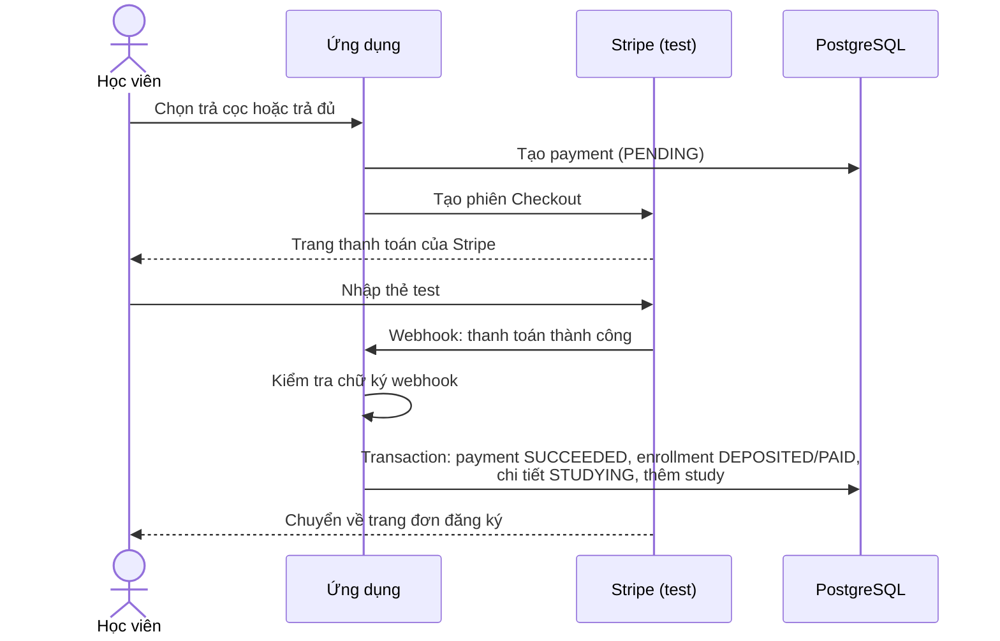
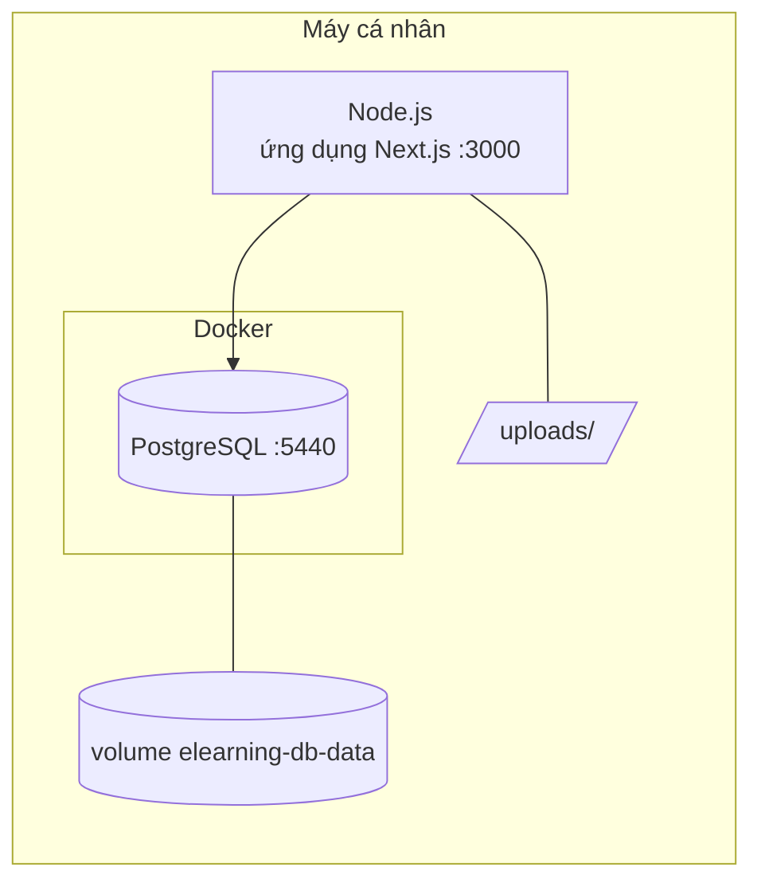

# Cấu trúc hệ thống — E-Learning

| Mục | Nội dung |
|---|---|
| Phiên bản | v1.0 |
| Ngày | 16/11/2026 |
| Tài liệu liên quan | [Yêu cầu người dùng](requirement.md) · [Từ điển dữ liệu](database/data-dictionary.md) · [Wireframe](ui/wireframes.md) · [PLAN.md](../PLAN.md) |

Tài liệu này mô tả hệ thống được chia thành những phần nào, mỗi phần nằm ở đâu trong mã nguồn và các phần nói chuyện với nhau ra sao. Yêu cầu nghiệp vụ nằm ở tài liệu yêu cầu; chi tiết từng bảng nằm ở từ điển dữ liệu.

> **Hiện trạng (sau Sprint 1, 23/11/2026):** đã có đăng nhập và phân quyền 3 vai trò, quản lý tài khoản, môn học / chương / bài học có file đính kèm, mở lớp kèm đề thi cuối kỳ, trang giảng viên; 9 / 27 bảng. Các phần đánh dấu ⬜ là **thiết kế dự kiến**, sẽ được xây ở các sprint sau và có thể được điều chỉnh khi làm. Phần đánh dấu ✅ đã có trong mã nguồn. Tài liệu này được cập nhật cuối mỗi sprint.

## Mục lục

1. [Tổng quan](#1-tổng-quan)
2. [Hệ thống và môi trường xung quanh](#2-hệ-thống-và-môi-trường-xung-quanh)
3. [Các thành phần chạy](#3-các-thành-phần-chạy)
4. [Các tầng bên trong ứng dụng](#4-các-tầng-bên-trong-ứng-dụng)
5. [Cấu trúc thư mục](#5-cấu-trúc-thư-mục)
6. [Phân hệ chức năng](#6-phân-hệ-chức-năng)
7. [Đường đi của một yêu cầu](#7-đường-đi-của-một-yêu-cầu)
8. [Xác thực và phân quyền](#8-xác-thực-và-phân-quyền)
9. [Dữ liệu](#9-dữ-liệu)
10. [Tích hợp và lưu trữ file](#10-tích-hợp-và-lưu-trữ-file)
11. [Xử lý phụ thuộc thời gian](#11-xử-lý-phụ-thuộc-thời-gian)
12. [Triển khai và cấu hình](#12-triển-khai-và-cấu-hình)
13. [Kiểm thử và chất lượng](#13-kiểm-thử-và-chất-lượng)
14. [Các quyết định kiến trúc](#14-các-quyết-định-kiến-trúc)

---

## 1. Tổng quan

E-Learning là một **ứng dụng web nguyên khối** (monolith): giao diện và phần xử lý phía server nằm chung trong một project Next.js, dùng một cơ sở dữ liệu PostgreSQL. Không có dịch vụ backend riêng, không có hàng đợi hay bộ nhớ đệm ngoài.

| Đặc điểm | Lựa chọn |
|---|---|
| Kiểu kiến trúc | Nguyên khối, ba tầng: giao diện → nghiệp vụ → dữ liệu |
| Cách render | Phía server theo từng yêu cầu (Server Component); phần tương tác chạy ở trình duyệt (Client Component) |
| Giao tiếp trình duyệt ↔ server | Server Action cho thao tác ghi; Route Handler cho webhook, tải file và kiểm tra sức khoẻ |
| Trạng thái | Toàn bộ nằm trong PostgreSQL và thư mục `uploads/`; server không giữ trạng thái giữa các yêu cầu |
| Người dùng | Bốn tác nhân: khách, học viên, giảng viên, quản trị viên |

Lý do chọn nguyên khối: nhóm nhỏ, thời gian ngắn, sản phẩm chỉ chạy trên một máy; một project duy nhất giúp chia sẻ kiểu dữ liệu giữa giao diện và server và chỉ cần một lệnh để chạy.

## 2. Hệ thống và môi trường xung quanh



Hệ thống chỉ phụ thuộc hai dịch vụ ngoài: **Stripe** để thu học phí (có thanh toán giả lập thay thế khi không có Stripe) và **YouTube / Google Drive** để phát video bài học (hệ thống chỉ lưu đường dẫn).

## 3. Các thành phần chạy



| Thành phần | Công nghệ | Vai trò | Trạng thái |
|---|---|---|---|
| Trình duyệt | React 19, Tailwind CSS 4, shadcn/ui | Hiển thị giao diện, xử lý tương tác (form, đồng hồ làm bài) | ✅ khung |
| Ứng dụng | Next.js 16.4 (App Router), TypeScript, Node.js 22+ | Render trang, xử lý nghiệp vụ, kiểm tra quyền | ✅ khung |
| Cơ sở dữ liệu | PostgreSQL 17 trong Docker | Lưu toàn bộ dữ liệu nghiệp vụ (27 bảng) | ✅ 9 bảng (S1) |
| Lưu file | Thư mục `uploads/` trên máy chạy | File đính kèm bài học, file đề và bài nộp quiz | ✅ file bài học (S1) |
| Stripe | Stripe Checkout + webhook, chế độ test | Thu học phí | ⬜ Sprint 2 |

## 4. Các tầng bên trong ứng dụng



| Tầng | Chứa gì | Được phép | Không được phép |
|---|---|---|---|
| Giao diện | Trang, layout, component, server action, route handler | Gọi tầng nghiệp vụ; hiển thị kết quả; điều hướng | Gọi Prisma trực tiếp; chứa quy tắc nghiệp vụ |
| Nghiệp vụ | Hàm kiểm tra quyền, lược đồ Zod, service, truy vấn | Gọi Prisma; mở transaction; gọi Stripe; đọc ghi file | Phụ thuộc React hay Next.js (trừ phần lấy phiên đăng nhập) |
| Dữ liệu | `db` (một Prisma Client duy nhất), schema, migration | Truy cập PostgreSQL | Chứa quy tắc nghiệp vụ |
| Tiện ích | Hàm thuần: định dạng tiền, phần trăm, ngày | Được mọi tầng dùng | Truy cập CSDL hay phiên đăng nhập |

Quy tắc phụ thuộc: **chỉ gọi xuống, không gọi ngược lên**. Nhờ vậy quy tắc nghiệp vụ nằm một chỗ, test được bằng Vitest mà không cần trình duyệt (Vitest không chạy được async Server Component).

## 5. Cấu trúc thư mục

```text
E-Learning Project/
├── src/
│   ├── app/                        tầng giao diện: mỗi thư mục là một đường dẫn
│   │   ├── layout.tsx              ✅ khung trang gốc, font, ngôn ngữ vi
│   │   ├── globals.css             ✅ Tailwind + biến màu shadcn/ui
│   │   ├── api/
│   │   │   ├── health/route.ts     ✅ kiểm tra sức khoẻ ứng dụng và CSDL
│   │   │   ├── auth/[...nextauth]/ ✅ Auth.js
│   │   │   ├── lessons/[id]/attachment/ ✅ tải file bài học có kiểm tra quyền
│   │   │   └── stripe/webhook/     ⬜ nhận kết quả thanh toán (S2)
│   │   ├── (public)/               ✅ trang chủ, đăng nhập, đăng ký, 403, danh mục và chi tiết môn học
│   │   ├── student/                ✅ khung; ⬜ môn học của tôi, học bài (S2 → S4)
│   │   ├── teacher/                ✅ lớp của tôi (S1); ⬜ quiz, chấm bài, lương (S3 → S5)
│   │   └── admin/                  ✅ tổng quan, tài khoản, môn học, lớp học (S1); ⬜ phần còn lại (S2 → S5)
│   ├── components/
│   │   ├── ui/                     ✅ component shadcn/ui: button, input, label, textarea
│   │   └── …                       ✅ khung trang theo vai trò, bảng responsive, ô nhập có nhãn, nhãn trạng thái, phân trang
│   ├── server/                     tầng nghiệp vụ, mỗi phân hệ một thư mục
│   │   ├── auth/                   ✅ Auth.js, getActor / requireActor, assertRole
│   │   ├── files/                  ✅ kiểm tra, lưu, đọc file trong uploads/
│   │   ├── accounts/  courses/  classes/   ✅ (S1)
│   │   ├── enrollments/  learning/
│   │   └── questions/  exams/  attempts/  quizzes/  salary/
│   ├── lib/
│   │   ├── db.ts                   ✅ Prisma Client dùng chung
│   │   ├── health.ts               ✅ truy vấn kiểm tra CSDL
│   │   ├── format.ts               ✅ định dạng tiền VND, phần trăm (có test)
│   │   └── utils.ts                ✅ tiện ích của shadcn/ui
│   ├── test/factories.ts           ✅ tạo và dọn dữ liệu cho test tích hợp
│   ├── generated/prisma/           mã Prisma tự sinh, không commit
│   └── proxy.ts                    ✅ chặn đường dẫn theo vai trò
├── prisma/
│   ├── schema.prisma               ✅ 9 / 27 model (S1), thêm dần theo sprint
│   ├── migrations/                 ✅ lịch sử thay đổi CSDL (kèm ràng buộc CHECK viết tay)
│   └── seed.ts                     ✅ dữ liệu mẫu: 1 Admin, 3 giảng viên, 10 học viên, 4 môn, 4 lớp
├── e2e/                            ✅ kịch bản Playwright: đăng nhập, phân quyền, luồng Admin → khách → giảng viên
├── scripts/setup.mjs               ✅ chuẩn bị môi trường cho `npm run up`
├── uploads/                        file người dùng tải lên, không commit
├── docs/                           tài liệu
├── docker-compose.yml              ✅ PostgreSQL
├── prisma.config.ts                ✅ cấu hình Prisma 7
├── next.config.ts                  ✅ cấu hình Next.js
└── So_do_CSDL.drawio               ✅ sơ đồ CSDL (ERD v1.1)
```

Bên trong mỗi thư mục phân hệ của `src/server/` (đã dùng từ S1):

| File | Nội dung |
|---|---|
| `schemas.ts` | Lược đồ Zod cho dữ liệu đầu vào, dùng chung cho form và server |
| `queries.ts` | Hàm đọc dữ liệu cho trang |
| `service.ts` | Hàm thay đổi dữ liệu, chứa quy tắc nghiệp vụ, chạy trong transaction |
| `actions.ts` | Server Action: lấy phiên đăng nhập → kiểm tra quyền → kiểm tra dữ liệu → gọi service |
| `*.test.ts` | Test Vitest cho service và quy tắc nghiệp vụ |

## 6. Phân hệ chức năng

Hệ thống gồm 10 phân hệ, tương ứng 10 epic và 10 nhóm chức năng `FR-m.n` trong tài liệu yêu cầu.

| # | Phân hệ | Thư mục nghiệp vụ | Bảng chính | Đường dẫn chính | Sprint |
|---|---|---|---|---|---|
| 1 | Tài khoản & phân quyền | `auth/`, `accounts/` | `user`, `admin`, `teacher`, `student` | `/login`, `/register`, `/admin/users` | S1 |
| 2 | Môn học & nội dung | `courses/` | `course`, `section`, `lesson` | `/courses`, `/admin/courses` | S1 |
| 3 | Lớp học & phân công | `classes/` | `classes`, `class_decline_request` | `/admin/classes`, `/teacher` | S1, S2, S5 |
| 4 | Đăng ký & thanh toán | `enrollments/` | `enrollment`, `student_courses_detail`, `study`, `payment` | `/student/enroll`, `/student/enrollments`, `/admin/payments` | S2 |
| 5 | Học tập & tiến độ | `learning/` | `lesson_progress`, `student_courses_detail` | `/student`, `/student/classes/[id]` | S2 |
| 6 | Ngân hàng câu hỏi | `questions/` | `questions`, `question_option` | `/teacher/questions` | S3 |
| 7 | Đề thi cuối kỳ | `exams/` | `exam`, `exam_question` | `/admin/classes/[id]/exam` | S1, S3 |
| 8 | Làm bài & chấm điểm | `attempts/` | `answer`, `answer_detail` | `/student/classes/[id]/exam`, `/teacher/classes/[id]/exam` | S3 |
| 9 | Quiz theo chương | `quizzes/` | `quiz`, `quiz_question`, `quiz_option`, `quiz_result`, `quiz_result_detail`, `quiz_feedback` | `…/quizzes` | S4, S5 |
| 10 | Lương & thống kê | `salary/` | `salary` | `/admin/salaries`, `/teacher/salary`, `/admin` | S4, S5 |

Phụ thuộc giữa các phân hệ (mũi tên: "cần dữ liệu của"):



Thứ tự các sprint trong PLAN.md đi theo đúng chiều phụ thuộc này: phân hệ ở gốc mũi tên chỉ làm được sau khi phân hệ ở đầu mũi tên đã có.

## 7. Đường đi của một yêu cầu

Ví dụ: học viên bấm "Đánh dấu hoàn thành" ở một bài học ⬜.



Mọi thao tác ghi đều đi qua bốn bước theo thứ tự: **xác thực → phân quyền → kiểm tra dữ liệu → nghiệp vụ trong transaction**. Trang chỉ đọc đi đường ngắn hơn: Server Component gọi thẳng hàm trong `queries.ts`, hàm này cũng tự kiểm tra quyền.

## 8. Xác thực và phân quyền

| Lớp bảo vệ | Ở đâu | Làm gì | Trạng thái |
|---|---|---|---|
| Phiên đăng nhập | Auth.js v5 (Credentials, phiên JWT 8 giờ), cookie HttpOnly | Xác định người dùng và vai trò; mật khẩu băm bằng bcrypt (`bcryptjs`, 10 vòng). `getActor()` đọc lại người dùng trong CSDL ở mỗi request nên tài khoản vừa bị khoá mất quyền ngay | ✅ S1 |
| Chặn theo khu vực | `src/proxy.ts` | Chưa đăng nhập → về `/login?callbackUrl=…`; sai vai trò với `/admin`, `/teacher`, `/student` → trang 403 (mã 403) | ✅ S1 |
| Kiểm tra vai trò | Trang và server action: `requireActor(...)`; service và truy vấn: `assertRole(actor, ...)` | Hàm dùng chung trong `src/server/auth/` | ✅ S1 |
| Kiểm tra quyền trên dữ liệu | Trong service và truy vấn | Giảng viên chỉ thao tác trên lớp được phân công; học viên chỉ xem lớp đã được mở quyền và bài làm của mình | ✅ giảng viên (S1); ⬜ học viên (S2) |

`proxy.ts` chỉ là lớp chặn sớm để điều hướng cho gọn; **quyết định cuối cùng luôn nằm ở tầng nghiệp vụ**, vì server action có thể bị gọi trực tiếp mà không đi qua trang (US-03, BR-20). Đáp án đúng không bao giờ được gửi về trình duyệt khi học viên đang làm bài (BR-24): truy vấn cho màn hình làm bài không chọn cột `is_correct`.

## 9. Dữ liệu

Cơ sở dữ liệu gồm 27 bảng chia thành 6 nhóm. Sơ đồ đầy đủ ở `So_do_CSDL.drawio`, chi tiết cột ở [từ điển dữ liệu](database/data-dictionary.md).



| Chủ đề | Cách làm |
|---|---|
| Truy cập | Chỉ qua một Prisma Client (`db` trong `src/lib/db.ts`), kết nối bằng driver adapter `@prisma/adapter-pg` |
| Thay đổi cấu trúc | Sửa `prisma/schema.prisma` → `npm run db:migrate` tạo migration; không sửa CSDL bằng tay. Sơ đồ và từ điển dữ liệu được sửa cùng lúc |
| Toàn vẹn | Ràng buộc khoá ngoại, duy nhất và kiểu enum đặt ở CSDL; quy tắc phức tạp hơn kiểm tra ở service |
| Transaction | Bắt buộc với: kích hoạt đơn, huỷ lớp hoàn tiền, nộp bài, chấm điểm, công bố điểm, tính lương (NFR-03) |
| Xoá | Không xoá hẳn dữ liệu đã có lịch sử; dùng cột trạng thái (BR-19) |
| Dữ liệu mẫu | `prisma/seed.ts`, nạp bằng `npm run db:seed` |

## 10. Tích hợp và lưu trữ file

### 10.1 Thanh toán qua Stripe ⬜ Sprint 2



- Việc kích hoạt đơn chỉ dựa vào **webhook**, không dựa vào việc trình duyệt quay lại trang.
- `payment.transaction_code` là duy nhất, nên webhook gửi lặp không làm ghi trùng.
- Thanh toán giả lập đi cùng một hàm kích hoạt đơn, chỉ khác nguồn xác nhận.
- Khoá Stripe nằm trong `.env`, chỉ dùng loại test (NFR-02).

### 10.2 Lưu trữ file ✅ Sprint 1

File đính kèm bài học, file đề và bài nộp quiz được lưu trong thư mục `uploads/` với tên do hệ thống sinh (`<uuid>__<tên gốc đã làm sạch>`); CSDL chỉ giữ đường dẫn tương đối. Đường dẫn thoát khỏi `uploads/` bị chặn. File **không** được phục vụ trực tiếp như file tĩnh: mọi lượt tải về đi qua một route handler để kiểm tra quyền trước (`/api/lessons/[id]/attachment`: Admin, giảng viên dạy lớp của môn; học viên từ S2). Dung lượng và định dạng được kiểm tra ở server (NFR-05).

## 11. Xử lý phụ thuộc thời gian

Một số việc phải xảy ra đúng thời điểm mà không có người bấm: chốt sĩ số tại ngày khai giảng, mở và đóng đề thi, tự nộp bài khi hết giờ, kết thúc lớp. Hệ thống **không có tiến trình chạy nền**; cách xử lý dự kiến ⬜:

| Việc | Cách xử lý |
|---|---|
| Đề thi mở / đóng | Trạng thái được **tính từ giờ server** so với `open_at`, `close_at` mỗi khi đọc, không cần ai chuyển trạng thái |
| Hết giờ làm bài | Trình duyệt đếm ngược và tự gửi bài; server luôn kiểm tra lại hạn theo `started_at` + thời lượng, bài quá hạn được chốt với những câu đã lưu |
| Chốt sĩ số, kết thúc lớp | Một hàm xử lý **chạy lại nhiều lần vẫn cho cùng kết quả**, được gọi khi có người mở trang liên quan tới lớp và khi Admin mở trang quản lý lớp |

Cách làm thứ ba sẽ được chốt khi làm US-16 ở Sprint 2. Mọi mốc thời gian đều lấy theo giờ server (BR-25).

## 12. Triển khai và cấu hình



| Chủ đề | Hiện tại |
|---|---|
| Khởi động | `npm run up`: tạo `.env`, bật PostgreSQL bằng Docker Compose, sinh Prisma Client, áp migration, chạy ứng dụng |
| Cấu hình | Biến môi trường trong `.env` (mẫu ở `.env.example`): kết nối CSDL, khoá Auth.js, khoá Stripe, thư mục và giới hạn file tải lên |
| Dữ liệu bền vững | Volume Docker `elearning-db-data` và thư mục `uploads/` |
| Chưa làm | Ứng dụng chưa chạy trong Docker (mới có CSDL); chưa triển khai online — ngoài phạm vi giai đoạn này |

## 13. Kiểm thử và chất lượng

| Lớp | Công cụ | Kiểm tra gì | Lệnh |
|---|---|---|---|
| Tĩnh | ESLint, TypeScript, Prettier | Lỗi cú pháp, kiểu dữ liệu, định dạng | `npm run check` |
| Đơn vị và tích hợp | Vitest | Hàm tiện ích, service, quy tắc nghiệp vụ, phân quyền | `npm run test` |
| Đầu cuối | Playwright (máy tính và điện thoại) | Luồng chính và kịch bản nghiệm thu `AT-xx` trên trình duyệt; tự nạp dữ liệu mẫu trước và dọn dữ liệu `E2E…` sau khi chạy | `npm run test:e2e` |
| Tự động khi push | GitHub Actions (có PostgreSQL để chạy test tích hợp) | Lint, typecheck, format, migration, unit và integration test, build | ✅ bật từ 23/11 |

## 14. Các quyết định kiến trúc

| # | Quyết định | Lý do | Đánh đổi |
|---|---|---|---|
| 1 | Một ứng dụng Next.js nguyên khối, không tách backend | Nhóm nhỏ, hạn ngắn, chạy trên một máy | Khó tách thành nhiều dịch vụ về sau — không cần cho đồ án |
| 2 | Tách tầng nghiệp vụ `src/server` khỏi tầng giao diện | Quy tắc nghiệp vụ nằm một chỗ, test được bằng Vitest | Thêm một lớp gọi hàm |
| 3 | Server Action cho thao tác ghi, không dựng REST API riêng | Ít mã hơn, dùng chung kiểu dữ liệu | Không có API cho ứng dụng khác gọi — ngoài phạm vi |
| 4 | Không bật Cache Components của Next.js 16 | Gần như mọi trang phụ thuộc phiên đăng nhập và CSDL; render theo từng yêu cầu đơn giản và luôn đúng | Không tận dụng được bộ nhớ đệm; chấp nhận với quy mô đồ án |
| 5 | PostgreSQL + Prisma 7, migration là cách duy nhất đổi CSDL | Nhiều quan hệ và transaction; lịch sử thay đổi rõ ràng | Prisma 7 bắt buộc dùng driver adapter, cấu hình khác các bản cũ |
| 6 | Kiểm tra quyền ở tầng nghiệp vụ, `proxy.ts` chỉ chặn sớm | Server action có thể bị gọi trực tiếp | Mỗi hàm phải tự gọi kiểm tra quyền; có test cho từng vai trò |
| 7 | Tiền lưu bằng số nguyên đồng | VND không có phần lẻ; tránh sai số số thực | Chưa được PO xác nhận |
| 8 | File lưu ở thư mục `uploads/` trên máy | Không cần dịch vụ lưu trữ khi chỉ chạy trên máy cá nhân | Phải đổi sang lưu trữ đám mây nếu triển khai online |
| 9 | Không có tiến trình chạy nền; việc theo thời gian được tính khi đọc | Ít thành phần phải chạy và phải giải thích | Trạng thái lớp chỉ được cập nhật khi có người truy cập |
| 10 | Kích hoạt đơn chỉ qua webhook của Stripe | Trình duyệt có thể đóng trước khi quay lại trang | Khi chạy trên máy cá nhân phải dùng Stripe CLI để chuyển tiếp webhook |
| 11 | Auth.js v5 (bản beta 5.0.0-beta.32) với đăng nhập email + mật khẩu, phiên JWT | Bản duy nhất của Auth.js hỗ trợ Next.js 16; không cần bảng phiên trong CSDL | Là bản beta; phiên JWT không thu hồi được nên mỗi request đọc lại trạng thái tài khoản trong CSDL |
| 12 | Service nhận `actor` làm tham số và tự gọi `assertRole` | Test được phân quyền bằng Vitest mà không cần trình duyệt hay cookie | Mỗi service phải nhớ gọi kiểm tra quyền |
| 13 | Form trả lại dữ liệu vừa nhập trong kết quả action (`values`) | React 19 xoá trắng form sau mỗi lần gửi; không có trường mật khẩu trong dữ liệu trả lại | Thêm một bước trong mỗi form |
