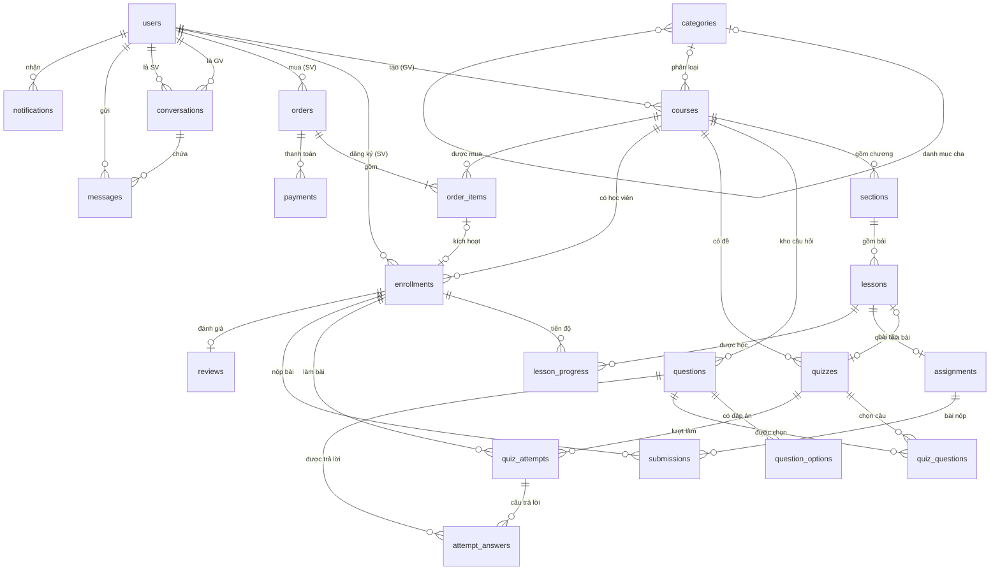
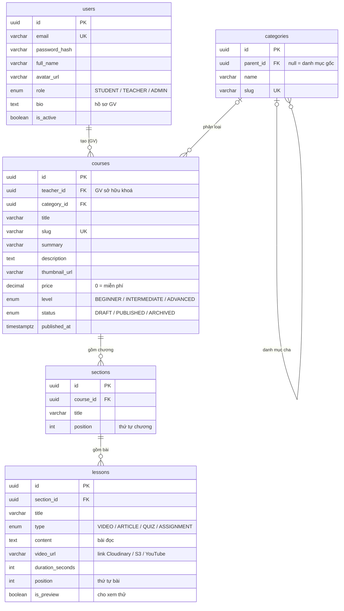
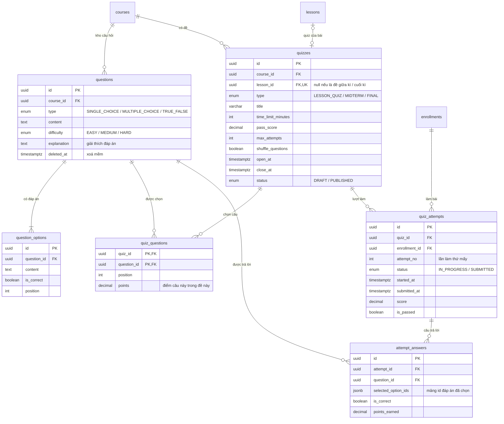
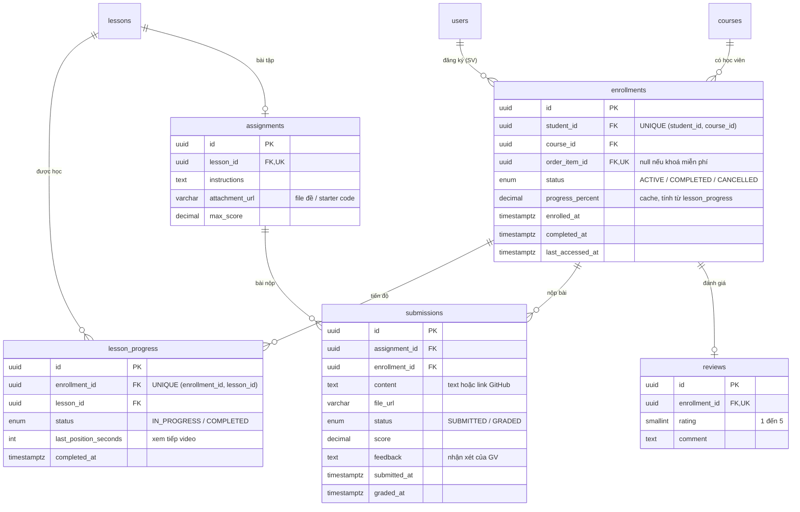
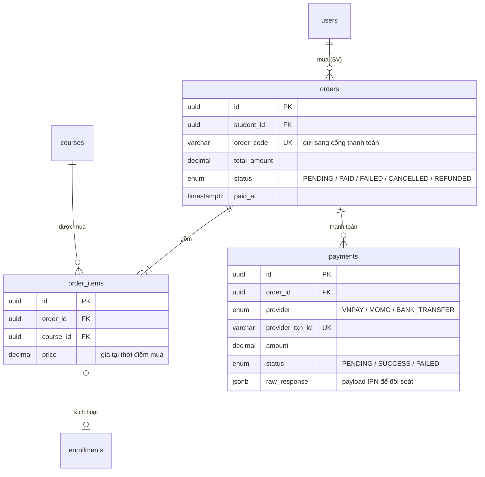
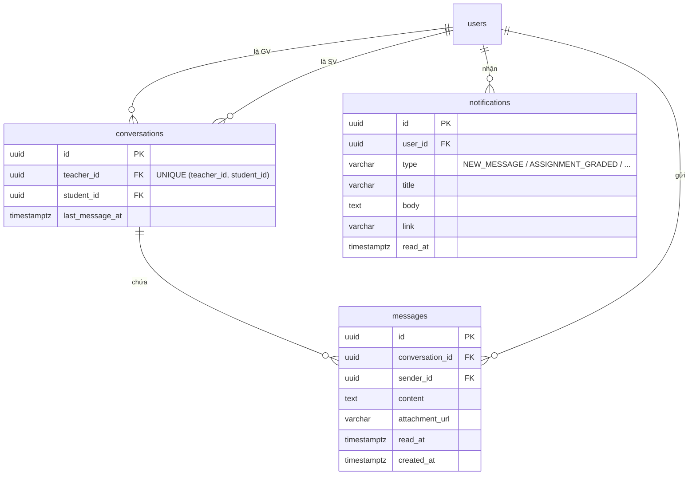

# Thiết kế cơ sở dữ liệu — E-Learning Platform

> Bản gốc (source of truth) là [`schema.dbml`](schema.dbml). File này dùng để đọc nhanh và giải thích **vì sao** thiết kế như vậy.
> Khi sửa schema: sửa `schema.dbml` trước, rồi cập nhật sơ đồ ở đây.

## Cách xem sơ đồ

| Muốn làm gì | Cách làm |
|---|---|
| Xem nhanh trên máy | Mở file này trên GitHub, hoặc VS Code + extension *Markdown Preview Mermaid Support* |
| Lấy ảnh đưa vào báo cáo | Paste `schema.dbml` vào [dbdiagram.io](https://dbdiagram.io) → Export PNG/PDF |
| Sinh SQL tạo bảng | dbdiagram.io → Export → PostgreSQL |

## Quy ước chung

- **CSDL:** PostgreSQL (dữ liệu có nhiều quan hệ và cần ràng buộc chặt → hợp với SQL hơn MongoDB).
- **Khoá chính:** `uuid` — URL kiểu `/courses/3f2a…` không đoán được id kế tiếp.
- **Tên bảng:** `snake_case`, số nhiều. **Tiền:** `decimal`, không dùng `float`.
- Mọi bảng đều có `created_at`, `updated_at` — **đã lược bớt trong các sơ đồ bên dưới cho gọn** (xem đủ trong `schema.dbml`).

---

## 1. Sơ đồ tổng quan (chỉ thể hiện quan hệ)



**Đọc ký hiệu:** `||` = đúng 1 · `|o` = 0 hoặc 1 · `o{` = 0 hoặc nhiều · `|{` = 1 hoặc nhiều.
Ví dụ `users ||--o{ courses`: mỗi khoá học có đúng 1 giảng viên, một giảng viên có 0..n khoá học.

---

## 2. Chi tiết theo nhóm

### 2.1 Người dùng & nội dung khoá học



### 2.2 Ngân hàng câu hỏi & bài kiểm tra



### 2.3 Đăng ký, tiến độ & bài tập thực hành



### 2.4 Bán khoá học



### 2.5 Chat & thông báo



---

## 3. Các quyết định thiết kế quan trọng

### 3.1 `enrollments` là trung tâm của mọi hoạt động học

Tiến độ (`lesson_progress`), lượt làm bài (`quiz_attempts`), bài nộp (`submissions`) và đánh giá (`reviews`) đều gắn với `enrollment_id`, **không** gắn trực tiếp với `student_id`. Lợi ích:

- Không thể có tiến độ / bài làm cho một khoá mà SV chưa đăng ký — ràng buộc nằm ngay trong khoá ngoại.
- Mọi thứ của "SV X trong khoá Y" nằm dưới một dòng `enrollments` → truy vấn tiến độ đơn giản.
- Kiểm tra quyền của GV chỉ cần một phép JOIN `enrollments → courses.teacher_id`.

### 3.2 Quy tắc "GV chỉ thấy SV và khoá học của chính mình"

Quy tắc này **không** cần bảng riêng — nó được đảm bảo bằng cách *mọi truy vấn phía GV đều lọc theo `courses.teacher_id`*, với `teacher_id` lấy từ JWT của người đang đăng nhập (không bao giờ lấy từ query string hay body do client gửi lên).

```sql
-- (1) Danh sách SV đã đăng ký ít nhất 1 khoá của GV đang đăng nhập
SELECT u.id, u.full_name, u.email, COUNT(e.id) AS so_khoa_da_dang_ky
FROM enrollments e
JOIN courses c ON c.id = e.course_id
JOIN users   u ON u.id = e.student_id
WHERE c.teacher_id = :currentTeacherId
GROUP BY u.id, u.full_name, u.email;

-- (2) Các khoá CỦA GV NÀY mà một SV đã đăng ký
--     (khoá của GV khác không bao giờ lọt vào kết quả)
SELECT c.id, c.title, e.progress_percent, e.enrolled_at
FROM enrollments e
JOIN courses c ON c.id = e.course_id
WHERE e.student_id = :studentId
  AND c.teacher_id = :currentTeacherId;
```

Ở API: nếu GV gọi `GET /api/teacher/students/:studentId` mà SV đó không học khoá nào của GV → trả **404** (không trả 403, để không lộ việc SV đó có tồn tại).

### 3.3 Tách kho câu hỏi khỏi đề thi

- `questions` là **kho** câu hỏi của một khoá. `quizzes` là **đề**. Bảng trung gian `quiz_questions` (N–N) cho phép một câu hỏi dùng lại ở nhiều đề (vd: vừa ở quiz chương 2, vừa ở đề cuối kì).
- Điểm của câu hỏi (`points`) đặt ở `quiz_questions`, vì cùng một câu có thể có trọng số khác nhau ở các đề khác nhau.
- Một bảng `quizzes` phục vụ cả 3 loại: quiz sau bài học (`lesson_id` có giá trị), đề giữa kì và đề cuối kì (`lesson_id = null`), phân biệt bằng cột `type`.

### 3.4 Giữ nguyên dữ liệu lịch sử

- `order_items.price` lưu giá **tại thời điểm mua** — GV đổi giá sau đó không làm sai hoá đơn cũ.
- `questions.deleted_at` (xoá mềm): câu hỏi đã có trong bài làm của SV thì không được xoá cứng, nếu không bài làm cũ sẽ bị hỏng. Nên chặn luôn việc sửa đáp án đúng của câu hỏi đã có người làm.
- Khoá học đã có người mua thì chuyển `status = ARCHIVED`, không xoá.

### 3.5 Tiến độ học tập

`progress_percent` trong `enrollments` là giá trị **cache** (phi chuẩn hoá có chủ đích) để trang "Khoá học của tôi" không phải đếm lại mỗi lần tải. Nguồn dữ liệu gốc vẫn là `lesson_progress`. Mỗi khi SV hoàn thành một bài, tính lại:

```sql
UPDATE enrollments e
SET progress_percent = COALESCE((
    SELECT ROUND(100.0 * COUNT(*) FILTER (WHERE lp.status = 'COMPLETED') / NULLIF(COUNT(*), 0), 2)
    FROM lessons l
    JOIN sections s ON s.id = l.section_id
    LEFT JOIN lesson_progress lp ON lp.lesson_id = l.id AND lp.enrollment_id = e.id
    WHERE s.course_id = e.course_id
), 0)
WHERE e.id = :enrollmentId;
```

### 3.6 Chat

- Mỗi cặp (GV, SV) có đúng **một** hội thoại (`UNIQUE (teacher_id, student_id)`), giống Messenger — SV học 3 khoá của cùng một GV vẫn chỉ có một khung chat.
- Chỉ được tạo hội thoại khi SV có ít nhất một `enrollment` (không bị huỷ) trong khoá của GV đó — kiểm tra ở tầng service trước khi `INSERT`.
- Lịch sử tin nhắn lấy qua REST (`GET /conversations/:id/messages?before=…`), tin nhắn realtime đi qua Socket.IO.

---

## 4. User story → bảng dữ liệu

| User story | Bảng liên quan |
|---|---|
| GV tạo khoá học, chương, bài, thêm video | `courses`, `sections`, `lessons` |
| GV tạo kho câu hỏi trắc nghiệm | `questions`, `question_options` |
| GV tạo quiz cho bài học, đề giữa kì / cuối kì | `quizzes`, `quiz_questions` |
| GV tạo bài tập thực hành, chấm và nhận xét | `assignments`, `submissions` |
| GV xem danh sách SV đã đăng ký khoá của mình | `enrollments` JOIN `courses` (lọc theo `teacher_id`) |
| GV và SV nhắn tin | `conversations`, `messages` |
| SV mua / đăng ký khoá học | `orders`, `order_items`, `payments`, `enrollments` |
| SV theo dõi tiến độ tất cả khoá đã đăng ký | `enrollments.progress_percent`, `lesson_progress` |
| SV làm bài kiểm tra, xem điểm | `quiz_attempts`, `attempt_answers` |
| *(bổ sung)* SV tìm khoá theo danh mục | `categories` |
| *(bổ sung)* SV đánh giá khoá học | `reviews` |
| *(bổ sung)* Thông báo khi có tin nhắn / được chấm bài | `notifications` |

## 5. Cố ý chưa đưa vào (để giai đoạn sau)

- **Xác thực nâng cao:** `refresh_tokens`, `password_resets`, xác minh email.
- **Giỏ hàng:** giữ ở frontend (localStorage) cho đến khi cần đồng bộ nhiều thiết bị.
- **Mã giảm giá:** `coupons`, `coupon_usages`.
- **Chứng chỉ hoàn thành:** `certificates`.
- **Sinh đề ngẫu nhiên từ kho** (vd: lấy 20 câu ngẫu nhiên, 30% câu khó): bảng `quiz_rules`.
- **Hỏi đáp dưới mỗi bài học:** `lesson_comments`.
- **Doanh thu / chia tiền cho GV** và vai trò **ADMIN** duyệt khoá học.
