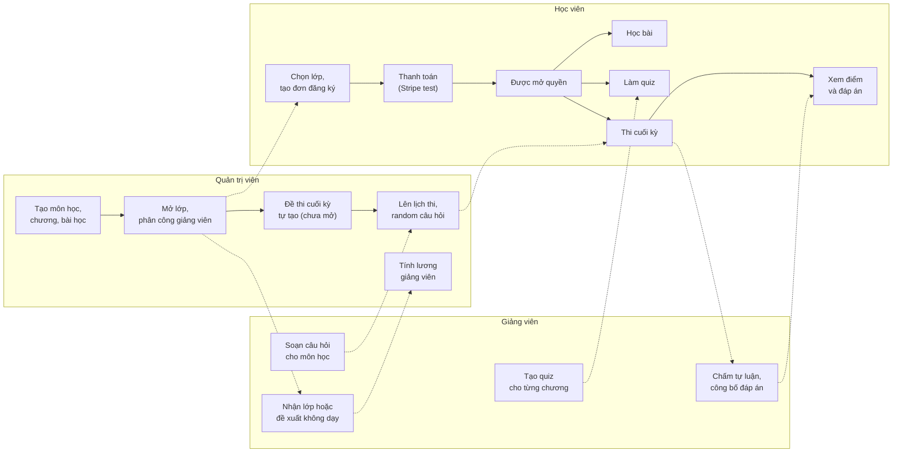
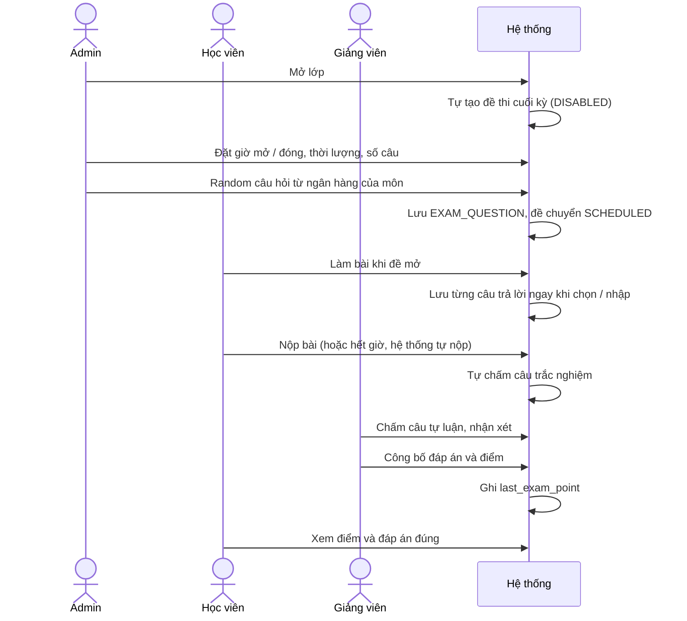

# Đặc tả yêu cầu — Ứng dụng web học trực tuyến (E-Learning)

| Mục | Nội dung |
|---|---|
| Phiên bản | **v1.0 — đã chốt theo câu trả lời Q-01 → Q-26**; 12 điểm còn mở đang dùng phương án mặc định ([mục 9.2](#92-câu-hỏi-còn-mở)) |
| Ngày | 02/11/2026 |
| Sơ đồ CSDL | [`So_do_CSDL.drawio`](../So_do_CSDL.drawio) — ERD v1.0, 27 bảng, ký hiệu chân gà |
| Kế hoạch thực hiện | [PLAN.md](../PLAN.md) |

> **Thay đổi chính so với v0.2**
> - **Admin** tạo môn học, mở lớp, phân công giảng viên, lên lịch và random đề thi, tính lương giảng viên.
> - **COURSE** được hiểu là **môn học** (học phần), không phải "khóa học".
> - Giữ **USER** là bảng cha, **ADMIN / TEACHER / STUDENT** là 3 bảng con riêng (Q-04).
> - Giữ riêng **ENROLLMENT**, **STUDY**, **STUDENT COURSES DETAIL** (Q-12); một lần đăng ký có thể gồm nhiều lớp.
> - Mỗi lớp có **1 đề thi cuối kỳ**, tự tạo khi mở lớp, Admin random câu hỏi từ ngân hàng của môn (Q-18 → Q-20).
> - Câu hỏi có 3 loại: trắc nghiệm 1 đáp án, nhiều đáp án, tự luận; trắc nghiệm tự chấm, tự luận giảng viên chấm (Q-16, Q-21).
> - Thêm **quiz theo chương**, **đề xuất không dạy lớp** (Q-10), **bảng lương** (Q-07), thanh toán qua **Stripe chế độ test** (Q-13).

> **Cách đọc tài liệu**
> - Nội dung không đánh dấu: lấy từ sơ đồ hoặc từ câu trả lời của bạn.
> - **[Đề xuất]**: phần mình bổ sung để hệ thống chạy được.
> - **[Mặc định Q-xx]**: đang dùng phương án mặc định, chờ bạn xác nhận ở [mục 9.2](#92-câu-hỏi-còn-mở).

## Mục lục

1. [Giới thiệu](#1-giới-thiệu)
2. [Thuật ngữ](#2-thuật-ngữ)
3. [Tác nhân](#3-tác-nhân)
4. [Luồng nghiệp vụ chính](#4-luồng-nghiệp-vụ-chính)
5. [Yêu cầu chức năng (user story)](#5-yêu-cầu-chức-năng-user-story)
6. [Quy tắc nghiệp vụ](#6-quy-tắc-nghiệp-vụ)
7. [Yêu cầu phi chức năng](#7-yêu-cầu-phi-chức-năng)
8. [Mô hình dữ liệu](#8-mô-hình-dữ-liệu)
9. [Câu hỏi đã chốt và còn mở](#9-câu-hỏi-đã-chốt-và-còn-mở)
10. [Ngoài phạm vi giai đoạn này](#10-ngoài-phạm-vi-giai-đoạn-này)
11. [Lịch sử thay đổi](#11-lịch-sử-thay-đổi)

---

## 1. Giới thiệu

### 1.1 Mục đích

Xây dựng ứng dụng web học trực tuyến cho một trung tâm đào tạo, gồm ba nhóm người dùng:

- **Quản trị viên (Admin)** tạo môn học, mở lớp và phân công giảng viên, lên lịch và tạo đề thi cuối kỳ, theo dõi thanh toán, tính lương giảng viên.
- **Giảng viên** dạy các lớp được phân công, soạn câu hỏi cho môn mình dạy, tạo quiz cho từng chương, chấm phần tự luận và công bố điểm.
- **Học viên** đăng ký một hoặc nhiều lớp, thanh toán, học bài, làm quiz, thi cuối kỳ và xem kết quả.

### 1.2 Ý tưởng cốt lõi

1. Một **môn học** (COURSE) có nhiều **chương**, mỗi chương có nhiều **bài học**; một môn học được mở thành nhiều **lớp**.
2. **Admin** tạo môn học, mở lớp và phân lớp cho giảng viên; giảng viên được quyền đề xuất không dạy một lớp, Admin duyệt hoặc từ chối.
3. Học viên **đăng ký theo lớp**; một lần đăng ký (đơn đăng ký) có thể gồm nhiều lớp. Thanh toán xong thì được mở quyền vào lớp.
4. Mỗi chương có **1 quiz** trong mỗi lớp; mỗi lớp có **1 đề thi cuối kỳ**.
5. Câu trắc nghiệm hệ thống tự chấm; câu tự luận giảng viên chấm; học viên xem đáp án và điểm sau khi giảng viên công bố.
6. Admin tính lương giảng viên dựa trên hệ số lương, số lớp dạy và số học viên mỗi lớp.

### 1.3 Phạm vi

Gồm 10 nhóm chức năng (epic): tài khoản & phân quyền, môn học & nội dung, lớp học & phân công, đăng ký & thanh toán, học tập & tiến độ, ngân hàng câu hỏi, đề thi cuối kỳ, làm bài & chấm điểm, quiz theo chương, lương & thống kê. Những gì chưa làm nằm ở [mục 10](#10-ngoài-phạm-vi-giai-đoạn-này).

---

## 2. Thuật ngữ

| Thuật ngữ | Bảng | Giải thích |
|---|---|---|
| Người dùng | `USER` | Bảng cha chứa thông tin chung: email, mật khẩu đã băm, tên, vai trò, trạng thái, ngày tạo |
| Vai trò | `ROLE` | Quan hệ chia người dùng thành Admin, Giảng viên, Học viên |
| Quản trị viên | `ADMIN` | Bảng con của `USER` |
| Giảng viên | `TEACHER` | Bảng con của `USER`, có thêm hệ số lương |
| Học viên | `STUDENT` | Bảng con của `USER` |
| Môn học (học phần) | `COURSE` | Nội dung giảng dạy do Admin tạo, ví dụ "Lập trình Python cơ bản" |
| Chương | `SECTION` | Một phần của môn học, chứa nhiều bài học; mỗi chương có 1 quiz trong mỗi lớp |
| Bài học | `LESSON` | Đơn vị nội dung: link video, văn bản, file đính kèm |
| Lớp học | `CLASSES` | Một đợt mở của môn học: giảng viên, học phí, tiền cọc, sĩ số, thời gian học |
| Đơn đăng ký | `ENROLLMENT` | Một lần đăng ký của một học viên, có thể gồm nhiều lớp; chứa tổng học phí, tiền cọc |
| Chi tiết môn học của học viên | `STUDENT COURSES DETAIL` | Mỗi lớp trong một đơn đăng ký: học phí, tiến độ, điểm quá trình, điểm cuối kỳ, trạng thái |
| Tham gia lớp | `STUDY` | Quan hệ học viên ↔ lớp, tạo khi học viên được mở quyền vào lớp |
| Thanh toán | `PAYMENT` | Một giao dịch trả tiền cho một đơn đăng ký (qua Stripe test hoặc giả lập) |
| Tiến độ bài học | `LESSON_PROGRESS` | Bài học mà học viên đã đánh dấu hoàn thành |
| Đề xuất không dạy | `CLASS_DECLINE_REQUEST` | Giảng viên xin không dạy một lớp được phân, kèm lý do; Admin duyệt |
| Bảng lương | `SALARY` | Lương một tháng của một giảng viên |
| Câu hỏi | `QUESTIONS` | Ngân hàng câu hỏi của môn học, do giảng viên soạn |
| Phương án | `QUESTION_OPTION` | Một lựa chọn của câu trắc nghiệm, có đánh dấu đúng/sai |
| Đề thi cuối kỳ | `EXAM` | Đề thi duy nhất của một lớp |
| Câu hỏi trong đề | `EXAM_QUESTION` | Câu hỏi được Admin random vào đề |
| Bài làm | `ANSWER` | Một lần học viên làm đề thi cuối kỳ |
| Trả lời một câu | `ANSWER_DETAIL` | Câu trả lời và điểm của học viên ở một câu |
| Lựa chọn | `ANSWER_CHOICE` | Phương án học viên đã chọn (một câu nhiều đáp án có thể có nhiều dòng) |
| Quiz | `QUIZ`, `QUIZ_QUESTION`, `QUIZ_OPTION` | Bài kiểm tra nhỏ của một chương trong một lớp, có câu hỏi và đáp án riêng |
| Bài làm quiz | `QUIZ_RESULT`, `QUIZ_RESULT_DETAIL` | Bài làm quiz: chọn đáp án, nhập tự luận, nộp file |
| Điểm quá trình | `middle_exam_point` | Trung bình điểm quiz **[Mặc định Q-33]** |
| Điểm cuối kỳ | `last_exam_point` | Điểm bài thi cuối kỳ |

---

## 3. Tác nhân

| Tác nhân | Việc chính |
|---|---|
| Khách | Xem danh mục môn học, lớp đang mở; đăng ký tài khoản học viên |
| Học viên | Đăng ký lớp, thanh toán, học bài, làm quiz, thi cuối kỳ, xem điểm và đáp án |
| Giảng viên | Xem lớp được phân, đề xuất không dạy, soạn câu hỏi cho môn, tạo quiz cho chương, chấm tự luận, công bố đáp án và điểm, xem bảng lương của mình |
| Quản trị viên | Quản lý tài khoản, tạo môn học, mở lớp và phân công giảng viên, duyệt đề xuất không dạy, lên lịch và random đề thi, theo dõi thanh toán, kết thúc / huỷ lớp, tính lương, xem thống kê |

---

## 4. Luồng nghiệp vụ chính

Luồng thi cuối kỳ:

---

## 5. Yêu cầu chức năng (user story)

Mức ưu tiên theo **MoSCoW**: **Must** (bắt buộc), **Should** (nên có), **Could** (có thì tốt).

### E1 — Tài khoản & phân quyền
*Bảng: `USER`, `ADMIN`, `TEACHER`, `STUDENT`*

| Mã | User story | Ưu tiên | Tiêu chí chấp nhận |
|---|---|---|---|
| US-01 | Là **khách**, tôi muốn đăng ký tài khoản học viên bằng email và mật khẩu | Must | Email không trùng; mật khẩu chỉ lưu dạng băm; tạo 1 dòng `USER` (`role = STUDENT`, `status = ACTIVE`) và 1 dòng `STUDENT` cùng `user_id` |
| US-02 | Là **người dùng**, tôi muốn đăng nhập / đăng xuất | Must | Sai thông tin thì báo lỗi chung; tài khoản `LOCKED` không đăng nhập được; đăng nhập xong chuyển về trang chủ theo vai trò |
| US-03 | Là **hệ thống**, tôi muốn mỗi trang và API chỉ cho đúng vai trò truy cập | Must | Ba vai trò Admin / Giảng viên / Học viên; truy cập trái phép bị chặn (403); kiểm tra quyền ở server |
| US-04 | Là **người dùng**, tôi muốn xem và sửa hồ sơ, đổi mật khẩu | Should | Sửa được tên; đổi mật khẩu phải nhập mật khẩu cũ; giảng viên xem được hệ số lương của mình nhưng không tự sửa |
| US-05 | Là **Admin**, tôi muốn quản lý tài khoản | Must | Danh sách, lọc theo vai trò; tạo tài khoản giảng viên (`USER` + `TEACHER` có `salary_coefficient`); sửa hệ số lương; khoá / mở khoá; tài khoản Admin đầu tiên có sẵn trong dữ liệu khởi tạo |
| US-06 | Là **người dùng**, tôi muốn đặt lại mật khẩu khi quên | Could | Gửi link đặt lại qua email; link hết hạn sau một khoảng thời gian |

### E2 — Môn học & nội dung
*Bảng: `COURSE`, `SECTION`, `LESSON`*

| Mã | User story | Ưu tiên | Tiêu chí chấp nhận |
|---|---|---|---|
| US-07 | Là **Admin**, tôi muốn tạo / sửa / ẩn môn học | Must | Có `course_name`, `description`, `course_status` (`DRAFT` / `PUBLISHED` / `ARCHIVED`), `course_date_created` tự ghi, `course_date_end` (ngày ngừng mở lớp mới); ghi `admin_id` người tạo |
| US-08 | Là **Admin**, tôi muốn chia môn học thành các chương | Must | Mỗi chương có `section_name`, `description`, `order_no` **[Mặc định Q-35]** |
| US-09 | Là **Admin**, tôi muốn thêm bài học vào chương | Must | Bài học có `title`, `description`, `video_url` (YouTube / Drive), `content` (văn bản), `attachment_url` (file đính kèm), `order_no`; có thể kết hợp nhiều loại nội dung **[Mặc định Q-35]** |
| US-10 | Là **khách / học viên**, tôi muốn xem danh mục môn học và tìm theo tên | Must | Chỉ hiện môn `PUBLISHED`; tìm theo tên; phân trang |
| US-11 | Là **khách / học viên**, tôi muốn xem chi tiết môn học | Must | Hiện mô tả, danh sách chương và tên bài học, các lớp đang nhận đăng ký (giảng viên, học phí, tiền cọc, ngày khai giảng, số chỗ còn lại); chưa được mở quyền thì không xem được nội dung bài học |

### E3 — Lớp học & phân công
*Bảng: `CLASSES`, `CLASS_DECLINE_REQUEST`*

| Mã | User story | Ưu tiên | Tiêu chí chấp nhận |
|---|---|---|---|
| US-12 | Là **Admin**, tôi muốn mở lớp cho một môn học và phân công giảng viên | Must | Lớp có môn học, giảng viên, `class_name`, `tuition_fee`, `deposit_amount`, `min_students`, `max_students`, `start_date`, `end_date`; trạng thái ban đầu `UPCOMING`; mỗi lớp có đúng 1 giảng viên; hệ thống tự tạo đề thi cuối kỳ ở trạng thái `DISABLED` (US-29) |
| US-13 | Là **giảng viên**, tôi muốn xem các lớp được phân công và học viên trong lớp | Must | Danh sách lớp kèm môn học, thời gian, sĩ số; danh sách học viên kèm trạng thái đăng ký và thanh toán |
| US-14 | Là **giảng viên**, tôi muốn đề xuất không dạy một lớp được phân | Should | Nhập lý do (bắt buộc); tạo `CLASS_DECLINE_REQUEST` trạng thái `PENDING`; chỉ gửi được khi lớp chưa kết thúc; mỗi lớp chỉ có 1 đề xuất đang chờ |
| US-15 | Là **Admin**, tôi muốn duyệt hoặc từ chối đề xuất không dạy | Should | Ghi `admin_id`, `reviewed_at`, trạng thái `APPROVED` / `REJECTED`; nếu duyệt thì Admin phải chọn giảng viên khác cho lớp; nếu từ chối thì giảng viên tiếp tục dạy; giảng viên thấy kết quả |
| US-16 | Là **Admin**, tôi muốn mở lớp khi đủ sĩ số tối thiểu, hoãn / huỷ khi không đủ, và kết thúc lớp | Must | Đủ `min_students` học viên đã thanh toán thì chuyển `ONGOING`; không đủ đến ngày khai giảng thì Admin hoãn (dời `start_date`) hoặc huỷ (`CANCELLED`, hoàn tiền) **[Mặc định Q-32]**; hết `end_date` thì chuyển `FINISHED`, học viên chỉ xem lại |

### E4 — Đăng ký & thanh toán
*Bảng: `ENROLLMENT`, `STUDENT COURSES DETAIL`, `STUDY`, `PAYMENT`*

| Mã | User story | Ưu tiên | Tiêu chí chấp nhận |
|---|---|---|---|
| US-17 | Là **học viên**, tôi muốn chọn một hoặc nhiều lớp và tạo một đơn đăng ký | Must | Tạo 1 `ENROLLMENT` (`tuition` = tổng học phí, `deposit` = tổng tiền cọc, `status = PENDING_PAYMENT`, `date_course_enroll`); mỗi lớp tạo 1 dòng `STUDENT COURSES DETAIL` (lưu `tuition_fee` của lớp lúc đăng ký, `status = PENDING`); không đăng ký trùng lớp đã đăng ký; chỉ đăng ký lớp `UPCOMING` còn chỗ **[Mặc định Q-36]** |
| US-18 | Là **học viên**, tôi muốn thanh toán đơn đăng ký | Must | Thanh toán qua Stripe chế độ test; khi chạy không có Stripe thì dùng nút "Thanh toán giả lập"; mỗi giao dịch tạo 1 `PAYMENT` (`amount`, `payment_type`, `method`, `transaction_code`, `status`, `paid_at`); chọn trả cọc hoặc trả đủ **[Mặc định Q-27]** |
| US-19 | Là **hệ thống**, tôi muốn kích hoạt đơn sau khi thanh toán thành công | Must | `ENROLLMENT` chuyển `DEPOSITED` hoặc `PAID`; các dòng `STUDENT COURSES DETAIL` chuyển `STUDYING`; thêm `STUDY` (học viên, lớp); từ đó học viên được vào bài học, quiz, đề thi của lớp |
| US-20 | Là **học viên**, tôi muốn huỷ đơn khi chưa thanh toán | Should | Chỉ huỷ khi chưa có `PAYMENT` thành công; đơn và các dòng chi tiết chuyển `CANCELLED` |
| US-21 | Là **học viên**, tôi muốn xem lịch sử đơn đăng ký và thanh toán | Should | Liệt kê đơn, các lớp trong đơn, số tiền đã trả, còn thiếu, trạng thái |
| US-22 | Là **Admin**, tôi muốn theo dõi thanh toán | Should | Danh sách giao dịch, lọc theo trạng thái; xác nhận thủ công giao dịch giả lập; hoàn tiền khi huỷ lớp |

### E5 — Học tập & tiến độ
*Bảng: `STUDENT COURSES DETAIL`, `LESSON_PROGRESS`*

| Mã | User story | Ưu tiên | Tiêu chí chấp nhận |
|---|---|---|---|
| US-23 | Là **học viên**, tôi muốn xem "Môn học của tôi" | Must | Đọc từ `STUDENT COURSES DETAIL`: các môn đã học và đang học, lớp, giảng viên, trạng thái, tiến độ (`course_process`), điểm quá trình, điểm cuối kỳ |
| US-24 | Là **học viên**, tôi muốn học bài và đánh dấu đã hoàn thành | Must | Mở bài học theo thứ tự chương; nút "Hoàn thành" tạo `LESSON_PROGRESS`; `course_process` = số bài đã hoàn thành / tổng số bài của môn (%) **[Mặc định Q-28]** |
| US-25 | Là **giảng viên**, tôi muốn xem tiến độ học của học viên trong lớp | Should | Bảng học viên × tiến độ, sắp xếp được |

### E6 — Ngân hàng câu hỏi
*Bảng: `QUESTIONS`, `QUESTION_OPTION`*

| Mã | User story | Ưu tiên | Tiêu chí chấp nhận |
|---|---|---|---|
| US-26 | Là **giảng viên**, tôi muốn soạn câu hỏi cho môn học mình dạy | Must | Câu hỏi thuộc một môn học (`course_id`), ghi người soạn (`teacher_id`); `question_type` = 1 đáp án / nhiều đáp án / tự luận; `description` là nội dung; ẩn được (`status`); chỉ soạn cho môn có lớp mình được phân |
| US-27 | Là **giảng viên**, tôi muốn nhập phương án và đáp án đúng cho câu trắc nghiệm | Must | Tối thiểu 2 phương án; câu 1 đáp án có **đúng 1** phương án đúng; câu nhiều đáp án có **ít nhất 1** phương án đúng; câu tự luận không có phương án |
| US-28 | Là **giảng viên**, tôi muốn nhập hàng loạt câu hỏi từ file Excel/CSV | Could | Có file mẫu; báo lỗi theo từng dòng |

### E7 — Đề thi cuối kỳ
*Bảng: `EXAM`, `EXAM_QUESTION`*

| Mã | User story | Ưu tiên | Tiêu chí chấp nhận |
|---|---|---|---|
| US-29 | Là **hệ thống**, tôi muốn tự tạo đề thi cuối kỳ khi mở lớp | Must | Mỗi lớp có đúng 1 `EXAM` (`class_id` không trùng), trạng thái `DISABLED`, học viên chưa thấy |
| US-30 | Là **Admin**, tôi muốn lên lịch thi | Must | Nhập `exam_name`, `description`, `open_at`, `close_at`, `duration_minutes`, `max_attempts` (mặc định 1); giờ mở trước giờ đóng và nằm trong thời gian học của lớp; đề chuyển `SCHEDULED` |
| US-31 | Là **Admin**, tôi muốn random câu hỏi từ ngân hàng của môn để tạo đề | Must | Chọn số câu mỗi loại; hệ thống lấy ngẫu nhiên câu `ACTIVE` của môn, không trùng; lưu `EXAM_QUESTION`; điểm chia đều cho các câu; random lại được trước giờ mở đề, sau đó khoá **[Mặc định Q-34]** |
| US-32 | Là **Admin / giảng viên**, tôi muốn xem trước đề thi | Should | Xem đề kèm đáp án đúng; học viên không xem được |

### E8 — Làm bài & chấm điểm
*Bảng: `ANSWER`, `ANSWER_DETAIL`, `ANSWER_CHOICE`*

| Mã | User story | Ưu tiên | Tiêu chí chấp nhận |
|---|---|---|---|
| US-33 | Là **học viên**, tôi muốn xem đề thi cuối kỳ của lớp | Must | Chỉ hiện khi đã được mở quyền; hiện trạng thái: Chưa mở / Đang mở / Đã đóng / Đã làm / Đã có điểm |
| US-34 | Là **học viên**, tôi muốn làm bài và nộp bài | Must | Tạo `ANSWER` (`attempt_no` ≤ `max_attempts`); câu 1 đáp án dùng radio, nhiều đáp án dùng checkbox, tự luận dùng ô nhập; lưu ngay vào `ANSWER_DETAIL` / `ANSWER_CHOICE`; tải lại trang vẫn giữ bài; hết giờ thì tự nộp; phải đóng đủ học phí mới được thi **[Mặc định Q-27]** |
| US-35 | Là **hệ thống**, tôi muốn tự chấm câu trắc nghiệm khi nộp bài | Must | Câu 1 đáp án đúng khi chọn đúng phương án đúng; câu nhiều đáp án đúng khi chọn đủ mọi phương án đúng và không chọn sai **[Mặc định Q-37]**; ghi `is_correct`, `point_earned`; còn câu tự luận thì bài ở `SUBMITTED` (chờ chấm), không còn thì `GRADED` |
| US-36 | Là **giảng viên**, tôi muốn chấm câu tự luận | Must | Nhập `point_earned` (≤ điểm của câu) và `teacher_comment`; ghi `graded_by`, `graded_at`; chấm xong mọi câu thì bài chuyển `GRADED`, `score` = tổng `point_earned` |
| US-37 | Là **giảng viên**, tôi muốn công bố đáp án và điểm | Must | Chỉ công bố khi mọi bài đã `GRADED`; ghi `answers_published_at`; trước đó học viên không xem được điểm và đáp án |
| US-38 | Là **hệ thống**, tôi muốn ghi điểm cuối kỳ vào hồ sơ học viên | Must | Khi công bố, ghi `last_exam_point` vào `STUDENT COURSES DETAIL` (lấy lần làm có điểm cao nhất nếu làm nhiều lần) |
| US-39 | Là **giảng viên**, tôi muốn xem bảng điểm của lớp | Should | Điểm quá trình, điểm cuối kỳ; mở được chi tiết bài làm từng học viên |
| US-40 | Là **giảng viên**, tôi muốn xuất bảng điểm ra Excel | Could | File gồm tên học viên, email, điểm quá trình, điểm cuối kỳ |

### E9 — Quiz theo chương
*Bảng: `QUIZ`, `QUIZ_QUESTION`, `QUIZ_OPTION`, `QUIZ_RESULT`, `QUIZ_RESULT_DETAIL`*

| Mã | User story | Ưu tiên | Tiêu chí chấp nhận |
|---|---|---|---|
| US-41 | Là **giảng viên**, tôi muốn tạo quiz cho từng chương của lớp tôi dạy | Must | Mỗi chương có đúng 1 quiz trong mỗi lớp (`UQ(class_id, section_id)`); câu hỏi nằm ngay trong quiz (`QUIZ_QUESTION`), loại trắc nghiệm hoặc tự luận; câu trắc nghiệm có các đáp án (`QUIZ_OPTION`, đúng 1 đáp án đúng); có `time_limit`, `point` mỗi câu |
| US-42 | Là **học viên**, tôi muốn làm quiz | Must | Chỉ khi đã được mở quyền vào lớp; câu trắc nghiệm chọn đáp án, câu tự luận nhập ô trả lời hoặc nộp file; mỗi quiz làm 1 lần **[Mặc định Q-38]** |
| US-43 | Là **hệ thống / giảng viên**, tôi muốn chấm quiz | Must | Hệ thống tự chấm câu trắc nghiệm; giảng viên chấm câu tự luận và file nộp (`point_earned`, `teacher_comment`); `score` = tổng `point_earned` |
| US-44 | Là **học viên**, tôi muốn xem điểm quiz | Must | Điểm câu trắc nghiệm hiện ngay sau khi nộp; điểm tự luận hiện sau khi giảng viên chấm; điểm quá trình = trung bình điểm quiz **[Mặc định Q-33, Q-38]** |

### E10 — Lương & thống kê
*Bảng: `SALARY`, `TEACHER`*

| Mã | User story | Ưu tiên | Tiêu chí chấp nhận |
|---|---|---|---|
| US-45 | Là **Admin**, tôi muốn tính lương tháng cho giảng viên | Must | Lấy `salary_coefficient`, số lớp đang dạy trong tháng, số học viên mỗi lớp; tính theo công thức **[Mặc định Q-31]**; lưu `SALARY` (giữ lại các số đã dùng để tính) trạng thái `DRAFT` |
| US-46 | Là **Admin**, tôi muốn duyệt bảng lương và đánh dấu đã trả | Should | `DRAFT` → `APPROVED` → `PAID`; đã duyệt thì không tính lại |
| US-47 | Là **giảng viên**, tôi muốn xem bảng lương của mình | Should | Chỉ thấy bảng lương đã duyệt của chính mình, có chi tiết cách tính |
| US-48 | Là **Admin**, tôi muốn xem bảng tổng quan hệ thống | Should | Số người dùng theo vai trò, số môn học, lớp đang mở, số đơn đăng ký, tổng tiền đã thu, tổng lương tháng |
| US-49 | Là **giảng viên**, tôi muốn xem bảng tổng quan của mình | Could | Lớp đang dạy, số học viên, bài chờ chấm, quiz và đề thi sắp tới |

**Tổng cộng: 49 user story** (Must: 33 · Should: 12 · Could: 4).

---

## 6. Quy tắc nghiệp vụ

### 6.1 Từ sơ đồ và câu trả lời của bạn

| Mã | Quy tắc | Nguồn |
|---|---|---|
| BR-01 | Một môn học có nhiều chương, mỗi chương có nhiều bài học; một môn học được mở thành nhiều lớp | Sơ đồ |
| BR-02 | `USER` là bảng cha; mỗi người dùng thuộc đúng một trong ba bảng con `ADMIN`, `TEACHER`, `STUDENT` (cùng `user_id`); bảng con dùng chung các cột của `USER` và có thể có cột riêng | Q-04, Q-06 |
| BR-03 | Email của mỗi tài khoản là duy nhất | Sơ đồ |
| BR-04 | Học viên tự đăng ký tài khoản; Admin tạo tài khoản giảng viên; Admin đầu tiên có sẵn khi khởi tạo | Q-05 |
| BR-05 | Admin tạo môn học, mở lớp và phân công giảng viên | Q-01, Q-08, Q-09 |
| BR-06 | Mỗi lớp có đúng một giảng viên; giảng viên có thể đề xuất không dạy lớp được phân (có lý do), Admin duyệt hoặc từ chối | Q-10 |
| BR-07 | Học phí và tiền cọc đặt ở lớp; đơn đăng ký lưu lại số tiền thực tế | Q-11 |
| BR-08 | Lớp có sĩ số tối đa (hết chỗ thì không nhận đăng ký) và sĩ số tối thiểu (chưa đủ thì chưa được mở lớp) | Q-11 |
| BR-09 | `ENROLLMENT` là một lần đăng ký của một học viên, có thể gồm nhiều lớp; `STUDENT COURSES DETAIL` lưu từng lớp trong đơn; `STUDY` là quan hệ học viên ↔ lớp | Q-12 |
| BR-10 | Thanh toán thành công thì học viên được mở quyền vào lớp: bài học, quiz, đề thi | Sơ đồ, Q-13 |
| BR-11 | Câu hỏi thuộc môn học, do giảng viên soạn; có 3 loại: trắc nghiệm 1 đáp án, trắc nghiệm nhiều đáp án, tự luận | Q-16, Q-17 |
| BR-12 | Mỗi lớp có đúng 1 đề thi cuối kỳ, được tạo sẵn khi mở lớp ở trạng thái chưa mở; Admin định ngày thi trước | Q-19, Q-20 |
| BR-13 | Admin random câu hỏi từ ngân hàng của môn để tạo đề; mọi học viên trong lớp làm cùng một đề | Q-02, Q-18 |
| BR-14 | Điểm của đề chia đều cho các câu | Q-19 |
| BR-15 | Câu trắc nghiệm hệ thống tự chấm; câu tự luận giảng viên chấm | Q-21 |
| BR-16 | Học viên chỉ xem được đáp án đúng và điểm sau khi giảng viên chấm xong và công bố | Q-22 |
| BR-17 | Mỗi chương có 1 quiz trong mỗi lớp; câu hỏi và đáp án quiz thuộc riêng quiz đó | Yêu cầu bổ sung ngày 23/10 |
| BR-18 | Admin tính lương giảng viên dựa trên hệ số lương, số lớp dạy, số học viên mỗi lớp | Q-07 |

### 6.2 Đề xuất bổ sung

| Mã | Quy tắc | Lý do |
|---|---|---|
| BR-19 | Không xoá hẳn dữ liệu đã có lịch sử (môn học đã có lớp, lớp đã có học viên, câu hỏi đã có bài làm); dùng trạng thái để ẩn | Giữ toàn vẹn bài làm và báo cáo |
| BR-20 | Giảng viên chỉ thao tác trên lớp mình được phân công và câu hỏi của môn mình dạy | Bảo mật |
| BR-21 | Mỗi học viên chỉ có một đăng ký còn hiệu lực cho mỗi lớp (`UQ(student_id, class_id)`) | Tránh đăng ký, thanh toán trùng |
| BR-22 | Câu nhiều đáp án chỉ được điểm khi chọn đủ mọi phương án đúng và không chọn sai **[Mặc định Q-37]** | Cách chấm rõ ràng |
| BR-23 | Câu hỏi đã nằm trong bài làm thì không sửa được nội dung và đáp án; muốn sửa thì nhân bản thành câu mới **[Mặc định Q-29]** | Bài làm cũ không bị đổi nghĩa |
| BR-24 | Đáp án đúng không được gửi về trình duyệt khi học viên đang làm bài | Chống xem đáp án bằng công cụ trình duyệt |
| BR-25 | Mọi mốc thời gian (mở đề, nộp bài, hết giờ, thanh toán) lấy theo giờ server | Chống chỉnh giờ máy |

---

## 7. Yêu cầu phi chức năng

| Mã | Nhóm | Yêu cầu |
|---|---|---|
| NFR-01 | Bảo mật | Mật khẩu băm bằng bcrypt; phiên đăng nhập trong cookie HttpOnly; mọi API kiểm tra quyền ở server; chống SQL injection, XSS, CSRF ở mức cơ bản |
| NFR-02 | Thanh toán | Chỉ dùng khoá Stripe chế độ test, lưu trong biến môi trường, không đưa vào mã nguồn; xác nhận thanh toán qua webhook có kiểm tra chữ ký |
| NFR-03 | Toàn vẹn dữ liệu | Kích hoạt đơn đăng ký, nộp bài, chấm điểm, tính lương chạy trong transaction |
| NFR-04 | Tin cậy | Câu trả lời được lưu ngay; mất mạng hoặc tải lại trang vẫn làm tiếp được bài đang làm |
| NFR-05 | File tải lên | File đính kèm bài học và file nộp quiz tối đa 10 MB, chỉ nhận định dạng cho phép (pdf, docx, pptx, zip, png, jpg); chỉ người có quyền mới tải về được |
| NFR-06 | Hiệu năng | Trang thông thường tải dưới 2 giây; chịu được khoảng 100 học viên cùng làm một đề **[giả định quy mô đồ án]** |
| NFR-07 | Dễ dùng | Giao diện tiếng Việt; hiển thị tốt trên máy tính và điện thoại; thông báo lỗi dễ hiểu |
| NFR-08 | Bảo trì | Có test tự động cho phân quyền, đăng ký – thanh toán, random đề, chấm điểm, tính lương; thay đổi CSDL qua migration; có dữ liệu mẫu để demo |
| NFR-09 | Triển khai | Chạy ở máy cá nhân bằng Docker Compose; có bản demo online theo công nghệ trong PLAN.md (Q-24) |

---

## 8. Mô hình dữ liệu

Sơ đồ đầy đủ: [`So_do_CSDL.drawio`](../So_do_CSDL.drawio). Kiểu dữ liệu và ràng buộc chi tiết sẽ viết trong `docs/database/` (việc T-0.8 trong PLAN.md).

### 8.1 Danh sách bảng

| Nhóm | Bảng | Cột chính |
|---|---|---|
| Người dùng | `USER` | `user_id` PK, `email` UQ, `hashed_pwd`, `name`, `role`, `status`, `date_created` |
| | `ADMIN` | `user_id` PK, FK → `USER` |
| | `TEACHER` | `user_id` PK, FK → `USER`; `salary_coefficient` |
| | `STUDENT` | `user_id` PK, FK → `USER` |
| Môn học | `COURSE` | `course_id`; `admin_id` FK; `course_name`, `description`, `course_status`, `course_date_created`, `course_date_end` |
| | `SECTION` | `section_id`; `course_id` FK; `section_name`, `description`, `order_no` |
| | `LESSON` | `lesson_id`; `section_id` FK; `title`, `description`, `video_url`, `content`, `attachment_url`, `order_no` |
| Lớp & phân công | `CLASSES` | `class_id`; `course_id`, `teacher_id`, `admin_id` FK; `class_name`, `status`, `tuition_fee`, `deposit_amount`, `min_students`, `max_students`, `start_date`, `end_date`, `date_class_created` |
| | `CLASS_DECLINE_REQUEST` | `request_id`; `class_id`, `teacher_id`, `admin_id` (người duyệt) FK; `reason`, `status`, `created_at`, `reviewed_at` |
| | `SALARY` | `salary_id`; `teacher_id`, `admin_id` FK; `month`, `salary_coefficient`, `class_count`, `student_count`, `total_amount`, `status`, `date_created` |
| Đăng ký & học tập | `ENROLLMENT` | `enrollment_id`; `student_id` FK; `tuition`, `deposit`, `status`, `date_course_enroll` |
| | `STUDENT COURSES DETAIL` | `st_course_id`; `enrollment_id`, `student_id`, `class_id` FK; `tuition_fee`, `course_process`, `middle_exam_point`, `last_exam_point`, `status`; `UQ(student_id, class_id)` |
| | `STUDY` | `student_id` + `class_id` (khoá chính kép, đều là FK) |
| | `PAYMENT` | `payment_id`; `enrollment_id` FK; `amount`, `payment_type`, `method`, `transaction_code`, `status`, `paid_at`, `description` |
| | `LESSON_PROGRESS` | `progress_id`; `st_course_id`, `lesson_id` FK; `completed_at`; `UQ(st_course_id, lesson_id)` |
| Câu hỏi & thi | `QUESTIONS` | `question_id`; `course_id`, `teacher_id` FK; `question_type`, `description`, `status`, `date_question_created` |
| | `QUESTION_OPTION` | `option_id`; `question_id` FK; `content`, `is_correct`, `order_no` |
| | `EXAM` | `exam_id`; `class_id` FK (UQ), `admin_id` FK; `exam_name`, `description`, `question_count`, `duration_minutes`, `open_at`, `close_at`, `max_attempts`, `status`, `answers_published_at`, `date_created` |
| | `EXAM_QUESTION` | `exam_question_id`; `exam_id`, `question_id` FK; `order_no`; `UQ(exam_id, question_id)` |
| | `ANSWER` | `answer_id`; `exam_id`, `student_id`, `graded_by` (giảng viên) FK; `attempt_no`, `score`, `status`, `started_at`, `submitted_at`, `graded_at` |
| | `ANSWER_DETAIL` | `answer_detail_id`; `answer_id`, `question_id` FK; `answer_text`, `is_correct`, `point_earned`, `teacher_comment` |
| | `ANSWER_CHOICE` | `answer_detail_id` + `option_id` (khoá chính kép, đều là FK) |
| Quiz | `QUIZ` | `quiz_id`; `class_id`, `section_id` FK; `title`, `time_limit`, `status`, `date_created`; `UQ(class_id, section_id)` |
| | `QUIZ_QUESTION` | `quiz_question_id`; `quiz_id` FK; `question_type`, `content`, `order_no`, `point` |
| | `QUIZ_OPTION` | `option_id`; `quiz_question_id` FK; `content`, `is_correct`, `order_no` |
| | `QUIZ_RESULT` | `result_id`; `quiz_id`, `student_id` FK; `score`, `status`, `started_at`, `submitted_at`, `graded_at` |
| | `QUIZ_RESULT_DETAIL` | `detail_id`; `result_id`, `quiz_question_id`, `chosen_option_id` FK; `answer_text`, `file_url`, `is_correct`, `point_earned`, `teacher_comment` |

### 8.2 Giá trị trạng thái **[Đề xuất]**

| Bảng.cột | Giá trị |
|---|---|
| `USER.role` | `ADMIN`, `TEACHER`, `STUDENT` |
| `USER.status` | `ACTIVE`, `LOCKED` |
| `COURSE.course_status` | `DRAFT` (nháp), `PUBLISHED` (đang mở), `ARCHIVED` (ngừng) |
| `CLASSES.status` | `UPCOMING` (nhận đăng ký), `ONGOING` (đang học), `FINISHED`, `CANCELLED` |
| `CLASS_DECLINE_REQUEST.status` | `PENDING`, `APPROVED`, `REJECTED` |
| `ENROLLMENT.status` | `PENDING_PAYMENT`, `DEPOSITED` (đã cọc), `PAID` (đã đủ), `CANCELLED` |
| `STUDENT COURSES DETAIL.status` | `PENDING`, `STUDYING`, `COMPLETED`, `CANCELLED` |
| `PAYMENT.payment_type` | `DEPOSIT` (cọc), `REMAINDER` (phần còn lại), `FULL` (trả đủ), `REFUND` (hoàn tiền) |
| `PAYMENT.method` / `status` | `STRIPE`, `SIMULATED` / `PENDING`, `SUCCEEDED`, `FAILED` |
| `QUESTIONS.question_type` | `SINGLE` (1 đáp án), `MULTIPLE` (nhiều đáp án), `ESSAY` (tự luận) |
| `QUESTIONS.status` | `ACTIVE`, `HIDDEN` |
| `EXAM.status` | `DISABLED` (vừa tạo), `SCHEDULED` (đã lên lịch), `OPEN`, `CLOSED` |
| `ANSWER.status`, `QUIZ_RESULT.status` | `IN_PROGRESS`, `SUBMITTED` (chờ chấm tự luận), `GRADED` |
| `QUIZ.status` | `DRAFT`, `OPEN`, `CLOSED` |
| `QUIZ_QUESTION.question_type` | `SINGLE`, `ESSAY` |
| `SALARY.status` | `DRAFT`, `APPROVED`, `PAID` |

### 8.3 Thay đổi so với sơ đồ đề xuất ngày 23/10 (`So_do_CSDL_de_xuat.drawio`)

| Thay đổi | Lý do |
|---|---|
| `ADMIN`, `TEACHER`, `STUDENT` giữ là bảng riêng nhưng chỉ còn `user_id` (PK, FK) và cột riêng; bỏ các cột chép lại của `USER` | Q-04, Q-06 |
| `TEACHER` thêm `salary_coefficient` | Q-07 |
| `STUDENT COURSES DETAIL` được khôi phục, nối với `ENROLLMENT`, `STUDENT`, `CLASSES`; các thuộc tính tiến độ và điểm chuyển từ quan hệ `PARTICIPATE` về bảng này | Q-12 |
| `PARTICIPATE` đổi lại thành `STUDY`, vẽ thành bảng chỉ có `student_id`, `class_id` | Q-12 |
| `ENROLLMENT` bỏ `class_id`, `course_id`, `date_class_end` vì một đơn có thể gồm nhiều lớp | Q-12, D-05 |
| `CLASSES` thêm `admin_id`, học phí, tiền cọc, sĩ số tối thiểu / tối đa, ngày khai giảng, ngày kết thúc | Q-09, Q-11, D-05 |
| `EXAM` gắn với lớp (`class_id` không trùng) và Admin (`admin_id`), bỏ `teacher_id`; thêm thông tin lịch thi và công bố đáp án | Q-18 → Q-20, Q-22 |
| `TEACHER` — `ANSWER` là quan hệ giảng viên chấm bài (`graded_by`) | Q-21, D-13 |
| Bảng mới: `CLASS_DECLINE_REQUEST`, `SALARY`, `LESSON_PROGRESS`, `QUESTION_OPTION`, `ANSWER_CHOICE` | Q-10, Q-07, Q-15, Q-16 |
| Toàn bộ quan hệ vẽ bằng ký hiệu chân gà, bỏ các nhãn `1...n` | D-18 |
| Cụm QUIZ giữ nguyên như bản ngày 23/10 | — |

### 8.4 Cách xử lý các điểm D-01 → D-19

| Mã | Kết quả |
|---|---|
| D-01 | **Không áp dụng** theo đề xuất ban đầu (gộp một bảng); làm theo Q-04: giữ 4 bảng, bảng con chỉ chứa khoá và cột riêng |
| D-02 | Áp dụng: `COURSE` là bảng môn học; `course_date_end` = ngày ngừng mở lớp mới |
| D-03 | **Không gộp** theo Q-12; chỉ bỏ các cột chép lại thông tin môn học khỏi `STUDENT COURSES DETAIL` |
| D-04 | Áp dụng: bỏ `CLASSES.student_id` |
| D-05 | Áp dụng: `CLASSES` có `start_date`, `end_date`, `date_class_created`; bỏ `ngay_ket_thuc`; bỏ cột lặp ở `ENROLLMENT` |
| D-06 | Áp dụng: nhãn "dạy" (giảng viên) và "tạo, phân công" (Admin) |
| D-07 | Bỏ qua: ghi chú đã xoá; "học phần" là `COURSE` (Q-03) |
| D-08 | Áp dụng: `EXAM.class_id`; môn học của đề suy ra từ lớp |
| D-09 | Áp dụng: thêm thông tin đề thi |
| D-10 | Áp dụng: `question_type` và bảng `QUESTION_OPTION` |
| D-11 | Áp dụng: `ANSWER_DETAIL` có `answer_id`, `question_id`, câu trả lời, đúng/sai, điểm, nhận xét; thêm `ANSWER_CHOICE` cho câu nhiều đáp án |
| D-12 | Áp dụng: `ANSWER` có `attempt_no`, `score`, `status`, các mốc thời gian |
| D-13 | Áp dụng: giảng viên chấm bài (Q-21) |
| D-14 | Áp dụng: `PAYMENT` có số tiền, loại, phương thức, mã giao dịch, trạng thái, thời điểm; một đơn có nhiều lần thanh toán |
| D-15 | Áp dụng: `LESSON` có tiêu đề, nội dung, thứ tự; `SECTION` có thứ tự |
| D-16 | Áp dụng: bảng `LESSON_PROGRESS` **[Mặc định Q-28]** |
| D-17 | Áp dụng: mọi khoá ngoại đều có đường nối |
| D-18 | Áp dụng: ký hiệu chân gà |
| D-19 | Áp dụng một phần: đổi `exam_question` thành `exam_question_id`, bỏ `ngay_ket_thuc`; giữ `course_process`, `st_course_id` như bạn đặt để dễ đối chiếu |

---

## 9. Câu hỏi đã chốt và còn mở

### 9.1 Đã chốt (Q-01 → Q-26)

| Mã | Câu hỏi | Câu trả lời của bạn | Áp dụng trong v1.0 |
|---|---|---|---|
| Q-01 | Có vai trò Quản trị viên không? | Có vai trò **Quản trị viên**, cần **Quản trị viên** để phân lớp dạy cho giáo viên | Thêm `ADMIN`; BR-05 |
| Q-02 | Bỏ ngân hàng câu hỏi, random đề cho từng học viên, snapshot của trang 2? | Theo đề xuất, chỉ làm theo trang 1 | Đề cố định cho cả lớp; BR-13 |
| Q-03 | "Học phần" có phải `SECTION`? | Không, học phần là dịch từ từ ngữ "COURSE" trong 2 bảng STUDENT COURSE DETAIL & TEACHER COURSE DETAIL và phần ghi chú đó bạn không cần quan tâm đâu vì mình đã xoá đi rồi | `COURSE` = môn học (học phần); `SECTION` = chương |
| Q-04 | Một bảng người dùng hay bốn bảng? | 4 bảng này riêng biệt để phân chia rõ ràng và chi tiết, USER sẽ như bảng cha kết nối với 3 bảng còn lại qua quan hệ ROLE | BR-02 |
| Q-05 | Tài khoản được tạo thế nào? | Theo đề xuất của bạn | BR-04, US-01, US-05 |
| Q-06 | Giảng viên / học viên có thông tin riêng không? | Bảng STUDENT và TEACHER sẽ dùng chung những thuộc tính chung trên USER, tuy nhiên vẫn sẽ có những thuộc tính riêng mà sau này có thể thêm vào (vd: `salary`,...) | Bảng con chỉ chứa khoá và cột riêng; `TEACHER.salary_coefficient` |
| Q-07 | Admin còn làm gì ngoài phân lớp? | Theo đề xuất của bạn và bổ sung chi tiết sau "Admin có thể tính lương của giáo viên theo công thức dựa trên hệ số lương, số lượng lớp dạy, số học sinh mỗi lớp mà giáo viên đó dạy, ..." | E10; công thức chi tiết ở Q-31 |
| Q-08 | Ai tạo môn học? | Admin sẽ là người tạo khoá học | US-07; `COURSE.admin_id` |
| Q-09 | Ai tạo lớp? | Theo đề xuất của bạn | Admin tạo lớp và chọn giảng viên; US-12 |
| Q-10 | Giảng viên được phân dạy lớp của môn khác? | Admin sẽ phân lớp, giáo viên chỉ dạy, nhưng giáo viên có thể đề xuất không dạy những lớp do admin lựa chọn (có lý do) và admin sẽ duyệt hoặc không duyệt | US-14, US-15; `CLASS_DECLINE_REQUEST` |
| Q-11 | Học phí, tiền cọc, sĩ số đặt ở đâu? | Theo đề xuất của bạn và bổ sung chi tiết sau "Lớp có sỉ số tối thiểu đề mở lớp " | BR-07, BR-08; `min_students`, `max_students` |
| Q-12 | `ENROLLMENT`, `STUDY`, `STUDENT COURSES DETAIL` khác nhau thế nào? | Không được gộp vì bảng `ENROLLMENT` để lưu thông tin đăng ký của các khoá học và 1 học sinh đăng ký trong 1 lần, còn `STUDY` là 1 bảng chỉ quan hệ giữa bảng `STUDENT` với bảng `CLASSES`, bảng `STUDENT COURSES DETAIL` sẽ là nơi để lưu thông tin về tất cả các khoá học mà học sinh đã học qua cũng như đang học trong từng lần đăng ký | BR-09; xem Q-36 |
| Q-13 | Thanh toán làm thế nào? | Có thể sẽ giả lập hoặc dùng API stripe để giả lập đăng ký | Stripe chế độ test, có nút giả lập dự phòng; phần còn lại ở Q-27 |
| Q-14 | Bài học có những loại nội dung nào? | Theo đề xuất của bạn | US-09 |
| Q-15 | Tiến độ tính thế nào? | *(chưa trả lời)* | Chuyển sang Q-28 |
| Q-16 | Có những loại câu hỏi nào? | Những loại câu hỏi: Trắc nghiệm chọn 1 & chọn nhiều đáp án, tự luận trả lời câu hỏi (Học viên điền câu trả lời) | BR-11; `QUESTION_OPTION`, `ANSWER_CHOICE`; cách chấm câu nhiều đáp án ở Q-37 |
| Q-17 | Câu hỏi thuộc môn học hay chương? | Dựa trên sơ đồ cơ sở dữ liệu hiện tại thì câu hỏi sẽ dựa trên theo course (tạm dịch là "môn học" bỏ dịch theo khoá học), 1 môn học sẽ được giáo viên tạo ra nhiều câu hỏi | BR-11; US-26 |
| Q-18 | Đề thi gắn với lớp nào? | Theo đề xuất của bạn, giáo viên tạo câu hỏi, admin sẽ random câu hỏi để tạo ra đề | BR-13; US-31 |
| Q-19 | Đề thi cần thông tin gì? | Đề thi sẽ được tạo sẵn ngay khi **Classes** được tạo nhưng sẽ để ở chế độ disabled và sẽ được định ngày thi trước do admin định. Thông tin đề thì theo như đề xuất | BR-12, BR-14; US-29, US-30 |
| Q-20 | Mỗi lớp có những bài thi nào? | Mỗi lớp chỉ có 1 bài kiểm tra cuối kì | BR-12; `middle_exam_point` xem Q-33 |
| Q-21 | Chấm tự động hay giảng viên chấm? | Chấm tự động cho các câu hỏi trắc nghiệm, giáo viên vẫn chấm điểm cho các câu hỏi tự luận | BR-15; US-35, US-36 |
| Q-22 | Học viên xem đáp án đúng khi nào? | Xem **đáp án đúng** sau khi giáo viên chấm bài xong, giáo viên mở đáp án thì học viên sẽ xem dược đáp án lẫn điểm số | BR-16; US-37 |
| Q-23 | Sửa câu hỏi đã có bài làm thì sao? | Chưa hiểu câu hỏi này mang ý nghĩa gì ? Hãy giải thích rõ ràng hơn trong thực tiễn | Giải thích lại ở Q-29 |
| Q-24 | Công nghệ bắt buộc? | Hãy sử dụng các công nghệ dựa theo PLAN.md | Next.js + PostgreSQL + Prisma (PLAN.md mục 4) |
| Q-25 | Hạn nộp, số thành viên? | Nhóm có 4 thành viên nhưng tôi muốn Claude code thực hiện toàn bộ phần code với nhiều vai trò khác nhau (e.g: Planner, Coder, Tester, E2E ) | Vai trò ở PLAN.md mục 2.3; hạn nộp ở Q-30 |
| Q-26 | Đồng ý cách xử lý D-01 → D-19? | Đồng ý tất cả | Mục 8.4 (D-01, D-03 theo Q-04, Q-12) |

### 9.2 Câu hỏi còn mở

Hệ thống đang được thiết kế theo **phương án mặc định**. Bạn chỉ cần trả lời những câu muốn đổi.

| Mã | Câu hỏi | Phương án mặc định (đang dùng) | Câu trả lời của bạn |
|---|---|---|---|
| Q-27 | Học viên trả **một lần** hay **cọc trước rồi trả phần còn lại**? Được vào lớp khi nào? (phần còn lại của Q-13) | Học viên chọn trả cọc hoặc trả đủ; đã cọc là được vào lớp học bài, làm quiz; phải trả đủ mới được thi cuối kỳ | Về cơ chế học phí thì học viên có thể trả trước cọc hoặc trả đủ, nếu học phí ở đợt đăng ký trước học viên chưa trả đủ thì sẽ có thông báo yêu cầu học viên trả trước rồi mới cho phép học viên đăng ký các khoá học tiếp theo, còn để mở lớp học thì sẽ có mức điều kiện là đủ bao nhiêu học viên đã cọc học phí thì sẽ mở lớp dạy và thi|
| Q-28 | Tiến độ `course_process` tính thế nào? (Q-15 chưa trả lời) | % số bài học viên đã bấm "Hoàn thành" trên tổng số bài của môn (bảng `LESSON_PROGRESS`) | Theo mặc định |
| Q-29 | **Giải thích lại Q-23.** Ví dụ: câu 5 "Thủ đô của Úc?", đáp án đúng B. Canberra. Lớp A thi xong, 30 học viên chọn B được điểm. Tuần sau giảng viên sửa câu 5 thành "Thành phố lớn nhất nước Úc?", đáp án đúng A. Sydney, để Admin random cho lớp B. Vì đề lớp A trỏ tới **cùng câu hỏi đó**, học viên lớp A xem lại bài sẽ thấy câu hỏi mới và bị tính là sai. Chọn cách nào? (a) Không cho sửa câu đã có người làm, muốn sửa thì nhân bản thành câu mới; (b) Cho sửa và hệ thống chấm lại mọi bài cũ; (c) Cho sửa tự do, chấp nhận bài cũ hiển thị sai | (a) | Mỗi lớp sẽ được random bộ đề với những câu hỏi khác nhau được soạn trong bộ QUESTIONS. Về quiz thì hiện tại mình thấy trong diagram bạn đã tạo thêm các bảng cho phần QUIZ thì mình có đề xuất, phần QUIZ sẽ được giảng viên được phân công dạy lớp sẽ tạo ra QUIZ cho từng chương (theo dạng bài tập về nhà) cho từng lớp mà giảng viên đó đứng lớp. Còn về phần thi thì như đã nói sẽ là bộ QUESTION soạn sẵn cho cả môn học đó và được ADMIN bóc random để tạo thành bộ đề thi riêng cho từng lớp mỗi khi tới thời gian mở **Đề thi**|
| Q-30 | **Hạn nộp / bảo vệ** đồ án là ngày nào? | Lịch tạm trong PLAN.md: kết thúc ngày 10/01/2027 | Hạn ngày 01/12/2026 |
| Q-31 | **Công thức lương** cụ thể? Tính theo tháng hay theo lớp? | Theo tháng: lương = lương cơ bản × `salary_coefficient` + Σ (phụ cấp mỗi lớp + đơn giá mỗi học viên × số học viên) của các lớp đang dạy trong tháng; lương cơ bản, phụ cấp lớp, đơn giá học viên do Admin cấu hình | Theo mặc định  |
| Q-32 | Đến ngày khai giảng mà lớp **chưa đủ sĩ số tối thiểu** thì sao? | Admin chọn hoãn (dời ngày khai giảng) hoặc huỷ lớp; huỷ thì hoàn tiền cho học viên đã trả | Nếu tới ngày mở lớp mà **chưa đủ sĩ số tối thiểu** thì hoàn tiền cọc / tiền đóng đủ cho đúng với học viên đã trả |
| Q-33 | Chỉ có 1 bài cuối kỳ thì `middle_exam_point` dùng để làm gì? | Dùng làm **điểm quá trình** = trung bình điểm quiz các chương của lớp | Theo mặc định |
| Q-34 | Admin **random đề** thế nào? | Admin nhập số câu mỗi loại (1 đáp án, nhiều đáp án, tự luận); hệ thống lấy ngẫu nhiên từ câu hỏi đang dùng của môn; random lại được trước giờ mở đề | Theo mặc định|
| Q-35 | Ai soạn **chương và bài học** của môn học: Admin (người tạo môn) hay giảng viên dạy môn đó? | Admin | Admin sẽ là người soạn nội dung giảng dạy cho từng môn và thêm quyền “Admin tạo tài khoản Admin” vào US-05 |
| Q-36 | Xác nhận cách hiểu Q-12: một đơn đăng ký (`ENROLLMENT`) có thể gồm **nhiều lớp** cùng lúc (giống giỏ hàng)? | Đúng: chọn nhiều lớp, thanh toán một lần cho cả đơn | Theo mặc định|
| Q-37 | Câu trắc nghiệm **nhiều đáp án** chấm thế nào? | Phải chọn đủ mọi đáp án đúng và không chọn sai mới được điểm của câu | Bỏ đi câu trắc nghiệm **nhiều đáp án** chỉ câu trắc nghiệm 1 đáp án đúng, thêm những câu hỏi đánh giá các câu trả lời đúng / sai (Ví dụ Thủ đô của Việt Nam là ? (a) Thanh Hoá -> sai (b) Hà Nội -> đúng (c) Đà Nẵng -> sai) giống như lựa chọn True / False trong bài thi IELTS  |
| Q-38 | Mỗi **quiz** được làm mấy lần? Học viên xem điểm quiz khi nào? | Làm 1 lần; điểm trắc nghiệm hiện ngay, điểm tự luận / file hiện sau khi giảng viên chấm | Có thể có nhiều dạng QUIZ, dạng sinh viên trả lời trắc nghiệm (với mục đích hệ thống lại lý thuyết cho học viên) thì có thể làm tối đa 2 lần, dạng học viên nộp file làm theo đề giảng viên đưa ra thì chỉ nộp được 1 lần và sẽ có thời hạn nộp cho học viên |

---

## 10. Ngoài phạm vi giai đoạn này

- Random đề riêng cho từng học viên, snapshot câu hỏi (nội dung trang 2 cũ) — Q-02
- Thanh toán thật (Stripe chế độ live, VNPay, MoMo); hoá đơn điện tử
- Thi giữa kỳ — Q-20
- Chat, thông báo realtime, diễn đàn thảo luận
- Đánh giá / xếp hạng môn học, cấp chứng chỉ
- Tự lưu trữ và phát video (bài học dùng link YouTube / Google Drive)
- Ứng dụng di động, học trực tiếp (livestream)
- Chấm công, hợp đồng, thuế thu nhập của giảng viên

---

## 11. Lịch sử thay đổi

| Phiên bản | Ngày | Người viết | Nội dung |
|---|---|---|---|
| v0.1 | 16/10/2026 | Claude Code | Bản demo đầu tiên, viết từ `So_do_CSDL_doan.drawio` (2 trang) |
| v0.1 | 16/10/2026 | Chủ dự án | Trả lời Q-01 |
| v0.2 | 19/10/2026 | Claude Code | Theo sơ đồ mới (xoá trang 2, thêm `ADMIN`); 38 user story; câu hỏi Q-02 → Q-26 |
| — | 23/10/2026 | Chủ dự án + Claude Code | Sơ đồ đề xuất: gộp `COURSE`, Admin tạo môn học, thêm cụm QUIZ |
| — | 23/10 – 02/11/2026 | Chủ dự án | Trả lời Q-02 → Q-26 |
| v1.0 | 02/11/2026 | Claude Code | Chốt theo câu trả lời: ERD v1.0 (`So_do_CSDL.drawio`, 27 bảng), 49 user story, 25 quy tắc nghiệp vụ, 9 yêu cầu phi chức năng; 12 câu hỏi còn mở Q-27 → Q-38 với phương án mặc định |
