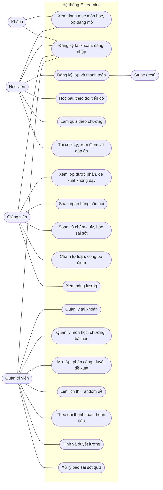
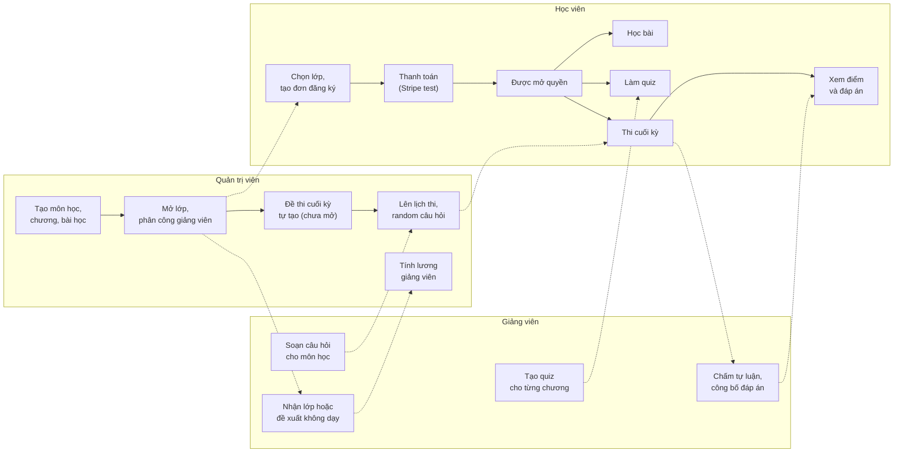
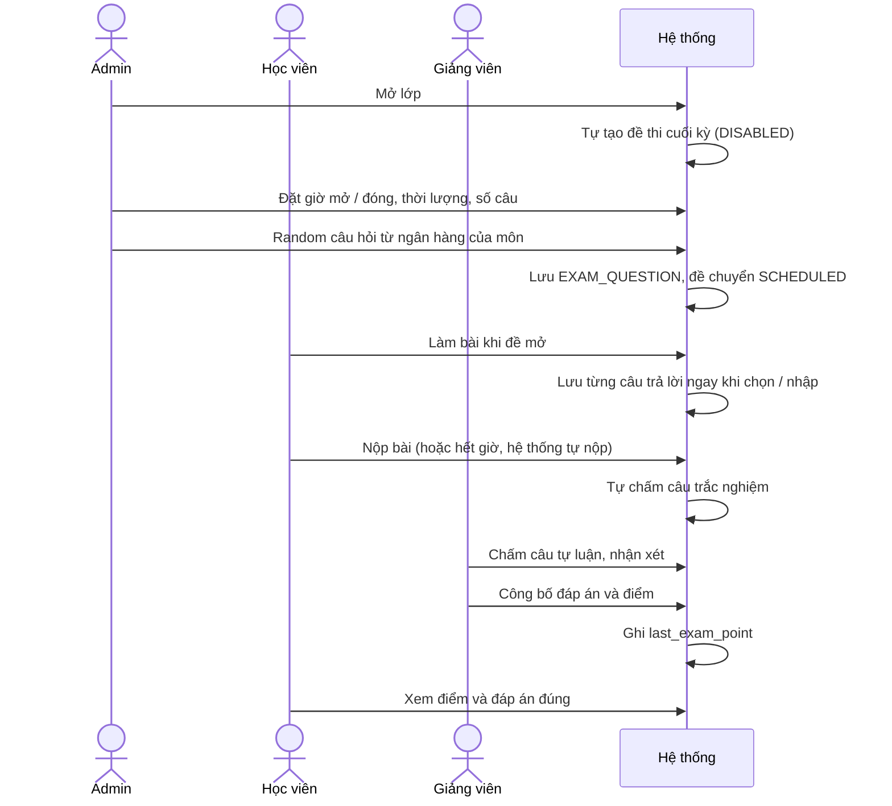

# Tài liệu yêu cầu người dùng (URD) — Ứng dụng web học trực tuyến E-Learning

| Mục | Nội dung |
|---|---|
| Loại tài liệu | Tài liệu yêu cầu người dùng (User Requirements Document) |
| Phiên bản | **v1.2** — mọi câu hỏi Q-01 → Q-38 và giả định G-1 → G-5 đã được PO chốt |
| Ngày | 16/11/2026 |
| Chủ sở hữu | Product Owner (trưởng nhóm) |
| Sơ đồ CSDL | [`So_do_CSDL.drawio`](../So_do_CSDL.drawio) — ERD v1.1, 27 bảng |
| Tài liệu liên quan | [PLAN.md](../PLAN.md) · [Từ điển dữ liệu](database/data-dictionary.md) · [Wireframe](ui/wireframes.md) |

## Mục lục

1. [Giới thiệu](#1-giới-thiệu)
2. [Nội dung yêu cầu](#2-nội-dung-yêu-cầu)
3. [Thuật ngữ](#3-thuật-ngữ)
4. [Yêu cầu người dùng](#4-yêu-cầu-người-dùng)
5. [Mô hình nghiệp vụ](#5-mô-hình-nghiệp-vụ)
6. [User story](#6-user-story)
7. [Chức năng hệ thống](#7-chức-năng-hệ-thống)
8. [Quy tắc nghiệp vụ](#8-quy-tắc-nghiệp-vụ)
9. [Yêu cầu phi chức năng](#9-yêu-cầu-phi-chức-năng)
10. [Yêu cầu dữ liệu](#10-yêu-cầu-dữ-liệu)
11. [Yêu cầu giao diện và tích hợp](#11-yêu-cầu-giao-diện-và-tích-hợp)
12. [Tiêu chí nghiệm thu](#12-tiêu-chí-nghiệm-thu)
13. [Ma trận truy vết](#13-ma-trận-truy-vết)

Phụ lục: [A. Câu hỏi đã chốt và giả định](#phụ-lục-a-câu-hỏi-đã-chốt-và-giả-định) · [B. Lịch sử thay đổi sơ đồ CSDL](#phụ-lục-b-lịch-sử-thay-đổi-sơ-đồ-csdl) · [C. Lịch sử thay đổi tài liệu](#phụ-lục-c-lịch-sử-thay-đổi-tài-liệu)

---

## 1. Giới thiệu

### 1.1 Mục đích tài liệu

Tài liệu này mô tả **người dùng cần gì** ở ứng dụng học trực tuyến E-Learning và **hệ thống phải làm được gì** để đáp ứng. Đây là căn cứ để lập kế hoạch, thiết kế, viết code, kiểm thử và nghiệm thu sản phẩm. Mọi chức năng được làm ra phải truy được về một yêu cầu trong tài liệu này.

### 1.2 Phạm vi tài liệu

Tài liệu gồm: bối cảnh và mục tiêu, yêu cầu của từng nhóm người dùng, user story kèm tiêu chí chấp nhận, danh sách chức năng hệ thống, quy tắc nghiệp vụ, yêu cầu phi chức năng, yêu cầu dữ liệu, giao diện, tích hợp và tiêu chí nghiệm thu. Thiết kế chi tiết của CSDL nằm ở [từ điển dữ liệu](database/data-dictionary.md); bố cục màn hình nằm ở [wireframe](ui/wireframes.md); lịch thực hiện nằm ở [PLAN.md](../PLAN.md).

### 1.3 Đối tượng đọc

| Người đọc | Dùng tài liệu để |
|---|---|
| Product Owner | Duyệt yêu cầu, sắp ưu tiên, nghiệm thu |
| Thành viên nhóm | Review sản phẩm, viết báo cáo đồ án, chuẩn bị demo |
| Claude Code (Planner, Coder, Tester, E2E) | Chia việc, viết code, viết test theo tiêu chí chấp nhận |
| Giảng viên hướng dẫn, hội đồng chấm | Đối chiếu sản phẩm với yêu cầu |

### 1.4 Quy ước mã số

| Mã | Ý nghĩa | Nằm ở |
|---|---|---|
| `UR-xx` | Yêu cầu người dùng: nhu cầu cấp cao của một tác nhân | [Mục 4](#4-yêu-cầu-người-dùng) |
| `E1` → `E10` | Epic: nhóm chức năng lớn | [Mục 6](#6-user-story) |
| `US-xx` | User story kèm tiêu chí chấp nhận | [Mục 6](#6-user-story) |
| `FR-m.n` | Chức năng hệ thống thứ *n* của phân hệ *m* | [Mục 7](#7-chức-năng-hệ-thống) |
| `BR-xx` | Quy tắc nghiệp vụ | [Mục 8](#8-quy-tắc-nghiệp-vụ) |
| `NFR-xx` | Yêu cầu phi chức năng | [Mục 9](#9-yêu-cầu-phi-chức-năng) |
| `AT-xx` | Kịch bản nghiệm thu mức hệ thống | [Mục 12](#12-tiêu-chí-nghiệm-thu) |
| `Q-xx`, `G-x`, `D-xx` | Câu hỏi đã chốt, giả định đã xác nhận, điểm chỉnh sơ đồ | Phụ lục A, B |

Mức ưu tiên theo **MoSCoW**: **Must** (bắt buộc), **Should** (nên có), **Could** (có thì tốt). Nội dung đánh dấu **[Đề xuất]** là phần Claude Code bổ sung để hệ thống chạy được, chưa do PO nêu ra.

---

## 2. Nội dung yêu cầu

### 2.1 Bối cảnh và vấn đề

Đồ án mô phỏng một **trung tâm đào tạo** dạy nhiều môn học, mỗi môn được mở thành nhiều lớp do các giảng viên khác nhau đứng lớp. Khi các công việc sau được làm thủ công hoặc rải rác trên nhiều công cụ, trung tâm gặp các vấn đề:

| Vấn đề | Hệ quả |
|---|---|
| Đăng ký lớp và thu học phí theo dõi bằng tay | Khó biết ai đã cọc, ai đã trả đủ, lớp nào đủ sĩ số để mở |
| Tài liệu học, bài tập và bài thi nằm ở nhiều nơi | Học viên không biết mình đã học tới đâu; giảng viên khó theo dõi lớp |
| Ra đề, chấm bài và công bố điểm làm thủ công | Tốn thời gian, dễ sai, học viên chờ lâu mới biết kết quả |
| Lương giảng viên tính tay theo số lớp, số học viên | Dễ nhầm, giảng viên không thấy được cách tính |

### 2.2 Mục tiêu

| Mã | Mục tiêu | Đo bằng |
|---|---|---|
| O-1 | Một ứng dụng web duy nhất cho ba nhóm người dùng: quản trị viên, giảng viên, học viên | Mỗi vai trò đăng nhập và làm trọn việc của mình trong hệ thống (AT-01) |
| O-2 | Tự động hoá chuỗi đăng ký → thanh toán → mở quyền vào lớp | Học viên thanh toán xong là vào được lớp, không cần ai thao tác thêm (AT-03) |
| O-3 | Học tập và đánh giá trực tuyến: bài học, quiz theo chương, thi cuối kỳ | Câu trắc nghiệm được chấm ngay khi nộp; điểm và đáp án hiện sau khi công bố (AT-05 → AT-07) |
| O-4 | Tính lương giảng viên minh bạch theo công thức | Bảng lương hiện đủ các số đã dùng để tính (AT-08) |
| O-5 | Hoàn thành trong khuôn khổ đồ án | Toàn bộ story **Must** đạt nghiệm thu trước ngày 06/12/2026 |

### 2.3 Ý tưởng cốt lõi

1. Một **môn học** (COURSE) có nhiều **chương**, mỗi chương có nhiều **bài học**; một môn học được mở thành nhiều **lớp**.
2. **Admin** tạo môn học, mở lớp và phân lớp cho giảng viên; giảng viên được quyền đề xuất không dạy một lớp, Admin duyệt hoặc từ chối.
3. Học viên **đăng ký theo lớp**; một lần đăng ký (đơn đăng ký) có thể gồm nhiều lớp. Đã cọc hoặc trả đủ thì được mở quyền vào lớp; phải trả đủ mới được thi cuối kỳ.
4. Mỗi chương có **1 quiz** trong mỗi lớp (bài tập về nhà dạng trắc nghiệm hoặc nộp file, do giảng viên đứng lớp soạn); mỗi lớp có **1 đề thi cuối kỳ**.
5. Câu trắc nghiệm hệ thống tự chấm; câu tự luận giảng viên chấm; học viên xem đáp án và điểm sau khi giảng viên công bố.
6. Admin tính lương giảng viên dựa trên hệ số lương, số lớp dạy và số học viên mỗi lớp.

### 2.4 Các bên liên quan và tác nhân

| Bên liên quan | Vai trò với dự án |
|---|---|
| Product Owner (trưởng nhóm) | Đưa ra và duyệt yêu cầu, quyết định ưu tiên, nghiệm thu |
| Nhóm phát triển (3 thành viên + Claude Code) | Xây dựng, review, kiểm thử, viết báo cáo |
| Giảng viên hướng dẫn, hội đồng chấm | Đánh giá đồ án |
| Người dùng cuối | Bốn tác nhân dưới đây |

Tác nhân là những người trực tiếp dùng hệ thống:

| Tác nhân | Việc chính |
|---|---|
| Khách | Xem danh mục môn học, lớp đang mở; đăng ký tài khoản học viên |
| Học viên | Đăng ký lớp, thanh toán, học bài, làm quiz, thi cuối kỳ, xem điểm và đáp án |
| Giảng viên | Xem lớp được phân, đề xuất không dạy, soạn câu hỏi cho môn, tạo quiz cho chương, chấm tự luận và bài nộp file, công bố đáp án và điểm, báo sai sót quiz cho Admin, xem bảng lương của mình |
| Quản trị viên | Quản lý tài khoản (kể cả tạo Admin khác), tạo môn học và soạn chương, bài học, mở lớp và phân công giảng viên, duyệt đề xuất không dạy, lên lịch và random đề thi, theo dõi thanh toán, kết thúc / huỷ lớp, xử lý báo sai sót quiz, tính lương, xem thống kê |

Ngoài ra, **hệ thống** tự thực hiện một số việc không cần người thao tác: kích hoạt đơn sau khi thanh toán, tạo đề thi khi mở lớp, chốt sĩ số tại ngày khai giảng, tự nộp bài khi hết giờ, tự chấm câu trắc nghiệm, ghi điểm vào hồ sơ. **Stripe** (chế độ test) là hệ thống ngoài duy nhất được tích hợp.

### 2.5 Phạm vi

**Trong phạm vi** — 10 nhóm chức năng (epic):

| Epic | Nhóm chức năng | Nội dung chính |
|---|---|---|
| E1 | Tài khoản & phân quyền | Đăng ký, đăng nhập, ba vai trò, quản lý tài khoản |
| E2 | Môn học & nội dung | Môn học, chương, bài học (video, văn bản, file), danh mục |
| E3 | Lớp học & phân công | Mở lớp, phân công giảng viên, đề xuất không dạy, sĩ số tối thiểu / tối đa |
| E4 | Đăng ký & thanh toán | Đơn đăng ký nhiều lớp, cọc hoặc trả đủ qua Stripe test, hoàn tiền |
| E5 | Học tập & tiến độ | Học bài, đánh dấu hoàn thành, tiến độ |
| E6 | Ngân hàng câu hỏi | Câu trắc nghiệm 1 đáp án và tự luận theo môn học |
| E7 | Đề thi cuối kỳ | Mỗi lớp một đề, lên lịch, random câu hỏi |
| E8 | Làm bài & chấm điểm | Thi trực tuyến, tự chấm trắc nghiệm, giảng viên chấm tự luận, công bố điểm |
| E9 | Quiz theo chương | Quiz trắc nghiệm hoặc nộp file cho từng chương của từng lớp |
| E10 | Lương & thống kê | Tính lương giảng viên theo tháng, bảng tổng quan |

**Ngoài phạm vi giai đoạn này:**

- Random đề riêng cho từng học viên, snapshot câu hỏi (nội dung trang 2 cũ) — Q-02
- Thanh toán thật (Stripe chế độ live, VNPay, MoMo); hoá đơn điện tử
- Câu trắc nghiệm nhiều đáp án, câu đúng / sai — Q-37
- Thi giữa kỳ — Q-20
- Triển khai bản demo online — chỉ chạy trên máy cá nhân
- Tách riêng vai trò "nhân viên học liệu" khỏi Admin (mọi tài khoản Admin có toàn quyền)
- Học viên gửi báo sai sót quiz ngay trong hệ thống — G-1
- Chat, thông báo realtime, diễn đàn thảo luận
- Đánh giá / xếp hạng môn học, cấp chứng chỉ
- Tự lưu trữ và phát video (bài học dùng link YouTube / Google Drive)
- Ứng dụng di động, học trực tiếp (livestream)
- Chấm công, hợp đồng, thuế thu nhập của giảng viên

### 2.6 Giả định và ràng buộc

**Ràng buộc:**

| Mã | Ràng buộc |
|---|---|
| C-1 | Hạn nộp đồ án là **06/12/2026** (Q-30, PO dời từ 01/12 ngày 23/11/2026); sau ngày 04/12 không thêm tính năng |
| C-2 | Nhóm 4 thành viên; Claude Code viết toàn bộ code, nhóm review và chạy thử (Q-25) |
| C-3 | Công nghệ theo PLAN.md mục 4: Next.js, TypeScript, PostgreSQL, Prisma, Tailwind CSS (Q-24) |
| C-4 | Sản phẩm chạy trên máy cá nhân bằng Docker Compose; chưa triển khai online |
| C-5 | Thanh toán chỉ dùng Stripe **chế độ test** hoặc giả lập; không có tiền thật (Q-13) |
| C-6 | Giao diện và nội dung bằng tiếng Việt; tiền tệ là VND |
| C-7 | Cấu trúc CSDL theo sơ đồ do PO chốt (ERD v1.1); đổi sơ đồ phải được PO đồng ý |

**Giả định:**

| Mã | Giả định |
|---|---|
| A-1 | Hệ thống phục vụ **một** trung tâm đào tạo; không có nhiều chi nhánh hay nhiều tổ chức dùng chung |
| A-2 | Người dùng có trình duyệt hiện đại và kết nối Internet ổn định |
| A-3 | Tài khoản Admin đầu tiên có sẵn trong dữ liệu khởi tạo; Admin là một vai trò có thể gồm nhiều người (Q-35) |
| A-4 | Video bài học được lưu ở YouTube hoặc Google Drive, hệ thống chỉ giữ đường dẫn |
| A-5 | Quy mô đồ án: khoảng 100 học viên cùng làm một đề thi |
| A-6 | Năm giả định nghiệp vụ G-1 → G-5 đã được PO xác nhận ([Phụ lục A.3](#a3-giả-định)) |

---

## 3. Thuật ngữ

| Thuật ngữ | Bảng | Giải thích |
|---|---|---|
| Người dùng | `USER` | Bảng cha chứa thông tin chung: email, mật khẩu đã băm, tên, vai trò, trạng thái, ngày tạo |
| Vai trò | `ROLE` | Quan hệ chia người dùng thành Admin, Giảng viên, Học viên |
| Quản trị viên | `ADMIN` | Bảng con của `USER` |
| Giảng viên | `TEACHER` | Bảng con của `USER`, có thêm hệ số lương |
| Học viên | `STUDENT` | Bảng con của `USER` |
| Môn học (học phần) | `COURSE` | Nội dung giảng dạy do Admin tạo, ví dụ "Lập trình Python cơ bản" |
| Chương | `SECTION` | Một phần của môn học, chứa nhiều bài học; mỗi chương có 1 quiz trong mỗi lớp |
| Bài học | `LESSON` | Đơn vị nội dung: link video, văn bản, file đính kèm |
| Lớp học | `CLASSES` | Một đợt mở của môn học: giảng viên, học phí, tiền cọc, sĩ số, thời gian học |
| Đơn đăng ký | `ENROLLMENT` | Một lần đăng ký của một học viên, có thể gồm nhiều lớp; chứa tổng học phí, tiền cọc |
| Chi tiết môn học của học viên | `STUDENT COURSES DETAIL` | Mỗi lớp trong một đơn đăng ký: học phí, tiến độ, điểm quá trình, điểm cuối kỳ, trạng thái |
| Tham gia lớp | `STUDY` | Quan hệ học viên ↔ lớp, tạo khi học viên được mở quyền vào lớp |
| Thanh toán | `PAYMENT` | Một giao dịch trả tiền cho một đơn đăng ký (qua Stripe test hoặc giả lập) |
| Tiến độ bài học | `LESSON_PROGRESS` | Bài học mà học viên đã đánh dấu hoàn thành |
| Đề xuất không dạy | `CLASS_DECLINE_REQUEST` | Giảng viên xin không dạy một lớp được phân, kèm lý do; Admin duyệt |
| Bảng lương | `SALARY` | Lương một tháng của một giảng viên |
| Câu hỏi | `QUESTIONS` | Ngân hàng câu hỏi của môn học, do giảng viên soạn |
| Phương án | `QUESTION_OPTION` | Một lựa chọn của câu trắc nghiệm, có đánh dấu đúng/sai; mỗi câu có đúng 1 phương án đúng |
| Đề thi cuối kỳ | `EXAM` | Đề thi duy nhất của một lớp |
| Câu hỏi trong đề | `EXAM_QUESTION` | Câu hỏi được Admin random vào đề |
| Bài làm | `ANSWER` | Một lần học viên làm đề thi cuối kỳ |
| Trả lời một câu | `ANSWER_DETAIL` | Câu trả lời của học viên ở một câu (phương án đã chọn hoặc bài tự luận) và điểm |
| Quiz | `QUIZ`, `QUIZ_QUESTION`, `QUIZ_OPTION` | Bài tập về nhà của một chương trong một lớp, do giảng viên đứng lớp soạn; dạng **trắc nghiệm** (có câu hỏi và đáp án riêng) hoặc dạng **nộp file** |
| Bài làm quiz | `QUIZ_RESULT`, `QUIZ_RESULT_DETAIL` | Một lần làm quiz: chọn đáp án (quiz trắc nghiệm) hoặc nộp file (quiz nộp file) |
| Báo sai sót quiz | `QUIZ_FEEDBACK` | Giảng viên báo cho Admin một quiz đã khoá có sai sót; Admin điều chỉnh điểm |
| Điểm quá trình | `middle_exam_point` | Trung bình điểm quiz các chương của lớp |
| Điểm cuối kỳ | `last_exam_point` | Điểm bài thi cuối kỳ |

---

## 4. Yêu cầu người dùng

Mỗi yêu cầu người dùng (UR) là một nhu cầu cấp cao của một tác nhân. Cách hệ thống đáp ứng từng UR được chi tiết hoá bằng user story ([mục 6](#6-user-story)) và chức năng hệ thống ([mục 7](#7-chức-năng-hệ-thống)); bảng đối chiếu đầy đủ ở [mục 13](#13-ma-trận-truy-vết).

| Mã | Tác nhân | Yêu cầu người dùng | Ưu tiên |
|---|---|---|---|
| UR-01 | Khách | Xem được danh mục môn học và các lớp đang nhận đăng ký mà không cần tài khoản | Must |
| UR-02 | Khách | Tự tạo được tài khoản học viên | Must |
| UR-03 | Mọi người dùng | Đăng nhập, đăng xuất, quản lý hồ sơ và mật khẩu của mình | Must |
| UR-04 | Mọi người dùng | Chỉ thấy và làm được những việc thuộc vai trò của mình; dữ liệu của mình không bị người không có quyền xem | Must |
| UR-05 | Học viên | Đăng ký một hoặc nhiều lớp trong một lần và thanh toán trực tuyến, bằng cọc hoặc trả đủ; thanh toán xong là vào được lớp | Must |
| UR-06 | Học viên | Theo dõi được các đơn đăng ký, số tiền đã trả và còn thiếu | Should |
| UR-07 | Học viên | Học bài theo từng chương và biết mình đã học tới đâu | Must |
| UR-08 | Học viên | Làm bài tập (quiz) của từng chương và biết điểm của mình | Must |
| UR-09 | Học viên | Thi cuối kỳ trực tuyến, không mất bài khi gặp sự cố; xem điểm và đáp án sau khi được công bố | Must |
| UR-10 | Giảng viên | Biết mình được phân công lớp nào, học viên là ai; xin không dạy một lớp khi có lý do | Must |
| UR-11 | Giảng viên | Xây dựng ngân hàng câu hỏi cho môn mình dạy | Must |
| UR-12 | Giảng viên | Giao quiz cho từng chương của lớp mình, chấm bài nộp và báo lại khi quiz có sai sót | Must |
| UR-13 | Giảng viên | Chấm phần tự luận của bài thi, công bố điểm, theo dõi điểm và tiến độ của lớp | Must |
| UR-14 | Giảng viên | Xem bảng lương của mình và cách tính | Should |
| UR-15 | Admin | Quản lý tài khoản của mọi vai trò | Must |
| UR-16 | Admin | Xây dựng môn học và nội dung giảng dạy dùng chung cho mọi lớp của môn | Must |
| UR-17 | Admin | Mở lớp, phân công giảng viên, xử lý đề xuất không dạy; lớp chỉ được mở khi đủ sĩ số | Must |
| UR-18 | Admin | Tổ chức thi cuối kỳ cho từng lớp: lên lịch và tạo đề ngẫu nhiên từ ngân hàng câu hỏi | Must |
| UR-19 | Admin | Theo dõi việc thu học phí và hoàn tiền | Should |
| UR-20 | Admin | Tính lương giảng viên theo tháng bằng một công thức thống nhất, duyệt và ghi nhận đã trả | Must |
| UR-21 | Admin | Nắm được tình hình chung của trung tâm qua một bảng tổng quan | Should |
| UR-22 | Admin | Sửa được điểm khi quiz có sai sót mà không làm thay đổi nội dung quiz đã giao | Should |

---

## 5. Mô hình nghiệp vụ

### 5.1 Sơ đồ use case tổng quát

### 5.2 Luồng nghiệp vụ chính

Luồng thi cuối kỳ:

---

## 6. User story

Mỗi user story mô tả một nhu cầu theo góc nhìn của tác nhân, kèm tiêu chí chấp nhận dùng để nghiệm thu. Mức ưu tiên theo **MoSCoW**: **Must** (bắt buộc), **Should** (nên có), **Could** (có thì tốt). Các user story được nhóm thành 10 epic E1 → E10.

### E1 — Tài khoản & phân quyền
*Bảng: `USER`, `ADMIN`, `TEACHER`, `STUDENT`*

| Mã | User story | Ưu tiên | Tiêu chí chấp nhận |
|---|---|---|---|
| US-01 | Là **khách**, tôi muốn đăng ký tài khoản học viên bằng email và mật khẩu | Must | Email không trùng; mật khẩu chỉ lưu dạng băm; tạo 1 dòng `USER` (`role = STUDENT`, `status = ACTIVE`) và 1 dòng `STUDENT` cùng `user_id` |
| US-02 | Là **người dùng**, tôi muốn đăng nhập / đăng xuất | Must | Sai thông tin thì báo lỗi chung; tài khoản `LOCKED` không đăng nhập được; đăng nhập xong chuyển về trang chủ theo vai trò |
| US-03 | Là **hệ thống**, tôi muốn mỗi trang và API chỉ cho đúng vai trò truy cập | Must | Ba vai trò Admin / Giảng viên / Học viên; truy cập trái phép bị chặn (403); kiểm tra quyền ở server |
| US-04 | Là **người dùng**, tôi muốn xem và sửa hồ sơ, đổi mật khẩu | Should | Sửa được tên; đổi mật khẩu phải nhập mật khẩu cũ; giảng viên xem được hệ số lương của mình nhưng không tự sửa |
| US-05 | Là **Admin**, tôi muốn quản lý tài khoản | Must | Danh sách, lọc theo vai trò; tạo tài khoản giảng viên (`USER` + `TEACHER` có `salary_coefficient`); tạo tài khoản Admin khác (`USER` + `ADMIN`); sửa hệ số lương; khoá / mở khoá; tài khoản Admin đầu tiên có sẵn trong dữ liệu khởi tạo |
| US-06 | Là **người dùng**, tôi muốn đặt lại mật khẩu khi quên | Could | Gửi link đặt lại qua email; link hết hạn sau một khoảng thời gian |

### E2 — Môn học & nội dung
*Bảng: `COURSE`, `SECTION`, `LESSON`*

| Mã | User story | Ưu tiên | Tiêu chí chấp nhận |
|---|---|---|---|
| US-07 | Là **Admin**, tôi muốn tạo / sửa / ẩn môn học | Must | Có `course_name`, `description`, `course_status` (`DRAFT` / `PUBLISHED` / `ARCHIVED`), `course_date_created` tự ghi, `course_date_end` (ngày ngừng mở lớp mới); ghi `admin_id` người tạo |
| US-08 | Là **Admin**, tôi muốn chia môn học thành các chương | Must | Mỗi chương có `section_name`, `description`, `order_no` |
| US-09 | Là **Admin**, tôi muốn thêm bài học vào chương | Must | Bài học có `title`, `description`, `video_url` (YouTube / Drive), `content` (văn bản), `attachment_url` (file đính kèm), `order_no`; có thể kết hợp nhiều loại nội dung |
| US-10 | Là **khách / học viên**, tôi muốn xem danh mục môn học và tìm theo tên | Must | Chỉ hiện môn `PUBLISHED`; tìm theo tên; phân trang |
| US-11 | Là **khách / học viên**, tôi muốn xem chi tiết môn học | Must | Hiện mô tả, danh sách chương và tên bài học, các lớp đang nhận đăng ký (giảng viên, học phí, tiền cọc, ngày khai giảng, số chỗ còn lại); chưa được mở quyền thì không xem được nội dung bài học |

### E3 — Lớp học & phân công
*Bảng: `CLASSES`, `CLASS_DECLINE_REQUEST`*

| Mã | User story | Ưu tiên | Tiêu chí chấp nhận |
|---|---|---|---|
| US-12 | Là **Admin**, tôi muốn mở lớp cho một môn học và phân công giảng viên | Must | Lớp có môn học, giảng viên, `class_name`, `tuition_fee`, `deposit_amount`, `min_students`, `max_students`, `start_date`, `end_date`; trạng thái ban đầu `UPCOMING`; mỗi lớp có đúng 1 giảng viên; hệ thống tự tạo đề thi cuối kỳ ở trạng thái `DISABLED` (US-29) |
| US-13 | Là **giảng viên**, tôi muốn xem các lớp được phân công và học viên trong lớp | Must | Danh sách lớp kèm môn học, thời gian, sĩ số; danh sách học viên kèm trạng thái đăng ký và thanh toán |
| US-14 | Là **giảng viên**, tôi muốn đề xuất không dạy một lớp được phân | Should | Nhập lý do (bắt buộc); tạo `CLASS_DECLINE_REQUEST` trạng thái `PENDING`; chỉ gửi được khi lớp chưa kết thúc; mỗi lớp chỉ có 1 đề xuất đang chờ |
| US-15 | Là **Admin**, tôi muốn duyệt hoặc từ chối đề xuất không dạy | Should | Ghi `admin_id`, `reviewed_at`, trạng thái `APPROVED` / `REJECTED`; nếu duyệt thì Admin phải chọn giảng viên khác cho lớp; nếu từ chối thì giảng viên tiếp tục dạy; giảng viên thấy kết quả |
| US-16 | Là **Admin**, tôi muốn lớp được mở khi đủ sĩ số tối thiểu, bị huỷ và hoàn tiền khi không đủ, và kết thúc lớp | Must | Tới `start_date`, lớp có đủ `min_students` học viên đã cọc hoặc trả đủ thì chuyển `ONGOING`; chưa đủ thì lớp chuyển `CANCELLED` và mỗi học viên được hoàn đúng số tiền đã trả cho lớp đó (cọc hoặc đủ) bằng giao dịch `REFUND`; hết `end_date` thì chuyển `FINISHED`, học viên chỉ xem lại |

### E4 — Đăng ký & thanh toán
*Bảng: `ENROLLMENT`, `STUDENT COURSES DETAIL`, `STUDY`, `PAYMENT`*

| Mã | User story | Ưu tiên | Tiêu chí chấp nhận |
|---|---|---|---|
| US-17 | Là **học viên**, tôi muốn chọn một hoặc nhiều lớp và tạo một đơn đăng ký | Must | Tạo 1 `ENROLLMENT` (`tuition` = tổng học phí, `deposit` = tổng tiền cọc, `status = PENDING_PAYMENT`, `date_course_enroll`); mỗi lớp tạo 1 dòng `STUDENT COURSES DETAIL` (lưu `tuition_fee` của lớp lúc đăng ký, `status = PENDING`); không đăng ký trùng lớp đã đăng ký; chỉ đăng ký lớp `UPCOMING` còn chỗ; học viên còn đơn chưa trả đủ (`DEPOSITED`) thì không tạo được đơn mới, hệ thống thông báo yêu cầu trả phần còn lại trước |
| US-18 | Là **học viên**, tôi muốn thanh toán đơn đăng ký | Must | Thanh toán qua Stripe chế độ test; khi chạy không có Stripe thì dùng nút "Thanh toán giả lập"; mỗi giao dịch tạo 1 `PAYMENT` (`amount`, `payment_type`, `method`, `transaction_code`, `status`, `paid_at`); chọn trả cọc hoặc trả đủ; đơn đã cọc thì trả tiếp phần còn lại (`REMAINDER`) |
| US-19 | Là **hệ thống**, tôi muốn kích hoạt đơn sau khi thanh toán thành công | Must | `ENROLLMENT` chuyển `DEPOSITED` hoặc `PAID`; các dòng `STUDENT COURSES DETAIL` chuyển `STUDYING`; thêm `STUDY` (học viên, lớp); từ đó học viên được vào bài học và quiz của lớp; đề thi cuối kỳ chỉ mở cho đơn đã `PAID` |
| US-20 | Là **học viên**, tôi muốn huỷ đơn khi chưa thanh toán | Should | Chỉ huỷ khi chưa có `PAYMENT` thành công; đơn và các dòng chi tiết chuyển `CANCELLED` |
| US-21 | Là **học viên**, tôi muốn xem lịch sử đơn đăng ký và thanh toán | Should | Liệt kê đơn, các lớp trong đơn, số tiền đã trả, còn thiếu, trạng thái |
| US-22 | Là **Admin**, tôi muốn theo dõi thanh toán | Should | Danh sách giao dịch, lọc theo trạng thái; xác nhận thủ công giao dịch giả lập; hoàn tiền khi huỷ lớp |

### E5 — Học tập & tiến độ
*Bảng: `STUDENT COURSES DETAIL`, `LESSON_PROGRESS`*

| Mã | User story | Ưu tiên | Tiêu chí chấp nhận |
|---|---|---|---|
| US-23 | Là **học viên**, tôi muốn xem "Môn học của tôi" | Must | Đọc từ `STUDENT COURSES DETAIL`: các môn đã học và đang học, lớp, giảng viên, trạng thái, tiến độ (`course_process`), điểm quá trình, điểm cuối kỳ |
| US-24 | Là **học viên**, tôi muốn học bài và đánh dấu đã hoàn thành | Must | Mở bài học theo thứ tự chương; nút "Hoàn thành" tạo `LESSON_PROGRESS`; `course_process` = số bài đã hoàn thành / tổng số bài của môn (%) |
| US-25 | Là **giảng viên**, tôi muốn xem tiến độ học của học viên trong lớp | Should | Bảng học viên × tiến độ, sắp xếp được |

### E6 — Ngân hàng câu hỏi
*Bảng: `QUESTIONS`, `QUESTION_OPTION`*

| Mã | User story | Ưu tiên | Tiêu chí chấp nhận |
|---|---|---|---|
| US-26 | Là **giảng viên**, tôi muốn soạn câu hỏi cho môn học mình dạy | Must | Câu hỏi thuộc một môn học (`course_id`), ghi người soạn (`teacher_id`); `question_type` = trắc nghiệm 1 đáp án / tự luận; `description` là nội dung; ẩn được (`status`); chỉ soạn cho môn có lớp mình được phân |
| US-27 | Là **giảng viên**, tôi muốn nhập phương án và đáp án đúng cho câu trắc nghiệm | Must | Câu trắc nghiệm có tối thiểu 2 phương án và **đúng 1** phương án đúng; câu tự luận không có phương án |
| US-28 | Là **giảng viên**, tôi muốn nhập hàng loạt câu hỏi từ file Excel/CSV | Could | Có file mẫu; báo lỗi theo từng dòng |

### E7 — Đề thi cuối kỳ
*Bảng: `EXAM`, `EXAM_QUESTION`*

| Mã | User story | Ưu tiên | Tiêu chí chấp nhận |
|---|---|---|---|
| US-29 | Là **hệ thống**, tôi muốn tự tạo đề thi cuối kỳ khi mở lớp | Must | Mỗi lớp có đúng 1 `EXAM` (`class_id` không trùng), trạng thái `DISABLED`, học viên chưa thấy |
| US-30 | Là **Admin**, tôi muốn lên lịch thi | Must | Nhập `exam_name`, `description`, `open_at`, `close_at`, `duration_minutes`, `max_attempts` (mặc định 1); giờ mở trước giờ đóng và nằm trong thời gian học của lớp; đề chuyển `SCHEDULED` |
| US-31 | Là **Admin**, tôi muốn random câu hỏi từ ngân hàng của môn để tạo đề | Must | Chọn số câu trắc nghiệm và số câu tự luận; hệ thống lấy ngẫu nhiên câu `ACTIVE` của môn, không trùng; lưu `EXAM_QUESTION`; điểm chia đều cho các câu; random lại được trước giờ mở đề, sau đó khoá |
| US-32 | Là **Admin / giảng viên**, tôi muốn xem trước đề thi | Should | Xem đề kèm đáp án đúng; học viên không xem được |

### E8 — Làm bài & chấm điểm
*Bảng: `ANSWER`, `ANSWER_DETAIL`*

| Mã | User story | Ưu tiên | Tiêu chí chấp nhận |
|---|---|---|---|
| US-33 | Là **học viên**, tôi muốn xem đề thi cuối kỳ của lớp | Must | Chỉ hiện khi đã được mở quyền; hiện trạng thái: Chưa mở / Đang mở / Đã đóng / Đã làm / Đã có điểm |
| US-34 | Là **học viên**, tôi muốn làm bài và nộp bài | Must | Tạo `ANSWER` (`attempt_no` ≤ `max_attempts`); câu trắc nghiệm dùng radio, tự luận dùng ô nhập; lưu ngay vào `ANSWER_DETAIL`; tải lại trang vẫn giữ bài; hết giờ thì tự nộp; phải đóng đủ học phí (đơn `PAID`) mới được thi, mới cọc thì không được thi |
| US-35 | Là **hệ thống**, tôi muốn tự chấm câu trắc nghiệm khi nộp bài | Must | Câu trắc nghiệm đúng khi phương án đã chọn (`chosen_option_id`) là phương án đúng; ghi `is_correct`, `point_earned`; còn câu tự luận thì bài ở `SUBMITTED` (chờ chấm), không còn thì `GRADED` |
| US-36 | Là **giảng viên**, tôi muốn chấm câu tự luận | Must | Nhập `point_earned` (≤ điểm của câu) và `teacher_comment`; ghi `graded_by`, `graded_at`; chấm xong mọi câu thì bài chuyển `GRADED`, `score` = tổng `point_earned` |
| US-37 | Là **giảng viên**, tôi muốn công bố đáp án và điểm | Must | Chỉ công bố khi mọi bài đã `GRADED`; ghi `answers_published_at`; trước đó học viên không xem được điểm và đáp án |
| US-38 | Là **hệ thống**, tôi muốn ghi điểm cuối kỳ vào hồ sơ học viên | Must | Khi công bố, ghi `last_exam_point` vào `STUDENT COURSES DETAIL` (lấy lần làm có điểm cao nhất nếu làm nhiều lần) |
| US-39 | Là **giảng viên**, tôi muốn xem bảng điểm của lớp | Should | Điểm quá trình, điểm cuối kỳ; mở được chi tiết bài làm từng học viên |
| US-40 | Là **giảng viên**, tôi muốn xuất bảng điểm ra Excel | Could | File gồm tên học viên, email, điểm quá trình, điểm cuối kỳ |

### E9 — Quiz theo chương
*Bảng: `QUIZ`, `QUIZ_QUESTION`, `QUIZ_OPTION`, `QUIZ_RESULT`, `QUIZ_RESULT_DETAIL`, `QUIZ_FEEDBACK`*

| Mã | User story | Ưu tiên | Tiêu chí chấp nhận |
|---|---|---|---|
| US-41 | Là **giảng viên**, tôi muốn tạo quiz cho từng chương của lớp tôi dạy | Must | Mỗi chương có đúng 1 quiz trong mỗi lớp (`UQ(class_id, section_id)`); khi soạn **bắt buộc chọn dạng**: *trắc nghiệm* (các câu `QUIZ_QUESTION` có `point`, mỗi câu có các `QUIZ_OPTION` với đúng 1 đáp án đúng; có `time_limit`) hoặc *nộp file* (mô tả đề, file đề `attachment_url`, hạn nộp `due_at`); đổi dạng được khi quiz còn `DRAFT`, đã publish (`PUBLISHED`) thì không đổi dạng; quiz đã publish vẫn sửa được khi chưa có học viên nào vào làm; có bài làm đầu tiên thì **khoá hẳn**: không sửa, không nhân bản |
| US-42 | Là **học viên**, tôi muốn làm quiz | Must | Chỉ khi đã được mở quyền vào lớp và quiz đã publish; quiz trắc nghiệm làm tối đa **2 lần** (`attempt_no` ≤ `max_attempts`), mỗi lần trong `time_limit`; quiz nộp file nộp **1 lần**, trước `due_at`, file theo NFR-05 |
| US-43 | Là **hệ thống / giảng viên**, tôi muốn chấm quiz | Must | Quiz trắc nghiệm: hệ thống tự chấm khi nộp, `score` = tổng `point_earned`; quiz nộp file: giảng viên của lớp nhập `score` và `teacher_comment`, bài chuyển `GRADED` |
| US-44 | Là **học viên**, tôi muốn xem điểm quiz | Must | Điểm quiz trắc nghiệm hiện ngay sau khi nộp, điểm của quiz là điểm **lần làm sau cùng**; điểm quiz nộp file hiện sau khi giảng viên chấm; điểm quá trình (`middle_exam_point`) = trung bình điểm quiz các chương của lớp |
| US-50 | Là **giảng viên / Admin**, tôi muốn xử lý sai sót của quiz đã khoá | Should | Khi học viên báo câu hỏi hoặc đáp án của quiz có sai sót, giảng viên gửi báo sai sót cho Admin (`QUIZ_FEEDBACK`, trạng thái `PENDING`); Admin điều chỉnh điểm các bài làm bị ảnh hưởng (ghi `adjust_note`), **không sửa nội dung quiz**; báo sai sót chuyển `RESOLVED` hoặc `REJECTED`, giảng viên thấy kết quả; điểm quá trình được tính lại |

### E10 — Lương & thống kê
*Bảng: `SALARY`, `TEACHER`*

| Mã | User story | Ưu tiên | Tiêu chí chấp nhận |
|---|---|---|---|
| US-45 | Là **Admin**, tôi muốn tính lương tháng cho giảng viên | Must | Lấy `salary_coefficient`, số lớp đang dạy trong tháng, số học viên mỗi lớp; lương = lương cơ bản × `salary_coefficient` + Σ (phụ cấp mỗi lớp + đơn giá mỗi học viên × số học viên) của các lớp đang dạy trong tháng; lương cơ bản, phụ cấp lớp, đơn giá học viên do Admin cấu hình; lưu `SALARY` (giữ lại các số đã dùng để tính) trạng thái `DRAFT` |
| US-46 | Là **Admin**, tôi muốn duyệt bảng lương và đánh dấu đã trả | Should | `DRAFT` → `APPROVED` → `PAID`; đã duyệt thì không tính lại |
| US-47 | Là **giảng viên**, tôi muốn xem bảng lương của mình | Should | Chỉ thấy bảng lương đã duyệt của chính mình, có chi tiết cách tính |
| US-48 | Là **Admin**, tôi muốn xem bảng tổng quan hệ thống | Should | Số người dùng theo vai trò, số môn học, lớp đang mở, số đơn đăng ký, tổng tiền đã thu, tổng lương tháng |
| US-49 | Là **giảng viên**, tôi muốn xem bảng tổng quan của mình | Could | Lớp đang dạy, số học viên, bài chờ chấm, quiz và đề thi sắp tới |

**Tổng cộng: 50 user story** (Must: 33 · Should: 13 · Could: 4).

---

## 7. Chức năng hệ thống

Danh sách dưới đây liệt kê **mọi chức năng hệ thống phải cung cấp**, chia theo 10 phân hệ tương ứng 10 epic. Mỗi chức năng có mã `FR-m.n`, tác nhân sử dụng, mức ưu tiên và user story chứa tiêu chí chấp nhận. Tổng cộng **72 chức năng** (Must: 53 · Should: 15 · Could: 4).

### 7.1 Phân hệ 1 — Tài khoản & phân quyền

| Mã | Chức năng | Tác nhân | Ưu tiên | User story |
|---|---|---|---|---|
| FR-1.1 | Đăng ký tài khoản học viên bằng email và mật khẩu | Khách | Must | US-01 |
| FR-1.2 | Đăng nhập, đăng xuất, duy trì phiên đăng nhập | Mọi người dùng | Must | US-02 |
| FR-1.3 | Từ chối đăng nhập với tài khoản bị khoá | Hệ thống | Must | US-02 |
| FR-1.4 | Kiểm tra quyền theo ba vai trò trên mọi trang và API; hiện trang 403 khi truy cập trái phép | Hệ thống | Must | US-03 |
| FR-1.5 | Hiện menu và trang chủ riêng cho từng vai trò | Hệ thống | Must | US-02, US-03 |
| FR-1.6 | Xem và sửa hồ sơ cá nhân | Mọi người dùng | Should | US-04 |
| FR-1.7 | Đổi mật khẩu (phải nhập mật khẩu cũ) | Mọi người dùng | Should | US-04 |
| FR-1.8 | Xem danh sách tài khoản, lọc theo vai trò | Admin | Must | US-05 |
| FR-1.9 | Tạo tài khoản giảng viên và tài khoản Admin | Admin | Must | US-05 |
| FR-1.10 | Sửa hệ số lương của giảng viên | Admin | Must | US-05 |
| FR-1.11 | Khoá và mở khoá tài khoản | Admin | Must | US-05 |
| FR-1.12 | Đặt lại mật khẩu qua liên kết gửi tới email | Mọi người dùng | Could | US-06 |

### 7.2 Phân hệ 2 — Môn học & nội dung

| Mã | Chức năng | Tác nhân | Ưu tiên | User story |
|---|---|---|---|---|
| FR-2.1 | Tạo, sửa môn học; đổi trạng thái nháp / đang mở / ngừng | Admin | Must | US-07 |
| FR-2.2 | Thêm, sửa, xoá và sắp xếp thứ tự chương của môn học | Admin | Must | US-08 |
| FR-2.3 | Thêm, sửa, xoá và sắp xếp bài học (link video, văn bản, file đính kèm) | Admin | Must | US-09 |
| FR-2.4 | Tải lên và tải về file đính kèm, có kiểm tra quyền, dung lượng và định dạng | Admin, Học viên | Must | US-09 |
| FR-2.5 | Danh mục môn học đang mở: tìm theo tên, phân trang | Khách, Học viên | Must | US-10 |
| FR-2.6 | Trang chi tiết môn học: mô tả, chương, tên bài học, các lớp đang nhận đăng ký | Khách, Học viên | Must | US-11 |

### 7.3 Phân hệ 3 — Lớp học & phân công

| Mã | Chức năng | Tác nhân | Ưu tiên | User story |
|---|---|---|---|---|
| FR-3.1 | Mở lớp cho một môn học: học phí, tiền cọc, sĩ số tối thiểu / tối đa, thời gian học | Admin | Must | US-12 |
| FR-3.2 | Phân công và đổi giảng viên của lớp | Admin | Must | US-12, US-15 |
| FR-3.3 | Xem các lớp được phân công và danh sách học viên của lớp | Giảng viên | Must | US-13 |
| FR-3.4 | Gửi đề xuất không dạy một lớp, kèm lý do | Giảng viên | Should | US-14 |
| FR-3.5 | Duyệt hoặc từ chối đề xuất không dạy | Admin | Should | US-15 |
| FR-3.6 | Chốt sĩ số tại ngày khai giảng: đủ thì mở lớp, thiếu thì huỷ lớp | Hệ thống | Must | US-16 |
| FR-3.7 | Hoàn tiền cho học viên khi lớp bị huỷ | Hệ thống | Must | US-16 |
| FR-3.8 | Kết thúc lớp khi hết thời gian học; học viên chỉ còn quyền xem lại | Hệ thống | Must | US-16 |

### 7.4 Phân hệ 4 — Đăng ký & thanh toán

| Mã | Chức năng | Tác nhân | Ưu tiên | User story |
|---|---|---|---|---|
| FR-4.1 | Chọn một hoặc nhiều lớp và tạo đơn đăng ký | Học viên | Must | US-17 |
| FR-4.2 | Kiểm tra điều kiện đăng ký: lớp còn nhận, còn chỗ, chưa đăng ký lớp đó, không còn nợ đơn trước | Hệ thống | Must | US-17 |
| FR-4.3 | Thanh toán qua Stripe (chế độ test): trả cọc, trả đủ, trả phần còn lại | Học viên | Must | US-18 |
| FR-4.4 | Thanh toán giả lập khi không dùng Stripe | Học viên | Must | US-18 |
| FR-4.5 | Xác nhận thanh toán, kích hoạt đơn và mở quyền vào lớp | Hệ thống | Must | US-19 |
| FR-4.6 | Huỷ đơn chưa thanh toán | Học viên | Should | US-20 |
| FR-4.7 | Xem lịch sử đơn đăng ký và thanh toán | Học viên | Should | US-21 |
| FR-4.8 | Xem danh sách giao dịch, lọc theo trạng thái, xác nhận thủ công giao dịch giả lập | Admin | Should | US-22 |

### 7.5 Phân hệ 5 — Học tập & tiến độ

| Mã | Chức năng | Tác nhân | Ưu tiên | User story |
|---|---|---|---|---|
| FR-5.1 | Trang "Môn học của tôi": lớp, giảng viên, trạng thái, tiến độ, điểm | Học viên | Must | US-23 |
| FR-5.2 | Xem nội dung bài học của lớp đã được mở quyền | Học viên | Must | US-24 |
| FR-5.3 | Đánh dấu bài học đã hoàn thành và tính tiến độ | Học viên | Must | US-24 |
| FR-5.4 | Bảng tiến độ học của học viên trong lớp | Giảng viên | Should | US-25 |

### 7.6 Phân hệ 6 — Ngân hàng câu hỏi

| Mã | Chức năng | Tác nhân | Ưu tiên | User story |
|---|---|---|---|---|
| FR-6.1 | Thêm, sửa, ẩn câu hỏi trắc nghiệm và tự luận của môn mình dạy | Giảng viên | Must | US-26 |
| FR-6.2 | Nhập phương án và đáp án đúng cho câu trắc nghiệm, có kiểm tra hợp lệ | Giảng viên | Must | US-27 |
| FR-6.3 | Khoá sửa câu hỏi đã nằm trong bài làm | Hệ thống | Must | US-26 (BR-23) |
| FR-6.4 | Nhập hàng loạt câu hỏi từ file Excel / CSV | Giảng viên | Could | US-28 |

### 7.7 Phân hệ 7 — Đề thi cuối kỳ

| Mã | Chức năng | Tác nhân | Ưu tiên | User story |
|---|---|---|---|---|
| FR-7.1 | Tự tạo đề thi cuối kỳ ở trạng thái chưa mở khi lớp được mở | Hệ thống | Must | US-29 |
| FR-7.2 | Lên lịch thi: giờ mở, giờ đóng, thời lượng, số lần làm | Admin | Must | US-30 |
| FR-7.3 | Random câu hỏi từ ngân hàng của môn để tạo đề; random lại được trước giờ mở đề | Admin | Must | US-31 |
| FR-7.4 | Xem trước đề thi kèm đáp án đúng | Admin, Giảng viên | Should | US-32 |
| FR-7.5 | Tự mở và đóng đề theo lịch | Hệ thống | Must | US-30, US-33 |

### 7.8 Phân hệ 8 — Làm bài & chấm điểm

| Mã | Chức năng | Tác nhân | Ưu tiên | User story |
|---|---|---|---|---|
| FR-8.1 | Xem đề thi của lớp và trạng thái của đề | Học viên | Must | US-33 |
| FR-8.2 | Làm bài có đồng hồ đếm ngược; lưu từng câu ngay; làm tiếp được sau khi tải lại trang | Học viên | Must | US-34 |
| FR-8.3 | Nộp bài; tự nộp khi hết giờ; giới hạn số lần làm; chặn khi chưa đóng đủ học phí | Học viên, Hệ thống | Must | US-34 |
| FR-8.4 | Tự chấm câu trắc nghiệm khi nộp bài | Hệ thống | Must | US-35 |
| FR-8.5 | Chấm câu tự luận: nhập điểm và nhận xét | Giảng viên | Must | US-36 |
| FR-8.6 | Công bố đáp án và điểm của đề thi | Giảng viên | Must | US-37 |
| FR-8.7 | Ghi điểm cuối kỳ vào hồ sơ học viên | Hệ thống | Must | US-38 |
| FR-8.8 | Xem điểm, bài làm và đáp án đúng sau khi công bố | Học viên | Must | US-37 |
| FR-8.9 | Bảng điểm của lớp, mở được chi tiết từng bài làm | Giảng viên | Should | US-39 |
| FR-8.10 | Xuất bảng điểm ra file Excel | Giảng viên | Could | US-40 |

### 7.9 Phân hệ 9 — Quiz theo chương

| Mã | Chức năng | Tác nhân | Ưu tiên | User story |
|---|---|---|---|---|
| FR-9.1 | Soạn quiz cho một chương của lớp: chọn dạng, soạn câu trắc nghiệm hoặc đề nộp file | Giảng viên | Must | US-41 |
| FR-9.2 | Publish quiz; khoá hẳn quiz khi đã có học viên vào làm | Giảng viên, Hệ thống | Must | US-41 |
| FR-9.3 | Làm quiz trắc nghiệm: tối đa 2 lần, có giới hạn thời gian | Học viên | Must | US-42 |
| FR-9.4 | Nộp file cho quiz nộp file: 1 lần, trước hạn nộp | Học viên | Must | US-42 |
| FR-9.5 | Tự chấm quiz trắc nghiệm khi nộp | Hệ thống | Must | US-43 |
| FR-9.6 | Chấm bài nộp file: nhập điểm và nhận xét | Giảng viên | Must | US-43 |
| FR-9.7 | Xem điểm quiz; tính điểm quá trình từ điểm các quiz | Học viên, Hệ thống | Must | US-44 |
| FR-9.8 | Gửi báo sai sót của quiz cho Admin | Giảng viên | Should | US-50 |
| FR-9.9 | Xử lý báo sai sót: điều chỉnh điểm các bài làm bị ảnh hưởng | Admin | Should | US-50 |

### 7.10 Phân hệ 10 — Lương & thống kê

| Mã | Chức năng | Tác nhân | Ưu tiên | User story |
|---|---|---|---|---|
| FR-10.1 | Cấu hình tham số lương: lương cơ bản, phụ cấp mỗi lớp, đơn giá mỗi học viên | Admin | Must | US-45 |
| FR-10.2 | Tính lương tháng cho giảng viên theo công thức | Admin | Must | US-45 |
| FR-10.3 | Duyệt bảng lương và đánh dấu đã trả | Admin | Should | US-46 |
| FR-10.4 | Xem bảng lương của mình kèm chi tiết cách tính | Giảng viên | Should | US-47 |
| FR-10.5 | Bảng tổng quan của Admin: người dùng, môn học, lớp, đơn đăng ký, tiền đã thu, tổng lương | Admin | Should | US-48 |
| FR-10.6 | Bảng tổng quan của giảng viên: lớp đang dạy, bài chờ chấm, quiz và đề thi sắp tới | Giảng viên | Could | US-49 |

---

## 8. Quy tắc nghiệp vụ

Quy tắc nghiệp vụ là những điều hệ thống luôn phải tuân theo, bất kể chức năng nào đang chạy.

### 8.1 Từ sơ đồ và câu trả lời của PO

| Mã | Quy tắc | Nguồn |
|---|---|---|
| BR-01 | Một môn học có nhiều chương, mỗi chương có nhiều bài học; một môn học được mở thành nhiều lớp | Sơ đồ |
| BR-02 | `USER` là bảng cha; mỗi người dùng thuộc đúng một trong ba bảng con `ADMIN`, `TEACHER`, `STUDENT` (cùng `user_id`); bảng con dùng chung các cột của `USER` và có thể có cột riêng | Q-04, Q-06 |
| BR-03 | Email của mỗi tài khoản là duy nhất | Sơ đồ |
| BR-04 | Học viên tự đăng ký tài khoản; Admin tạo tài khoản giảng viên và tài khoản Admin khác; Admin đầu tiên có sẵn khi khởi tạo | Q-05, Q-35 |
| BR-05 | Admin tạo môn học, soạn chương và bài học, mở lớp và phân công giảng viên | Q-01, Q-08, Q-09, Q-35 |
| BR-06 | Mỗi lớp có đúng một giảng viên; giảng viên có thể đề xuất không dạy lớp được phân (có lý do), Admin duyệt hoặc từ chối | Q-10 |
| BR-07 | Học phí và tiền cọc đặt ở lớp; đơn đăng ký lưu lại số tiền thực tế | Q-11 |
| BR-08 | Lớp có sĩ số tối đa (hết chỗ thì không nhận đăng ký) và sĩ số tối thiểu tính theo số học viên đã cọc hoặc trả đủ; tới ngày khai giảng chưa đủ thì huỷ lớp và hoàn tiền | Q-11, Q-27, Q-32 |
| BR-09 | `ENROLLMENT` là một lần đăng ký của một học viên, có thể gồm nhiều lớp; `STUDENT COURSES DETAIL` lưu từng lớp trong đơn; `STUDY` là quan hệ học viên ↔ lớp | Q-12 |
| BR-10 | Đã cọc hoặc trả đủ thì học viên được mở quyền vào lớp (bài học, quiz); phải trả đủ học phí mới được thi cuối kỳ | Sơ đồ, Q-13, Q-27 |
| BR-11 | Câu hỏi thuộc môn học, do giảng viên soạn; có 2 loại: trắc nghiệm 1 đáp án và tự luận | Q-16, Q-17, Q-37 |
| BR-12 | Mỗi lớp có đúng 1 đề thi cuối kỳ, được tạo sẵn khi mở lớp ở trạng thái chưa mở; Admin định ngày thi trước | Q-19, Q-20 |
| BR-13 | Admin random câu hỏi từ ngân hàng của môn để tạo đề; mọi học viên trong lớp làm cùng một đề | Q-02, Q-18 |
| BR-14 | Điểm của đề chia đều cho các câu | Q-19 |
| BR-15 | Câu trắc nghiệm hệ thống tự chấm; câu tự luận giảng viên chấm | Q-21 |
| BR-16 | Học viên chỉ xem được đáp án đúng và điểm sau khi giảng viên chấm xong và công bố | Q-22 |
| BR-17 | Mỗi chương có 1 quiz trong mỗi lớp, do giảng viên đứng lớp soạn; quiz là dạng trắc nghiệm (làm tối đa 2 lần, lấy điểm lần sau cùng) hoặc dạng nộp file (1 lần, có hạn nộp); câu hỏi và đáp án quiz thuộc riêng quiz đó | Yêu cầu ngày 23/10, Q-29, Q-38 |
| BR-18 | Admin tính lương giảng viên dựa trên hệ số lương, số lớp dạy, số học viên mỗi lớp | Q-07 |

### 8.2 Bổ sung để hệ thống chạy được

| Mã | Quy tắc | Lý do |
|---|---|---|
| BR-19 | Không xoá hẳn dữ liệu đã có lịch sử (môn học đã có lớp, lớp đã có học viên, câu hỏi đã có bài làm); dùng trạng thái để ẩn | Giữ toàn vẹn bài làm và báo cáo |
| BR-20 | Giảng viên chỉ thao tác trên lớp mình được phân công và câu hỏi của môn mình dạy | Bảo mật |
| BR-21 | Mỗi học viên chỉ có một đăng ký còn hiệu lực cho mỗi lớp (`UQ(student_id, class_id)`) | Tránh đăng ký, thanh toán trùng |
| BR-22 | Học viên còn đơn đăng ký chưa trả đủ học phí thì không được tạo đơn đăng ký mới | Theo Q-27 |
| BR-23 | Quiz đã có học viên vào làm thì khoá hẳn: không sửa, không nhân bản; sai sót được xử lý bằng cách Admin điều chỉnh điểm (US-50). Câu hỏi của ngân hàng đề thi đã nằm trong bài làm cũng không sửa được nội dung và đáp án, chỉ ẩn được | Theo Q-29; bài làm cũ không bị đổi nghĩa |
| BR-24 | Đáp án đúng không được gửi về trình duyệt khi học viên đang làm bài | Chống xem đáp án bằng công cụ trình duyệt |
| BR-25 | Mọi mốc thời gian (mở đề, nộp bài, hết giờ, thanh toán) lấy theo giờ server | Chống chỉnh giờ máy |

---

## 9. Yêu cầu phi chức năng

| Mã | Nhóm | Yêu cầu |
|---|---|---|
| NFR-01 | Bảo mật | Mật khẩu băm bằng bcrypt; phiên đăng nhập trong cookie HttpOnly; mọi API kiểm tra quyền ở server; chống SQL injection, XSS, CSRF ở mức cơ bản |
| NFR-02 | Thanh toán | Chỉ dùng khoá Stripe chế độ test, lưu trong biến môi trường, không đưa vào mã nguồn; xác nhận thanh toán qua webhook có kiểm tra chữ ký |
| NFR-03 | Toàn vẹn dữ liệu | Kích hoạt đơn đăng ký, nộp bài, chấm điểm, tính lương chạy trong transaction |
| NFR-04 | Tin cậy | Câu trả lời được lưu ngay; mất mạng hoặc tải lại trang vẫn làm tiếp được bài đang làm |
| NFR-05 | File tải lên | File đính kèm bài học và file nộp quiz tối đa 10 MB, chỉ nhận định dạng cho phép (pdf, docx, pptx, zip, png, jpg); chỉ người có quyền mới tải về được |
| NFR-06 | Hiệu năng | Trang thông thường tải dưới 2 giây; chịu được khoảng 100 học viên cùng làm một đề **[giả định quy mô đồ án]** |
| NFR-07 | Dễ dùng | Giao diện tiếng Việt; hiển thị tốt trên máy tính và điện thoại; thông báo lỗi dễ hiểu |
| NFR-08 | Bảo trì | Có test tự động cho phân quyền, đăng ký – thanh toán, random đề, chấm điểm, tính lương; thay đổi CSDL qua migration; có dữ liệu mẫu để demo |
| NFR-09 | Triển khai | Chạy ở máy cá nhân bằng Docker Compose; giai đoạn này chưa cần bản demo online |
| NFR-10 | Tương thích | Chạy đúng trên hai phiên bản mới nhất của Chrome, Edge, Firefox và Safari; màn hình từ 360 px trở lên **[Đề xuất v1.2]** |
| NFR-11 | Bản địa hoá | Múi giờ hiển thị `Asia/Ho_Chi_Minh`; ngày theo dạng `dd/MM/yyyy`; tiền theo VND, ví dụ `1.500.000 ₫` **[Đề xuất v1.2]** |
| NFR-12 | Trợ năng | Mọi ô nhập có nhãn; thao tác chính dùng được bằng bàn phím; trạng thái không chỉ thể hiện bằng màu **[Đề xuất v1.2]** |

---

## 10. Yêu cầu dữ liệu

Hệ thống lưu dữ liệu trong 27 bảng theo sơ đồ [`So_do_CSDL.drawio`](../So_do_CSDL.drawio) (ERD v1.1). Kiểu dữ liệu, ràng buộc và chỉ mục của từng cột nằm ở [từ điển dữ liệu](database/data-dictionary.md).

### 10.1 Danh sách bảng

| Nhóm | Bảng | Cột chính |
|---|---|---|
| Người dùng | `USER` | `user_id` PK, `email` UQ, `hashed_pwd`, `name`, `role`, `status`, `date_created` |
| | `ADMIN` | `user_id` PK, FK → `USER` |
| | `TEACHER` | `user_id` PK, FK → `USER`; `salary_coefficient` |
| | `STUDENT` | `user_id` PK, FK → `USER` |
| Môn học | `COURSE` | `course_id`; `admin_id` FK; `course_name`, `description`, `course_status`, `course_date_created`, `course_date_end` |
| | `SECTION` | `section_id`; `course_id` FK; `section_name`, `description`, `order_no` |
| | `LESSON` | `lesson_id`; `section_id` FK; `title`, `description`, `video_url`, `content`, `attachment_url`, `order_no` |
| Lớp & phân công | `CLASSES` | `class_id`; `course_id`, `teacher_id`, `admin_id` FK; `class_name`, `status`, `tuition_fee`, `deposit_amount`, `min_students`, `max_students`, `start_date`, `end_date`, `date_class_created` |
| | `CLASS_DECLINE_REQUEST` | `request_id`; `class_id`, `teacher_id`, `admin_id` (người duyệt) FK; `reason`, `status`, `created_at`, `reviewed_at` |
| | `SALARY` | `salary_id`; `teacher_id`, `admin_id` FK; `month`, `salary_coefficient`, `class_count`, `student_count`, `total_amount`, `status`, `date_created` |
| Đăng ký & học tập | `ENROLLMENT` | `enrollment_id`; `student_id` FK; `tuition`, `deposit`, `status`, `date_course_enroll` |
| | `STUDENT COURSES DETAIL` | `st_course_id`; `enrollment_id`, `student_id`, `class_id` FK; `tuition_fee`, `course_process`, `middle_exam_point`, `last_exam_point`, `status`; `UQ(student_id, class_id)` |
| | `STUDY` | `student_id` + `class_id` (khoá chính kép, đều là FK) |
| | `PAYMENT` | `payment_id`; `enrollment_id` FK; `amount`, `payment_type`, `method`, `transaction_code`, `status`, `paid_at`, `description` |
| | `LESSON_PROGRESS` | `progress_id`; `st_course_id`, `lesson_id` FK; `completed_at`; `UQ(st_course_id, lesson_id)` |
| Câu hỏi & thi | `QUESTIONS` | `question_id`; `course_id`, `teacher_id` FK; `question_type`, `description`, `status`, `date_question_created` |
| | `QUESTION_OPTION` | `option_id`; `question_id` FK; `content`, `is_correct`, `order_no` |
| | `EXAM` | `exam_id`; `class_id` FK (UQ), `admin_id` FK; `exam_name`, `description`, `question_count`, `duration_minutes`, `open_at`, `close_at`, `max_attempts`, `status`, `answers_published_at`, `date_created` |
| | `EXAM_QUESTION` | `exam_question_id`; `exam_id`, `question_id` FK; `order_no`; `UQ(exam_id, question_id)` |
| | `ANSWER` | `answer_id`; `exam_id`, `student_id`, `graded_by` (giảng viên) FK; `attempt_no`, `score`, `status`, `started_at`, `submitted_at`, `graded_at` |
| | `ANSWER_DETAIL` | `answer_detail_id`; `answer_id`, `question_id`, `chosen_option_id` (phương án đã chọn) FK; `answer_text`, `is_correct`, `point_earned`, `teacher_comment` |
| Quiz | `QUIZ` | `quiz_id`; `class_id`, `section_id` FK; `title`, `quiz_type`, `description`, `attachment_url` (đề dạng file), `time_limit`, `due_at`, `max_attempts`, `status`, `date_created`, `published_at`; `UQ(class_id, section_id)` |
| | `QUIZ_QUESTION` | `quiz_question_id`; `quiz_id` FK; `content`, `order_no`, `point` |
| | `QUIZ_OPTION` | `option_id`; `quiz_question_id` FK; `content`, `is_correct`, `order_no` |
| | `QUIZ_RESULT` | `result_id`; `quiz_id`, `student_id` FK; `attempt_no`, `file_url` (bài nộp), `score`, `teacher_comment`, `adjust_note`, `status`, `started_at`, `submitted_at`, `graded_at`; `UQ(quiz_id, student_id, attempt_no)` |
| | `QUIZ_RESULT_DETAIL` | `detail_id`; `result_id`, `quiz_question_id`, `chosen_option_id` FK; `is_correct`, `point_earned` |
| | `QUIZ_FEEDBACK` | `feedback_id`; `quiz_id`, `teacher_id` (người gửi), `admin_id` (người xử lý) FK; `content`, `status`, `admin_note`, `created_at`, `resolved_at` |

### 10.2 Giá trị trạng thái

| Bảng.cột | Giá trị |
|---|---|
| `USER.role` | `ADMIN`, `TEACHER`, `STUDENT` |
| `USER.status` | `ACTIVE`, `LOCKED` |
| `COURSE.course_status` | `DRAFT` (nháp), `PUBLISHED` (đang mở), `ARCHIVED` (ngừng) |
| `CLASSES.status` | `UPCOMING` (nhận đăng ký), `ONGOING` (đang học), `FINISHED`, `CANCELLED` |
| `CLASS_DECLINE_REQUEST.status` | `PENDING`, `APPROVED`, `REJECTED` |
| `ENROLLMENT.status` | `PENDING_PAYMENT`, `DEPOSITED` (đã cọc), `PAID` (đã đủ), `CANCELLED` |
| `STUDENT COURSES DETAIL.status` | `PENDING`, `STUDYING`, `COMPLETED`, `CANCELLED` |
| `PAYMENT.payment_type` | `DEPOSIT` (cọc), `REMAINDER` (phần còn lại), `FULL` (trả đủ), `REFUND` (hoàn tiền) |
| `PAYMENT.method` / `status` | `STRIPE`, `SIMULATED` / `PENDING`, `SUCCEEDED`, `FAILED` |
| `QUESTIONS.question_type` | `SINGLE` (trắc nghiệm 1 đáp án), `ESSAY` (tự luận) |
| `QUESTIONS.status` | `ACTIVE`, `HIDDEN` |
| `EXAM.status` | `DISABLED` (vừa tạo), `SCHEDULED` (đã lên lịch), `OPEN`, `CLOSED` |
| `ANSWER.status`, `QUIZ_RESULT.status` | `IN_PROGRESS`, `SUBMITTED` (chờ chấm tự luận), `GRADED` |
| `QUIZ.quiz_type` | `MCQ` (trắc nghiệm), `FILE` (nộp file) |
| `QUIZ.status` | `DRAFT` (đang soạn), `PUBLISHED` (đã giao), `CLOSED` |
| `QUIZ_FEEDBACK.status` | `PENDING`, `RESOLVED`, `REJECTED` |
| `SALARY.status` | `DRAFT`, `APPROVED`, `PAID` |

### 10.3 Yêu cầu về lưu giữ dữ liệu

- Dữ liệu đã có lịch sử không bị xoá hẳn; dùng trạng thái để ẩn (BR-19).
- Bài làm, điểm và giao dịch thanh toán được giữ nguyên sau khi lớp kết thúc để học viên xem lại và để đối chiếu.
- Bảng lương lưu lại các con số đã dùng để tính tại thời điểm tính (US-45).
- File tải lên được lưu ngoài CSDL, CSDL chỉ giữ đường dẫn (NFR-05).

---

## 11. Yêu cầu giao diện và tích hợp

### 11.1 Giao diện người dùng

- Ứng dụng web, dùng qua trình duyệt, không cần cài đặt. Bố cục và sơ đồ màn hình theo [wireframe](ui/wireframes.md).
- Mỗi vai trò có khu vực và menu riêng; sau khi đăng nhập, người dùng được đưa về trang chủ của vai trò mình.
- Giao diện tiếng Việt, dùng được trên máy tính và điện thoại (NFR-07, NFR-10).
- Thao tác không hoàn tác được (huỷ đơn, publish quiz, công bố điểm, duyệt lương) phải có bước xác nhận.
- Thông báo lỗi nói rõ điều gì sai và người dùng cần làm gì.

### 11.2 Tích hợp với hệ thống ngoài

| Hệ thống | Mục đích | Yêu cầu |
|---|---|---|
| Stripe (chế độ test) | Thu học phí trực tuyến | Dùng Stripe Checkout; xác nhận kết quả qua webhook có kiểm tra chữ ký; khoá để trong biến môi trường (NFR-02); khi không có Stripe thì dùng thanh toán giả lập |
| YouTube / Google Drive | Phát video bài học | Hệ thống chỉ lưu đường dẫn và nhúng video; không tự lưu trữ video |
| Email | Gửi liên kết đặt lại mật khẩu | Chỉ cần cho US-06 (Could); nếu không làm US-06 thì không tích hợp |

### 11.3 Môi trường vận hành

| Thành phần | Yêu cầu |
|---|---|
| Máy chạy | Máy cá nhân có Docker Desktop và Node.js 22 trở lên |
| Cơ sở dữ liệu | PostgreSQL 17 chạy bằng Docker Compose |
| Ứng dụng | Next.js; khởi động toàn bộ bằng một lệnh (NFR-09) |
| Trình duyệt | Theo NFR-10 |

---

## 12. Tiêu chí nghiệm thu

### 12.1 Nghiệm thu từng user story

Một user story được coi là xong khi:

1. Mọi tiêu chí chấp nhận của story trong [mục 6](#6-user-story) đều đạt.
2. Các quy tắc nghiệp vụ liên quan ([mục 8](#8-quy-tắc-nghiệp-vụ)) không bị vi phạm.
3. Đạt **Definition of Done** trong PLAN.md mục 3.2: test tự động pass, phân quyền kiểm tra ở server, giao diện tiếng Việt dùng được trên điện thoại, có thành viên nhóm review.

### 12.2 Kịch bản nghiệm thu mức hệ thống

Các kịch bản dưới đây chạy trên dữ liệu mẫu, đi xuyên qua nhiều chức năng, và là nội dung của buổi demo.

| Mã | Kịch bản | Kết quả mong đợi | User story |
|---|---|---|---|
| AT-01 | Đăng nhập lần lượt bằng ba vai trò; học viên thử mở trang của Admin | Mỗi vai trò thấy menu riêng; truy cập trái phép bị chặn (403) | US-01, US-02, US-03, US-05 |
| AT-02 | Admin tạo môn học có chương và bài học, mở lớp, giao cho giảng viên | Khách thấy lớp đang nhận đăng ký; giảng viên thấy lớp của mình; lớp có sẵn đề thi chưa mở | US-07 → US-13, US-29 |
| AT-03 | Học viên chọn 2 lớp, tạo một đơn, trả cọc bằng thẻ test của Stripe; sau đó thử đăng ký thêm lớp | Vào được cả 2 lớp; đơn mới bị chặn cho tới khi trả đủ đơn cũ | US-17, US-18, US-19 |
| AT-04 | Tới ngày khai giảng: một lớp đủ sĩ số, một lớp thiếu | Lớp đủ chuyển sang đang học; lớp thiếu bị huỷ và học viên được hoàn đúng số tiền đã trả | US-16 |
| AT-05 | Học viên học và đánh dấu hoàn thành 3 bài | Tiến độ tăng đúng tỉ lệ; "Môn học của tôi" hiện tiến độ mới | US-23, US-24 |
| AT-06 | Giảng viên soạn 30 câu hỏi; Admin lên lịch và random đề 20 câu; học viên đã trả đủ làm bài và nộp; giảng viên chấm tự luận, công bố | Câu trắc nghiệm được chấm ngay; học viên chỉ thấy điểm và đáp án sau khi công bố; học viên mới cọc không vào thi được | US-26, US-27, US-30, US-31, US-33 → US-38 |
| AT-07 | Giảng viên soạn một quiz trắc nghiệm và một quiz nộp file; học viên làm quiz trắc nghiệm 2 lần và nộp file; giảng viên chấm bài nộp | Điểm quiz trắc nghiệm là điểm lần sau cùng; quiz khoá sau khi có bài làm; điểm quá trình được tính | US-41 → US-44 |
| AT-08 | Admin tính lương tháng cho 3 giảng viên rồi duyệt; giảng viên xem bảng lương | Tổng lương đúng theo công thức; giảng viên chỉ thấy bảng lương của mình | US-45, US-46, US-47 |

### 12.3 Điều kiện nghiệm thu sản phẩm

- Toàn bộ 33 user story **Must** đạt nghiệm thu; các kịch bản AT-01 → AT-08 chạy trọn vẹn.
- Các yêu cầu phi chức năng NFR-01 → NFR-05 và NFR-07 → NFR-09 được kiểm tra và đạt.
- `npm run check` và bộ kiểm thử trên trình duyệt đều pass.
- Hệ thống khởi động được trên một máy mới theo hướng dẫn trong README, có dữ liệu mẫu để demo.
- Tài liệu đầy đủ: tài liệu này, từ điển dữ liệu, sơ đồ CSDL, hướng dẫn chạy.

---

## 13. Ma trận truy vết

Bảng dưới nối mỗi yêu cầu người dùng với chức năng hệ thống, user story và quy tắc liên quan. Mọi user story và mọi chức năng đều thuộc ít nhất một yêu cầu người dùng.

| Yêu cầu người dùng | Chức năng hệ thống | User story | Quy tắc, phi chức năng | Nghiệm thu |
|---|---|---|---|---|
| UR-01 | FR-2.5, FR-2.6 | US-10, US-11 | BR-01 | AT-02 |
| UR-02 | FR-1.1 | US-01 | BR-03, BR-04 | AT-01 |
| UR-03 | FR-1.2, FR-1.3, FR-1.6, FR-1.7, FR-1.12 | US-02, US-04, US-06 | NFR-01 | AT-01 |
| UR-04 | FR-1.4, FR-1.5 | US-03 | BR-02, BR-20, NFR-01 | AT-01 |
| UR-05 | FR-4.1 → FR-4.6 | US-17, US-18, US-19, US-20 | BR-07, BR-09, BR-10, BR-21, BR-22, NFR-02, NFR-03 | AT-03 |
| UR-06 | FR-4.7 | US-21 | — | — |
| UR-07 | FR-2.4, FR-5.1, FR-5.2, FR-5.3 | US-23, US-24 | BR-10 | AT-05 |
| UR-08 | FR-9.3, FR-9.4, FR-9.5, FR-9.7 | US-42, US-43, US-44 | BR-17, NFR-05 | AT-07 |
| UR-09 | FR-7.5, FR-8.1 → FR-8.4, FR-8.7, FR-8.8 | US-33, US-34, US-35, US-37, US-38 | BR-10, BR-14, BR-15, BR-16, BR-24, BR-25, NFR-04 | AT-06 |
| UR-10 | FR-3.3, FR-3.4 | US-13, US-14 | BR-06, BR-20 | AT-02 |
| UR-11 | FR-6.1 → FR-6.4 | US-26, US-27, US-28 | BR-11, BR-23 | AT-06 |
| UR-12 | FR-9.1, FR-9.2, FR-9.6, FR-9.8 | US-41, US-43, US-50 | BR-17, BR-23 | AT-07 |
| UR-13 | FR-5.4, FR-8.5, FR-8.6, FR-8.9, FR-8.10 | US-25, US-36, US-37, US-39, US-40 | BR-15, BR-16 | AT-06 |
| UR-14 | FR-10.4, FR-10.6 | US-47, US-49 | BR-18 | AT-08 |
| UR-15 | FR-1.8 → FR-1.11 | US-05 | BR-04 | AT-01 |
| UR-16 | FR-2.1 → FR-2.4 | US-07, US-08, US-09 | BR-01, BR-05, BR-19, NFR-05 | AT-02 |
| UR-17 | FR-3.1, FR-3.2, FR-3.5 → FR-3.8 | US-12, US-15, US-16 | BR-05, BR-06, BR-08 | AT-02, AT-04 |
| UR-18 | FR-7.1 → FR-7.4 | US-29, US-30, US-31, US-32 | BR-12, BR-13, BR-14 | AT-06 |
| UR-19 | FR-3.7, FR-4.8 | US-22 | NFR-02 | AT-04 |
| UR-20 | FR-10.1, FR-10.2, FR-10.3 | US-45, US-46 | BR-18, NFR-03 | AT-08 |
| UR-21 | FR-10.5 | US-48 | — | — |
| UR-22 | FR-9.9 | US-50 | BR-23 | — |

---

## Phụ lục A. Câu hỏi đã chốt và giả định

Phụ lục này ghi lại nguyên văn câu trả lời của PO. Khi một nội dung ở các mục trên mâu thuẫn với câu trả lời tại đây thì câu trả lời của PO có giá trị cao hơn.

### A.1 Đã chốt ngày 02/11 (Q-01 → Q-26)

| Mã | Câu hỏi | Câu trả lời của PO | Áp dụng trong v1.0 |
|---|---|---|---|
| Q-01 | Có vai trò Quản trị viên không? | Có vai trò **Quản trị viên**, cần **Quản trị viên** để phân lớp dạy cho giáo viên | Thêm `ADMIN`; BR-05 |
| Q-02 | Bỏ ngân hàng câu hỏi, random đề cho từng học viên, snapshot của trang 2? | Theo đề xuất, chỉ làm theo trang 1 | Đề cố định cho cả lớp; BR-13 |
| Q-03 | "Học phần" có phải `SECTION`? | Không, học phần là dịch từ từ ngữ "COURSE" trong 2 bảng STUDENT COURSE DETAIL & TEACHER COURSE DETAIL và phần ghi chú đó bạn không cần quan tâm đâu vì mình đã xoá đi rồi | `COURSE` = môn học (học phần); `SECTION` = chương |
| Q-04 | Một bảng người dùng hay bốn bảng? | 4 bảng này riêng biệt để phân chia rõ ràng và chi tiết, USER sẽ như bảng cha kết nối với 3 bảng còn lại qua quan hệ ROLE | BR-02 |
| Q-05 | Tài khoản được tạo thế nào? | Theo đề xuất của bạn | BR-04, US-01, US-05 |
| Q-06 | Giảng viên / học viên có thông tin riêng không? | Bảng STUDENT và TEACHER sẽ dùng chung những thuộc tính chung trên USER, tuy nhiên vẫn sẽ có những thuộc tính riêng mà sau này có thể thêm vào (vd: `salary`,...) | Bảng con chỉ chứa khoá và cột riêng; `TEACHER.salary_coefficient` |
| Q-07 | Admin còn làm gì ngoài phân lớp? | Theo đề xuất của bạn và bổ sung chi tiết sau "Admin có thể tính lương của giáo viên theo công thức dựa trên hệ số lương, số lượng lớp dạy, số học sinh mỗi lớp mà giáo viên đó dạy, ..." | E10; công thức chi tiết ở Q-31 |
| Q-08 | Ai tạo môn học? | Admin sẽ là người tạo khoá học | US-07; `COURSE.admin_id` |
| Q-09 | Ai tạo lớp? | Theo đề xuất của bạn | Admin tạo lớp và chọn giảng viên; US-12 |
| Q-10 | Giảng viên được phân dạy lớp của môn khác? | Admin sẽ phân lớp, giáo viên chỉ dạy, nhưng giáo viên có thể đề xuất không dạy những lớp do admin lựa chọn (có lý do) và admin sẽ duyệt hoặc không duyệt | US-14, US-15; `CLASS_DECLINE_REQUEST` |
| Q-11 | Học phí, tiền cọc, sĩ số đặt ở đâu? | Theo đề xuất của bạn và bổ sung chi tiết sau "Lớp có sỉ số tối thiểu đề mở lớp " | BR-07, BR-08; `min_students`, `max_students` |
| Q-12 | `ENROLLMENT`, `STUDY`, `STUDENT COURSES DETAIL` khác nhau thế nào? | Không được gộp vì bảng `ENROLLMENT` để lưu thông tin đăng ký của các khoá học và 1 học sinh đăng ký trong 1 lần, còn `STUDY` là 1 bảng chỉ quan hệ giữa bảng `STUDENT` với bảng `CLASSES`, bảng `STUDENT COURSES DETAIL` sẽ là nơi để lưu thông tin về tất cả các khoá học mà học sinh đã học qua cũng như đang học trong từng lần đăng ký | BR-09; xem Q-36 |
| Q-13 | Thanh toán làm thế nào? | Có thể sẽ giả lập hoặc dùng API stripe để giả lập đăng ký | Stripe chế độ test, có nút giả lập dự phòng; phần còn lại ở Q-27 |
| Q-14 | Bài học có những loại nội dung nào? | Theo đề xuất của bạn | US-09 |
| Q-15 | Tiến độ tính thế nào? | *(chưa trả lời)* | Chuyển sang Q-28 |
| Q-16 | Có những loại câu hỏi nào? | Những loại câu hỏi: Trắc nghiệm chọn 1 & chọn nhiều đáp án, tự luận trả lời câu hỏi (Học viên điền câu trả lời) | BR-11; `QUESTION_OPTION`, `ANSWER_CHOICE`; cách chấm câu nhiều đáp án ở Q-37 |
| Q-17 | Câu hỏi thuộc môn học hay chương? | Dựa trên sơ đồ cơ sở dữ liệu hiện tại thì câu hỏi sẽ dựa trên theo course (tạm dịch là "môn học" bỏ dịch theo khoá học), 1 môn học sẽ được giáo viên tạo ra nhiều câu hỏi | BR-11; US-26 |
| Q-18 | Đề thi gắn với lớp nào? | Theo đề xuất của bạn, giáo viên tạo câu hỏi, admin sẽ random câu hỏi để tạo ra đề | BR-13; US-31 |
| Q-19 | Đề thi cần thông tin gì? | Đề thi sẽ được tạo sẵn ngay khi **Classes** được tạo nhưng sẽ để ở chế độ disabled và sẽ được định ngày thi trước do admin định. Thông tin đề thì theo như đề xuất | BR-12, BR-14; US-29, US-30 |
| Q-20 | Mỗi lớp có những bài thi nào? | Mỗi lớp chỉ có 1 bài kiểm tra cuối kì | BR-12; `middle_exam_point` xem Q-33 |
| Q-21 | Chấm tự động hay giảng viên chấm? | Chấm tự động cho các câu hỏi trắc nghiệm, giáo viên vẫn chấm điểm cho các câu hỏi tự luận | BR-15; US-35, US-36 |
| Q-22 | Học viên xem đáp án đúng khi nào? | Xem **đáp án đúng** sau khi giáo viên chấm bài xong, giáo viên mở đáp án thì học viên sẽ xem dược đáp án lẫn điểm số | BR-16; US-37 |
| Q-23 | Sửa câu hỏi đã có bài làm thì sao? | Chưa hiểu câu hỏi này mang ý nghĩa gì ? Hãy giải thích rõ ràng hơn trong thực tiễn | Giải thích lại ở Q-29 |
| Q-24 | Công nghệ bắt buộc? | Hãy sử dụng các công nghệ dựa theo PLAN.md | Next.js + PostgreSQL + Prisma (PLAN.md mục 4) |
| Q-25 | Hạn nộp, số thành viên? | Nhóm có 4 thành viên nhưng tôi muốn Claude code thực hiện toàn bộ phần code với nhiều vai trò khác nhau (e.g: Planner, Coder, Tester, E2E ) | Vai trò ở PLAN.md mục 2.3; hạn nộp ở Q-30 |
| Q-26 | Đồng ý cách xử lý D-01 → D-19? | Đồng ý tất cả | Mục 8.4 (D-01, D-03 theo Q-04, Q-12) |

### A.2 Đã chốt ngày 13/11 (Q-27 → Q-38)

| Mã | Câu hỏi | Phương án mặc định (đề xuất ở v1.0) | Câu trả lời của PO | Áp dụng trong v1.1 |
|---|---|---|---|---|
| Q-27 | Học viên trả **một lần** hay **cọc trước rồi trả phần còn lại**? Được vào lớp khi nào? (phần còn lại của Q-13) | Học viên chọn trả cọc hoặc trả đủ; đã cọc là được vào lớp học bài, làm quiz; phải trả đủ mới được thi cuối kỳ | Về cơ chế học phí thì học viên có thể trả trước cọc hoặc trả đủ, nếu học phí ở đợt đăng ký trước học viên chưa trả đủ thì sẽ có thông báo yêu cầu học viên trả trước rồi mới cho phép học viên đăng ký các khoá học tiếp theo, còn để mở lớp học thì sẽ có mức điều kiện là đủ bao nhiêu học viên đã cọc học phí thì sẽ mở lớp dạy và thi | Cọc hoặc trả đủ; còn nợ đơn trước thì chặn đơn mới; sĩ số tối thiểu tính theo học viên đã cọc. **Làm rõ 13/11:** mới cọc thì không được thi, phải đóng đủ. → US-16, US-17, US-18, US-34; BR-08, BR-10, BR-22 |
| Q-28 | Tiến độ `course_process` tính thế nào? (Q-15 chưa trả lời) | % số bài học viên đã bấm "Hoàn thành" trên tổng số bài của môn (bảng `LESSON_PROGRESS`) | Theo mặc định | US-24 |
| Q-29 | **Giải thích lại Q-23.** Ví dụ: câu 5 "Thủ đô của Úc?", đáp án đúng B. Canberra. Lớp A thi xong, 30 học viên chọn B được điểm. Tuần sau giảng viên sửa câu 5 thành "Thành phố lớn nhất nước Úc?", đáp án đúng A. Sydney, để Admin random cho lớp B. Vì đề lớp A trỏ tới **cùng câu hỏi đó**, học viên lớp A xem lại bài sẽ thấy câu hỏi mới và bị tính là sai. Chọn cách nào? (a) Không cho sửa câu đã có người làm, muốn sửa thì nhân bản thành câu mới; (b) Cho sửa và hệ thống chấm lại mọi bài cũ; (c) Cho sửa tự do, chấp nhận bài cũ hiển thị sai | (a) | Mỗi lớp sẽ được random bộ đề với những câu hỏi khác nhau được soạn trong bộ QUESTIONS. Về quiz thì hiện tại mình thấy trong diagram bạn đã tạo thêm các bảng cho phần QUIZ thì mình có đề xuất, phần QUIZ sẽ được giảng viên được phân công dạy lớp sẽ tạo ra QUIZ cho từng chương (theo dạng bài tập về nhà) cho từng lớp mà giảng viên đó đứng lớp. Còn về phần thi thì như đã nói sẽ là bộ QUESTION soạn sẵn cho cả môn học đó và được ADMIN bóc random để tạo thành bộ đề thi riêng cho từng lớp mỗi khi tới thời gian mở **Đề thi** | **Làm rõ 13/11:** giảng viên chọn dạng quiz (nộp file hoặc trắc nghiệm) khi soạn, không đổi sau khi soạn xong; quiz đã có học viên vào làm thì khoá, không sửa, không nhân bản; có sai sót thì giảng viên báo Admin, Admin sửa điểm, không sửa nội dung. → US-41, US-50; BR-17, BR-23; bảng `QUIZ_FEEDBACK` |
| Q-30 | **Hạn nộp / bảo vệ** đồ án là ngày nào? | Lịch tạm trong PLAN.md: kết thúc ngày 10/01/2027 | Hạn ngày 01/12/2026. **Cập nhật 23/11/2026:** dời hạn sang 06/12/2026, giữ nguyên phạm vi | PLAN.md xếp lại lịch, kết thúc ngày 06/12/2026; bỏ triển khai online |
| Q-31 | **Công thức lương** cụ thể? Tính theo tháng hay theo lớp? | Theo tháng: lương = lương cơ bản × `salary_coefficient` + Σ (phụ cấp mỗi lớp + đơn giá mỗi học viên × số học viên) của các lớp đang dạy trong tháng; lương cơ bản, phụ cấp lớp, đơn giá học viên do Admin cấu hình | Theo mặc định | US-45 |
| Q-32 | Đến ngày khai giảng mà lớp **chưa đủ sĩ số tối thiểu** thì sao? | Admin chọn hoãn (dời ngày khai giảng) hoặc huỷ lớp; huỷ thì hoàn tiền cho học viên đã trả | Nếu tới ngày mở lớp mà **chưa đủ sĩ số tối thiểu** thì hoàn tiền cọc / tiền đóng đủ cho đúng với học viên đã trả | Bỏ lựa chọn hoãn lớp → US-16; BR-08 |
| Q-33 | Chỉ có 1 bài cuối kỳ thì `middle_exam_point` dùng để làm gì? | Dùng làm **điểm quá trình** = trung bình điểm quiz các chương của lớp | Theo mặc định | US-44 |
| Q-34 | Admin **random đề** thế nào? | Admin nhập số câu mỗi loại (1 đáp án, nhiều đáp án, tự luận); hệ thống lấy ngẫu nhiên từ câu hỏi đang dùng của môn; random lại được trước giờ mở đề | Theo mặc định | US-31 |
| Q-35 | Ai soạn **chương và bài học** của môn học: Admin (người tạo môn) hay giảng viên dạy môn đó? | Admin | Admin sẽ là người soạn nội dung giảng dạy cho từng môn và thêm quyền “Admin tạo tài khoản Admin” vào US-05 | US-05, US-08, US-09; BR-04, BR-05 |
| Q-36 | Xác nhận cách hiểu Q-12: một đơn đăng ký (`ENROLLMENT`) có thể gồm **nhiều lớp** cùng lúc (giống giỏ hàng)? | Đúng: chọn nhiều lớp, thanh toán một lần cho cả đơn | Theo mặc định | US-17 |
| Q-37 | Câu trắc nghiệm **nhiều đáp án** chấm thế nào? | Phải chọn đủ mọi đáp án đúng và không chọn sai mới được điểm của câu | Bỏ đi câu trắc nghiệm **nhiều đáp án** chỉ câu trắc nghiệm 1 đáp án đúng, thêm những câu hỏi đánh giá các câu trả lời đúng / sai (Ví dụ Thủ đô của Việt Nam là ? (a) Thanh Hoá -> sai (b) Hà Nội -> đúng (c) Đà Nẵng -> sai) giống như lựa chọn True / False trong bài thi IELTS | **Làm rõ 13/11:** bỏ cả câu nhiều đáp án lẫn câu đúng / sai; chỉ còn trắc nghiệm 1 đáp án và tự luận. → US-26, US-27, US-31, US-34, US-35; BR-11; bỏ `ANSWER_CHOICE` |
| Q-38 | Mỗi **quiz** được làm mấy lần? Học viên xem điểm quiz khi nào? | Làm 1 lần; điểm trắc nghiệm hiện ngay, điểm tự luận / file hiện sau khi giảng viên chấm | Có thể có nhiều dạng QUIZ, dạng sinh viên trả lời trắc nghiệm (với mục đích hệ thống lại lý thuyết cho học viên) thì có thể làm tối đa 2 lần, dạng học viên nộp file làm theo đề giảng viên đưa ra thì chỉ nộp được 1 lần và sẽ có thời hạn nộp cho học viên | Quiz trắc nghiệm làm tối đa 2 lần, quiz nộp file 1 lần có hạn nộp. **Làm rõ 13/11:** lấy điểm lần làm sau cùng. → US-41 → US-44; BR-17 |

### A.3 Giả định

Các điểm dưới đây do Claude Code suy ra từ câu trả lời của PO để hệ thống chạy được. PO đã xác nhận cả năm giả định ngày 13/11.

| Mã | Giả định | Dùng ở | Trạng thái |
|---|---|---|---|
| G-1 | Học viên báo sai sót quiz cho giảng viên **ngoài hệ thống** (trên lớp hoặc kênh liên lạc riêng); chỉ bước giảng viên báo cho Admin nằm trong hệ thống | US-50 | ✅ Đã xác nhận: việc học viên báo cho giảng viên không nhất thiết là một hành động trên hệ thống |
| G-2 | Nguyên tắc "đã có người làm thì khoá" của quiz cũng áp dụng cho **ngân hàng câu hỏi đề thi**: câu đã nằm trong bài làm thì không sửa được, chỉ ẩn được | BR-23 | ✅ Đã xác nhận |
| G-3 | Quiz **không còn câu tự luận nhập chữ**: hoặc là bộ câu trắc nghiệm, hoặc là nộp file | US-41, US-42 | ✅ Đã xác nhận |
| G-4 | Đơn đăng ký gồm nhiều lớp mà chỉ một lớp bị huỷ thì **chỉ hoàn phần tiền của lớp bị huỷ**, các lớp khác giữ nguyên | US-16 | ✅ Đã xác nhận |
| G-5 | Sĩ số tối thiểu được **chốt một lần tại ngày khai giảng**; hệ thống tự kiểm tra và tự huỷ lớp, Admin không cần bấm | US-16 | ✅ Đã xác nhận |

---

## Phụ lục B. Lịch sử thay đổi sơ đồ CSDL

### B.1 ERD v1.0 so với sơ đồ đề xuất ngày 23/10 (file đề xuất đã xoá ngày 13/11)

| Thay đổi | Lý do |
|---|---|
| `ADMIN`, `TEACHER`, `STUDENT` giữ là bảng riêng nhưng chỉ còn `user_id` (PK, FK) và cột riêng; bỏ các cột chép lại của `USER` | Q-04, Q-06 |
| `TEACHER` thêm `salary_coefficient` | Q-07 |
| `STUDENT COURSES DETAIL` được khôi phục, nối với `ENROLLMENT`, `STUDENT`, `CLASSES`; các thuộc tính tiến độ và điểm chuyển từ quan hệ `PARTICIPATE` về bảng này | Q-12 |
| `PARTICIPATE` đổi lại thành `STUDY`, vẽ thành bảng chỉ có `student_id`, `class_id` | Q-12 |
| `ENROLLMENT` bỏ `class_id`, `course_id`, `date_class_end` vì một đơn có thể gồm nhiều lớp | Q-12, D-05 |
| `CLASSES` thêm `admin_id`, học phí, tiền cọc, sĩ số tối thiểu / tối đa, ngày khai giảng, ngày kết thúc | Q-09, Q-11, D-05 |
| `EXAM` gắn với lớp (`class_id` không trùng) và Admin (`admin_id`), bỏ `teacher_id`; thêm thông tin lịch thi và công bố đáp án | Q-18 → Q-20, Q-22 |
| `TEACHER` — `ANSWER` là quan hệ giảng viên chấm bài (`graded_by`) | Q-21, D-13 |
| Bảng mới: `CLASS_DECLINE_REQUEST`, `SALARY`, `LESSON_PROGRESS`, `QUESTION_OPTION`, `ANSWER_CHOICE` | Q-10, Q-07, Q-15, Q-16 |
| Toàn bộ quan hệ vẽ bằng ký hiệu chân gà, bỏ các nhãn `1...n` | D-18 |
| Cụm QUIZ giữ nguyên như bản ngày 23/10 | — |

### B.2 ERD v1.1 so với v1.0

| Thay đổi | Lý do |
|---|---|
| `QUESTIONS.question_type` chỉ còn 1 đáp án / tự luận | Q-37 |
| Bỏ bảng `ANSWER_CHOICE`; `ANSWER_DETAIL` thêm `chosen_option_id` trỏ tới `QUESTION_OPTION` | Q-37: mỗi câu trắc nghiệm chỉ chọn 1 phương án |
| `QUIZ` thêm `quiz_type`, `description`, `attachment_url`, `due_at`, `max_attempts`, `published_at` | Q-29, Q-38: quiz trắc nghiệm hoặc nộp file |
| `QUIZ_QUESTION` bỏ `question_type` (câu hỏi quiz luôn là trắc nghiệm 1 đáp án) | Q-29, Q-37 |
| `QUIZ_RESULT` thêm `attempt_no`, `file_url`, `teacher_comment`, `adjust_note`, `UQ(quiz_id, student_id, attempt_no)` | Q-38: làm 2 lần; nộp file; Admin sửa điểm |
| `QUIZ_RESULT_DETAIL` bỏ `answer_text`, `file_url`, `teacher_comment` (chỉ dùng cho quiz trắc nghiệm) | Q-38 |
| Bảng mới `QUIZ_FEEDBACK` nối với `QUIZ`, `TEACHER`, `ADMIN` | Q-29: giảng viên báo sai sót, Admin sửa điểm |

Số bảng vẫn là 27 (bỏ 1, thêm 1).

### B.3 Cách xử lý các điểm D-01 → D-19 (ở ERD v1.0)

| Mã | Kết quả |
|---|---|
| D-01 | **Không áp dụng** theo đề xuất ban đầu (gộp một bảng); làm theo Q-04: giữ 4 bảng, bảng con chỉ chứa khoá và cột riêng |
| D-02 | Áp dụng: `COURSE` là bảng môn học; `course_date_end` = ngày ngừng mở lớp mới |
| D-03 | **Không gộp** theo Q-12; chỉ bỏ các cột chép lại thông tin môn học khỏi `STUDENT COURSES DETAIL` |
| D-04 | Áp dụng: bỏ `CLASSES.student_id` |
| D-05 | Áp dụng: `CLASSES` có `start_date`, `end_date`, `date_class_created`; bỏ `ngay_ket_thuc`; bỏ cột lặp ở `ENROLLMENT` |
| D-06 | Áp dụng: nhãn "dạy" (giảng viên) và "tạo, phân công" (Admin) |
| D-07 | Bỏ qua: ghi chú đã xoá; "học phần" là `COURSE` (Q-03) |
| D-08 | Áp dụng: `EXAM.class_id`; môn học của đề suy ra từ lớp |
| D-09 | Áp dụng: thêm thông tin đề thi |
| D-10 | Áp dụng: `question_type` và bảng `QUESTION_OPTION` |
| D-11 | Áp dụng: `ANSWER_DETAIL` có `answer_id`, `question_id`, câu trả lời, đúng/sai, điểm, nhận xét; thêm `ANSWER_CHOICE` cho câu nhiều đáp án (đã bỏ ở v1.1) |
| D-12 | Áp dụng: `ANSWER` có `attempt_no`, `score`, `status`, các mốc thời gian |
| D-13 | Áp dụng: giảng viên chấm bài (Q-21) |
| D-14 | Áp dụng: `PAYMENT` có số tiền, loại, phương thức, mã giao dịch, trạng thái, thời điểm; một đơn có nhiều lần thanh toán |
| D-15 | Áp dụng: `LESSON` có tiêu đề, nội dung, thứ tự; `SECTION` có thứ tự |
| D-16 | Áp dụng: bảng `LESSON_PROGRESS` |
| D-17 | Áp dụng: mọi khoá ngoại đều có đường nối |
| D-18 | Áp dụng: ký hiệu chân gà |
| D-19 | Áp dụng một phần: đổi `exam_question` thành `exam_question_id`, bỏ `ngay_ket_thuc`; giữ `course_process`, `st_course_id` như bạn đặt để dễ đối chiếu |

---

## Phụ lục C. Lịch sử thay đổi tài liệu

| Phiên bản | Ngày | Người viết | Nội dung |
|---|---|---|---|
| v0.1 | 16/10/2026 | Claude Code | Bản demo đầu tiên, viết từ `So_do_CSDL_doan.drawio` (2 trang) |
| v0.1 | 16/10/2026 | Chủ dự án | Trả lời Q-01 |
| v0.2 | 19/10/2026 | Claude Code | Theo sơ đồ mới (xoá trang 2, thêm `ADMIN`); 38 user story; câu hỏi Q-02 → Q-26 |
| — | 23/10/2026 | Chủ dự án + Claude Code | Sơ đồ đề xuất: gộp `COURSE`, Admin tạo môn học, thêm cụm QUIZ |
| — | 23/10 – 02/11/2026 | Chủ dự án | Trả lời Q-02 → Q-26 |
| v1.0 | 02/11/2026 | Claude Code | Chốt theo câu trả lời: ERD v1.0 (`So_do_CSDL.drawio`, 27 bảng), 49 user story, 25 quy tắc nghiệp vụ, 9 yêu cầu phi chức năng; 12 câu hỏi còn mở Q-27 → Q-38 với phương án mặc định |
| — | 13/11/2026 | Chủ dự án | Trả lời Q-27 → Q-38 và làm rõ Q-27, Q-29, Q-37, Q-38 |
| v1.1 | 13/11/2026 | Claude Code | Chốt toàn bộ câu hỏi: ERD v1.1 (bỏ `ANSWER_CHOICE`, thêm `QUIZ_FEEDBACK`, mở rộng cụm QUIZ), 50 user story, quiz 2 dạng, học phí cọc / đủ, huỷ lớp hoàn tiền, hạn nộp 01/12/2026; 5 giả định G-1 → G-5 |
| — | 13/11/2026 | Chủ dự án | Xác nhận cả năm giả định G-1 → G-5 |
| v1.2 | 16/11/2026 | Claude Code | Sắp xếp lại thành tài liệu yêu cầu người dùng (URD) hoàn chỉnh: thêm nội dung yêu cầu (bối cảnh, mục tiêu, bên liên quan, giả định, ràng buộc), 22 yêu cầu người dùng UR-01 → UR-22, sơ đồ use case, 72 chức năng hệ thống FR, yêu cầu giao diện và tích hợp, tiêu chí nghiệm thu AT-01 → AT-08, ma trận truy vết; thêm NFR-10 → NFR-12. Không đổi nội dung user story, quy tắc nghiệp vụ và mô hình dữ liệu |
| — | 23/11/2026 | Chủ dự án | Dời hạn nộp từ 01/12/2026 sang 06/12/2026, giữ nguyên toàn bộ 50 user story (Q-30, C-1, O-5) |

**Thay đổi chính của v1.0 so với v0.2**

- **Admin** tạo môn học, mở lớp, phân công giảng viên, lên lịch và random đề thi, tính lương giảng viên.
- **COURSE** được hiểu là **môn học** (học phần), không phải "khóa học".
- Giữ **USER** là bảng cha, **ADMIN / TEACHER / STUDENT** là 3 bảng con riêng (Q-04).
- Giữ riêng **ENROLLMENT**, **STUDY**, **STUDENT COURSES DETAIL** (Q-12); một lần đăng ký có thể gồm nhiều lớp.
- Mỗi lớp có **1 đề thi cuối kỳ**, tự tạo khi mở lớp, Admin random câu hỏi từ ngân hàng của môn (Q-18 → Q-20).
- Câu hỏi có 3 loại: trắc nghiệm 1 đáp án, nhiều đáp án, tự luận (v1.1 bỏ loại nhiều đáp án); trắc nghiệm tự chấm, tự luận giảng viên chấm (Q-16, Q-21).
- Thêm **quiz theo chương**, **đề xuất không dạy lớp** (Q-10), **bảng lương** (Q-07), thanh toán qua **Stripe chế độ test** (Q-13).

**Thay đổi của v1.1 so với v1.0** (theo câu trả lời Q-27 → Q-38)

- Chỉ còn 2 loại câu hỏi: **trắc nghiệm 1 đáp án** và **tự luận**; bỏ câu nhiều đáp án, bỏ bảng `ANSWER_CHOICE` (Q-37).
- **Quiz** có 2 dạng do giảng viên chọn khi soạn: trắc nghiệm (làm tối đa 2 lần, lấy điểm lần sau cùng) hoặc nộp file (1 lần, có hạn nộp); quiz đã có học viên làm thì khoá hẳn (Q-29, Q-38).
- Thêm **báo sai sót quiz**: giảng viên báo cho Admin, Admin điều chỉnh điểm, không sửa nội dung quiz (bảng `QUIZ_FEEDBACK`, US-50).
- Học phí: cọc hoặc trả đủ; còn nợ đơn trước thì không được đăng ký tiếp; mới cọc thì không được thi cuối kỳ (Q-27).
- Tới ngày khai giảng chưa đủ sĩ số tối thiểu thì **huỷ lớp và hoàn tiền**, không còn lựa chọn hoãn (Q-32).
- **Admin** soạn chương và bài học; Admin tạo được tài khoản Admin khác (Q-35).
- Hạn nộp đồ án **01/12/2026**; bản demo chỉ cần chạy trên máy cá nhân (Q-30).
