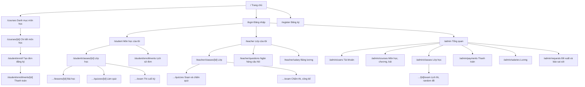

# Wireframe — E-Learning

| Mục | Nội dung |
|---|---|
| Phiên bản | v1.0 — theo requirement v1.1 |
| Ngày | 14/11/2026 |

Tài liệu này mô tả sơ đồ màn hình, đường dẫn và bố cục của các màn hình chính. Đây là bản phác thảo để thống nhất bố cục trước khi code, không phải thiết kế chi tiết; màu sắc và component theo shadcn/ui.

## 1. Nguyên tắc chung

- Giao diện tiếng Việt. Bố cục một cột trên điện thoại (dưới 768px), menu bên trái thu thành nút ☰.
- Mỗi vai trò có khu vực riêng: `/admin`, `/teacher`, `/student`. Truy cập sai vai trò chuyển tới trang 403.
- Danh sách dài có ô tìm kiếm, bộ lọc trạng thái và phân trang. Trên điện thoại, bảng chuyển thành danh sách thẻ.
- Thao tác không hoàn tác được (huỷ đơn, publish quiz, công bố điểm, duyệt lương) luôn có hộp xác nhận.
- Trạng thái hiển thị bằng nhãn màu: xám (nháp, chưa mở), xanh dương (đang diễn ra), xanh lá (hoàn thành), đỏ (huỷ, từ chối).

## 2. Sơ đồ màn hình



## 3. Khung trang

Khách và trang công khai:

```text
┌──────────────────────────────────────────────────────────────┐
│ E-Learning        Môn học              [Đăng nhập] [Đăng ký] │
├──────────────────────────────────────────────────────────────┤
│                        nội dung trang                        │
└──────────────────────────────────────────────────────────────┘
```

Sau khi đăng nhập (menu thay đổi theo vai trò):

```text
┌──────────────────────────────────────────────────────────────┐
│ ☰ E-Learning                              Nguyễn Văn A ▾     │
├───────────────┬──────────────────────────────────────────────┤
│ Tổng quan     │ Tiêu đề trang                   [Nút chính]  │
│ Mục 2         │ ──────────────────────────────────────────── │
│ Mục 3         │                                              │
│ …             │               nội dung trang                 │
│               │                                              │
│ Hồ sơ         │                                              │
│ Đăng xuất     │                                              │
└───────────────┴──────────────────────────────────────────────┘
```

| Vai trò | Mục trong menu |
|---|---|
| Học viên | Môn học của tôi · Danh mục môn học · Đơn đăng ký · Hồ sơ |
| Giảng viên | Lớp của tôi · Ngân hàng câu hỏi · Bảng lương · Hồ sơ |
| Admin | Tổng quan · Tài khoản · Môn học · Lớp học · Thanh toán · Lương · Đề xuất và báo sai sót |

## 4. Màn hình công khai

### 4.1 Đăng nhập và đăng ký — US-01, US-02

```text
┌──────────────────────────────┐   ┌──────────────────────────────┐
│          Đăng nhập           │   │      Đăng ký học viên        │
│ Email     [________________] │   │ Họ tên    [________________] │
│ Mật khẩu  [________________] │   │ Email     [________________] │
│ ⚠ Email hoặc mật khẩu sai    │   │ Mật khẩu  [________________] │
│        [ Đăng nhập ]         │   │ Nhập lại  [________________] │
│ Chưa có tài khoản? Đăng ký   │   │         [ Đăng ký ]          │
└──────────────────────────────┘   └──────────────────────────────┘
```

Lỗi đăng nhập luôn là một câu chung, không cho biết email có tồn tại hay không.

### 4.2 Danh mục và chi tiết môn học — US-10, US-11

```text
Danh mục môn học                         [ Tìm theo tên…      🔍 ]
┌───────────────┐ ┌───────────────┐ ┌───────────────┐
│ Tên môn học   │ │ Tên môn học   │ │ Tên môn học   │
│ Mô tả ngắn…   │ │ Mô tả ngắn…   │ │ Mô tả ngắn…   │
│ 3 lớp đang mở │ │ 1 lớp đang mở │ │ Chưa có lớp   │
└───────────────┘ └───────────────┘ └───────────────┘
                     ‹ 1 2 3 ›

Chi tiết: Lập trình Python cơ bản
Mô tả …
┌ Nội dung ────────────────────┐ ┌ Lớp đang nhận đăng ký ─────────────┐
│ Chương 1: Làm quen           │ │ ☐ PY-01 · GV Trần B · 15/12         │
│   • Bài 1.1 …   🔒           │ │   Học phí 2.000.000 ₫ · Cọc 500.000 │
│   • Bài 1.2 …   🔒           │ │   Còn 12 / 30 chỗ                   │
│ Chương 2: …                  │ │ ☐ PY-02 · GV Lê C · 05/01 · Hết chỗ │
└──────────────────────────────┘ │        [ Đăng ký lớp đã chọn ]      │
                                 └─────────────────────────────────────┘
```

Khách bấm "Đăng ký" thì được đưa tới trang đăng nhập rồi quay lại.

## 5. Học viên

### 5.1 Tạo đơn đăng ký và thanh toán — US-17, US-18, US-19

```text
Đơn đăng ký
┌────────────────────────────────────────────────────────────┐
│ Lớp               Học phí          Cọc              [Bỏ]   │
│ PY-01 · Python    2.000.000 ₫      500.000 ₫         ✕     │
│ DB-02 · CSDL      1.500.000 ₫      400.000 ₫         ✕     │
│ ────────────────────────────────────────────────────────── │
│ Tổng              3.500.000 ₫      900.000 ₫               │
└────────────────────────────────────────────────────────────┘
( ) Trả cọc 900.000 ₫ — được học và làm quiz, chưa được thi cuối kỳ
(•) Trả đủ 3.500.000 ₫
[ Thanh toán qua Stripe ]     [ Thanh toán giả lập ]

⚠ Bạn còn đơn #12 chưa trả đủ 2.600.000 ₫. Hãy trả phần còn lại
  trước khi đăng ký lớp mới.            [ Trả phần còn lại ]
```

Cảnh báo cuối chỉ hiện khi học viên còn đơn `DEPOSITED`; khi đó hai nút thanh toán bị ẩn (BR-22).

### 5.2 Môn học của tôi và lớp học — US-23, US-24

```text
Môn học của tôi
┌────────────────────────────────────────────────────────────┐
│ Python cơ bản · PY-01 · GV Trần B            [Đang học]    │
│ Tiến độ ▓▓▓▓▓▓░░░░ 60%   Quá trình 8,0   Cuối kỳ —         │
│                                              [ Vào lớp ]   │
└────────────────────────────────────────────────────────────┘

Lớp PY-01                  [ Bài học ] [ Quiz ] [ Thi cuối kỳ ]
┌ Chương 1 ─────────────┐ ┌ Bài 1.2: Biến và kiểu dữ liệu ────┐
│ ✓ Bài 1.1             │ │ ▶ video                           │
│ ● Bài 1.2             │ │ Nội dung văn bản …                │
│ ○ Bài 1.3             │ │ 📎 slide.pdf                      │
│ Quiz chương 1  7,5    │ │ [ Đánh dấu hoàn thành ] [ Tiếp › ]│
└───────────────────────┘ └───────────────────────────────────┘
```

### 5.3 Làm quiz — US-42, US-44

```text
Quiz trắc nghiệm                         Quiz nộp file
┌──────────────────────────────────┐    ┌──────────────────────────────────┐
│ Quiz chương 1      ⏱ 09:41       │    │ Bài tập chương 2                 │
│ Lần làm 1 / 2                    │    │ Hạn nộp: 20/12/2026 23:59        │
│ Câu 3 / 10                       │    │ Đề bài … 📎 de-bai.pdf           │
│ Nội dung câu hỏi …               │    │ File nộp [ Chọn file ] (≤ 10 MB) │
│ ( ) A …   (•) B …   ( ) C …      │    │ Chỉ nộp được 1 lần.              │
│ [‹ Trước]  [Tiếp ›]   [Nộp bài]  │    │            [ Nộp bài ]           │
└──────────────────────────────────┘    └──────────────────────────────────┘
```

Sau khi nộp quiz trắc nghiệm, điểm hiện ngay kèm nút "Làm lại" nếu còn lượt; điểm của quiz là điểm lần làm sau cùng. Quiz nộp file hiện "Chờ chấm" cho tới khi giảng viên chấm.

### 5.4 Thi cuối kỳ — US-33, US-34, US-37

```text
┌────────────────────────────────────────────────────────────┐
│ Thi cuối kỳ · PY-01                       ⏱ 44:12          │
│ ┌ Câu ─────────┐  Câu 7 (trắc nghiệm)                      │
│ │ 1✓ 2✓ 3✓ 4✓  │  Nội dung câu hỏi …                       │
│ │ 5✓ 6✓ 7● 8○  │  ( ) A …  ( ) B …  (•) C …  ( ) D …       │
│ │ 9○ 10○ …     │                                           │
│ └──────────────┘  Câu 18 (tự luận)                         │
│                   [ ô nhập câu trả lời                   ] │
│ Đã lưu lúc 09:15:02          [‹ Trước] [Tiếp ›] [Nộp bài]  │
└────────────────────────────────────────────────────────────┘
```

Trước khi vào thi, trang hiện trạng thái đề (Chưa mở / Đang mở / Đã đóng / Đã làm / Đã có điểm). Học viên mới cọc thấy thông báo "Hãy đóng đủ học phí để được thi" thay cho nút "Bắt đầu". Đáp án đúng và điểm chỉ hiện sau khi giảng viên công bố.

## 6. Giảng viên

### 6.1 Lớp của tôi và trang lớp — US-13, US-14

```text
Lớp của tôi
┌────────────────────────────────────────────────────────────┐
│ PY-01 · Python cơ bản · 15/12 – 15/02 · 18/30 · [Đang học] │
│ 3 bài chờ chấm                               [ Vào lớp ]   │
└────────────────────────────────────────────────────────────┘

Lớp PY-01        [ Học viên ] [ Quiz ] [ Thi cuối kỳ ] [ Điểm ]
Học viên           Thanh toán   Tiến độ   Quá trình   Cuối kỳ
Nguyễn Văn A       Đã đủ        60%       8,0         —
Trần Thị B         Đã cọc       35%       6,5         —
                                       [ Đề xuất không dạy lớp này ]
```

### 6.2 Soạn quiz — US-41

```text
Soạn quiz · Chương 1 · PY-01                              [Nháp]
Tiêu đề [______________________]
Dạng    (•) Trắc nghiệm   ( ) Nộp file      ← đổi được khi còn nháp
Thời gian làm [ 15 ] phút
┌ Câu 1 ────────────────────────────────── Điểm [ 1 ] ── [Xoá] ┐
│ Nội dung [__________________________________________]        │
│ (•) A [________]   ( ) B [________]   ( ) C [________]  [+]  │
└──────────────────────────────────────────────────────────────┘
[ + Thêm câu hỏi ]                    [ Lưu nháp ] [ Publish ]
```

Khi chọn "Nộp file", phần câu hỏi được thay bằng: mô tả đề, file đề và hạn nộp. Sau khi publish không đổi được dạng. Khi đã có học viên vào làm, cả trang chuyển sang chỉ xem, kèm nút "Báo sai sót cho Admin" (US-50).

### 6.3 Ngân hàng câu hỏi — US-26, US-27

```text
Ngân hàng câu hỏi · Môn [ Python cơ bản ▾ ]   [ + Thêm câu hỏi ]
Lọc: [ Tất cả loại ▾ ] [ Đang dùng ▾ ]
#    Nội dung                    Loại          Trạng thái
12   Kiểu dữ liệu nào…           Trắc nghiệm   Đang dùng   [Sửa] [Ẩn]
13   Trình bày khái niệm…        Tự luận       Đang dùng   🔒 đã có bài làm
```

Câu đã nằm trong bài làm chỉ ẩn được, không sửa được (BR-23).

### 6.4 Chấm thi và công bố — US-36, US-37

```text
Thi cuối kỳ · PY-01            Đã chấm 15 / 18     [ Công bố điểm ]
Học viên        Trắc nghiệm   Tự luận      Tổng    Trạng thái
Nguyễn Văn A    6,0           Chờ chấm     —       Chờ chấm  [Chấm]
Trần Thị B      5,5           3,0          8,5     Đã chấm   [Xem]

Chấm bài · Nguyễn Văn A
Câu 18 (tự luận, tối đa 0,5 điểm)
Bài làm: …
Điểm [ 0,5 ]   Nhận xét [______________________]   [ Lưu ] [ Câu sau › ]
```

Nút "Công bố điểm" chỉ bật khi mọi bài đã chấm xong.

## 7. Admin

### 7.1 Tổng quan — US-48

```text
┌ Người dùng ──┐ ┌ Môn học ─┐ ┌ Lớp đang mở ┐ ┌ Đã thu ────────┐
│ 1 · 3 · 120  │ │ 8        │ │ 5           │ │ 45.000.000 ₫   │
└──────────────┘ └──────────┘ └─────────────┘ └────────────────┘
Cần xử lý: 2 đề xuất không dạy · 1 báo sai sót quiz · 3 lớp sắp khai giảng
```

### 7.2 Tài khoản — US-05

```text
Tài khoản   [ Tất cả vai trò ▾ ]     [ + Giảng viên ] [ + Admin ]
Tên             Email              Vai trò      Hệ số   Trạng thái
Trần B          b@example.com      Giảng viên   1,50    Hoạt động  [Sửa] [Khoá]
```

### 7.3 Môn học, chương, bài học — US-07, US-08, US-09

```text
Môn học: Python cơ bản                 [Đang mở ▾]   [ Lưu ]
Tên [__________________]   Ngừng mở lớp từ [ __/__/____ ]
Mô tả [______________________________________________]
┌ Chương ───────────────────────────────────────── [+ Chương] ┐
│ ⠿ Chương 1: Làm quen                           [Sửa] [Xoá]  │
│     ⠿ Bài 1.1 · video + văn bản                [Sửa] [Xoá]  │
│     ⠿ Bài 1.2 · văn bản + file                 [Sửa] [Xoá]  │
│     [ + Bài học ]                                           │
└─────────────────────────────────────────────────────────────┘
```

Biểu tượng ⠿ dùng để kéo đổi thứ tự; trên điện thoại thay bằng hai nút lên / xuống.

### 7.4 Lớp học và đề thi — US-12, US-16, US-30, US-31

```text
Mở lớp
Môn học [ Python cơ bản ▾ ]     Giảng viên [ Trần B ▾ ]
Tên lớp [ PY-01 ]               Học phí [ 2.000.000 ]   Cọc [ 500.000 ]
Sĩ số   tối thiểu [ 10 ]  tối đa [ 30 ]
Khai giảng [ 15/12/2026 ]       Kết thúc [ 15/02/2027 ]
                                                    [ Mở lớp ]

Đề thi cuối kỳ · PY-01                                [Chưa mở]
Tên đề [__________]   Mở [ 10/02 08:00 ]   Đóng [ 10/02 10:00 ]
Thời lượng [ 60 ] phút     Số lần làm [ 1 ]
Số câu: trắc nghiệm [ 16 ] (có 40)    tự luận [ 4 ] (có 9)
[ Lưu lịch thi ]   [ Random đề ]   [ Xem trước ]
```

Trang lớp hiện số học viên đã cọc hoặc trả đủ so với sĩ số tối thiểu. Tới ngày khai giảng mà chưa đủ, hệ thống tự huỷ lớp và hoàn tiền (G-5). "Random đề" bị khoá sau giờ mở đề.

### 7.5 Thanh toán, lương, đề xuất — US-22, US-45, US-46, US-15, US-50

```text
Thanh toán     [ Tất cả trạng thái ▾ ]
Mã GD      Học viên      Đơn    Loại    Số tiền        Trạng thái
pi_3N…     Nguyễn A      #12    Cọc     900.000 ₫      Thành công
SIM-0007   Trần B        #15    Đủ      2.000.000 ₫    Chờ xác nhận [Xác nhận]

Lương tháng [ 12/2026 ▾ ]                        [ Tính lương ]
Giảng viên   Hệ số   Số lớp   Học viên   Tổng            Trạng thái
Trần B       1,50    2        41         12.050.000 ₫    Nháp  [Duyệt]

Đề xuất và báo sai sót
[Đề xuất không dạy] Trần B · PY-02 · "Trùng lịch…"   [Duyệt + chọn GV] [Từ chối]
[Báo sai sót quiz]  Lê C · Quiz chương 3 · DB-02     [Sửa điểm] [Từ chối]
```
